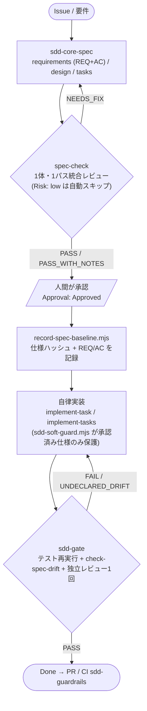

# SDD Forge

v2.1.4 — 開発者体験（DX）・AI エージェントの自律性と仕様ガバナンスを両立する **軽量ガードレール（Lightweight Guardrails）＋ SDD Core ＋ Software Factory** プラグインスイートです。Claude Code、Codex CLI、GitHub Copilot CLI、Antigravity CLI（`agy`）、旧 Gemini CLI に対応します。

## クイックスタート（2 コマンド）

```bash
# Step 1: 仕様化フェーズ（SDD Core 仕様生成 + 1パス統合レビュー）
/sdd-bootstrap:bootstrap feature https://github.com/your-org/your-repo/issues/42
# → 人間が specs/<feature>/tasks.md の Approval: Draft を Approval: Approved に変更

# Step 2: 実装・品質保証フェーズ（ベースライン固定 → 自律実装 → 統合 sdd-gate → Done）
/sdd-ship:ship specs/<feature>/tasks.md
```

> **v2.x での主な刷新（[ADR-0051](docs/adr/0051-lightweight-guardrails-and-sdd-core.md) / [ADR-0052](docs/adr/0052-mcp-architecture-and-v2-consolidation.md)）**:
> - 重厚な **SDD Full**（3 連レビューループ・7 層仕様・外部鍵署名・224 ファイル物理ロック・7,247 行の 4 言語フック・カナリア儀式・ADR-0023 `ERROR_STOP`）と、軽すぎる **SDD Lite**（事前レビューゼロ）を廃止し、**単一トラック `SDD Core` ＋ リスクレベル伸縮（`low` / `standard` / `high`）** へ統合しました。
> - **「Local Soft, Boundary Firm」** 設計により、ローカルでは AI の自律的な探索・テスト・実装を妨げず、承認済み仕様ファイルの意図しない改変（ゴールポスト移動）だけをソフトガード＋Spec Drift 検知＋PR/CI で抑止します（Spec Drift の比較対象はベースライン記録済みの機能。未記録の承認済み機能は CI が警告で列挙します）。
> - **v2.1.4**: MCP 試験 95 件と監査指摘の統合（#974）。証跡バンドル検査の `.ps1` 版を `.sh` 版と同じ判定にし（大文字小文字・dirty 判定・相対 root）、旧 v1 署名はどちらの発行器の並び順でも検証できる。寄稿者向け証跡収集は `--prepare` のみ、ドメイン適合指摘の `N/A`（未実行）と `0` を区別、ドメインモデル承認の案内に契約の発行を追加。詳細は [CHANGELOG](CHANGELOG.md)。
> - **v2.1.3**: 監査是正の仕上げ（11 件）。CLI ロックの所有者保持と期限延長（リース方式）、Scope の重複判定（実パス比較・注記・`{a,b}`）、段階承認を差分にしない、承認欄の解釈の統一、読取上限超の仕様を `UNVERIFIABLE` として扱う、ゲート証跡を検証した仕様入力に結び付けて古い合格を完了扱いにしない。詳細は [CHANGELOG](CHANGELOG.md)。
> - **v2.1.2**: 監査是正の続き。独立評価の判定だけを Done の根拠にする、未解決レビューチケットでゲート停止、`--base` による再開、Blockers の検証（未知 ID・自己依存）、改定理由のない仕様差分の可視化、シンボリックリンク経由の CLI 起動修正、WFI 監査の整合。詳細は [CHANGELOG](CHANGELOG.md)。
> - **v2.1.1**: 監査（#801〜#861）の是正 20 件。CI の `required-checks` 集約とインストーラ試験の CI 登録、Claude でのガード二重登録の解消、ゲート／MCP の Done 判定（コマンド 0 件の機械 PASS を完了根拠にしない等）、工場計測の意味の修正。詳細は [CHANGELOG](CHANGELOG.md)。
> - **v2.1.0**: MCP 4 ツール統合＆オプトイン登録（ADR-0052）、Google Antigravity CLI（`agy`）フルネイティブ対応、Software Factory 拡張（レビュー観点採否表・並列ロック＆ウェーブ計画・出典リンク・メトリクス帰属・2 層ナレッジ還流・非対話ファクトリ運用）を追加しました。

## 全体の流れ（SDD Core 単一トラック）



## 3 層ソフト・ガードレール（Lightweight Guardrails）

| 層 | コンポーネント | 役割 |
|---|---|---|
| **Layer 1: 編集時ソフトガード** | `plugins/sdd-quality-loop/scripts/v2/sdd-soft-guard.mjs` | Node.js ESM 単一実装（5 環境対応: Claude / Codex / Copilot / Antigravity / Gemini）。① `AGENT_STOP` 緊急停止 ② `Approval: Approved` 自己追加抑止 ③ 承認済み仕様本文の編集検知（既定 `confirm`、`sdd/guardrails.yaml` で `warn`/`confirm`/`strict` 設定可）。`Bash` / `shell` / `run_shell_command` / `run_command` / `Read` 等は `AGENT_STOP` 以外ではブロックしません。 |
| **Layer 2: Spec Drift 検知** | `record-spec-baseline.mjs` / `check-spec-drift.mjs` / `run-sdd-gate.mjs` | 外部署名鍵不要。承認時の仕様契約ハッシュ・`REQ-*` / `AC-*` と比較し、`CLEAN` / `AMENDED` / `UNDECLARED_DRIFT` を決定論的に判定（`tasks.md` の `Status:` 更新は誤検知なし）。 |
| **Layer 3: マージ境界ガバナンス** | `.github/workflows/sdd-guardrails.yml` + `CODEOWNERS` | PR 上で自動テスト＋Spec Drift チェックを実行し、ガード・仕様変更に人間のレビューを強制します。 |

### リスクレベル別の滑らかな伸縮

| リスク | 想定用途 | `spec-check`（着工前） | ソフトガード | `sdd-gate`（完了前） |
|---|---|---|---|---|
| **`low`** | 小規模バグ修正（`diagnose` 経由）、ドキュメント | 自動スキップ | `sdd/guardrails.yaml` 準拠 | テスト・プレースホルダー・Spec Drift 確認 |
| **`standard`** *(既定)* | 通常の新機能・API/UI 追加・中規模変更 | **1 体・1 パス統合チェック** | **既定 `confirm`** | テスト + Spec Drift + AC 突合 + 独立レビュー 1 回 |
| **`high`** | 認証/認可・決済・PII・DB 移行・破壊的契約変更 | **2 視点並列・1 パス（仕様/AC + 設計/セキュリティ）** + 任意 ADR | `confirm` / `strict` | 上記 + セキュリティ・回帰・ロールバック確認 + PR CODEOWNERS |

設定をカスタマイズする場合は [`sdd/guardrails.example.yaml`](sdd/guardrails.example.yaml) を `sdd/guardrails.yaml` へコピーして編集してください（スキーマ: [`contracts/guardrails.schema.json`](contracts/guardrails.schema.json)）。設定ファイル不在でも安全な既定値（`mode: confirm`）でそのまま動作します。

## インストール

前提ランタイムは **Node.js >= 20 LTS** のみです（v1 系の過剰な `Node >= 26.13.0` / `Claude >= 2.1.295` 強制停止と 4 言語パリティ要件は撤廃しました）。

```bash
# macOS / Linux — 既定（sdd-bootstrap, sdd-ship + 依存自動解決。ローカル CLI 向けのため MCP は既定オプトイン）
./install.sh --source-directory .

# 非シェルクライアント（Desktop / Web / 監査ビューア）向けに単一 sdd-forge-mcp v2 も導入する場合
./install.sh --source-directory . --with-mcp

# 対象環境を指定（All | Codex | Claude | Copilot | Antigravity | Gemini | FilesOnly）
./install.sh --source-directory . --target Antigravity
```

```powershell
# Windows
./install.ps1 -SourceDirectory .
# MCP v2 も導入する場合
./install.ps1 -SourceDirectory . -WithMcp
```

### プラグイン構成

- コア（既定導入）: `sdd-bootstrap` / `sdd-ship` / `sdd-implementation` / `sdd-quality-loop` / `sdd-review-loop`
- オプトイン専門レーン（明示指定・不在時オーバーヘッドゼロ）: `sdd-domain`（DDD） / `sdd-azure-cloud` / `sdd-aws-cloud`
- 読み取り専用 MCP サーバー（オプトイン `--with-mcp`、ADR-0052）: `sdd-forge-mcp` v2（単一サーバー・4 ツール、`scripts/v2/*.mjs` 直結 SSOT）。外部隔離 CI 用に `--mcp sdd-forge-mcp,ci-mcp` も指定可（`local-env-mcp` は非推奨）

### アンインストール

```bash
./uninstall.sh
```

## ドキュメントマップ

- [docs/workflow-guide.md](docs/workflow-guide.md) — SDD Core 開発フロー・仕様変更（Spec Amendments）手順
- [docs/THREAT-MODEL.md](docs/THREAT-MODEL.md) — v2 脅威モデル（Local Soft, Boundary Firm）
- [docs/adr/0051-lightweight-guardrails-and-sdd-core.md](docs/adr/0051-lightweight-guardrails-and-sdd-core.md) — v2 設計決定記録（ADR-0051）
- [docs/adr/0052-mcp-architecture-and-v2-consolidation.md](docs/adr/0052-mcp-architecture-and-v2-consolidation.md) — MCP v2 統合・オプトイン化（ADR-0052）
- [docs/architecture/mcp-v2-spec.md](docs/architecture/mcp-v2-spec.md) — `sdd-forge-mcp` v2 規範仕様
- [docs/non-interactive-factory.md](docs/non-interactive-factory.md) — 非対話・自律ファクトリ運用ガイド（`claude -p` / `codex exec` / `agy -p`）
- [USERGUIDE.md](USERGUIDE.md) — MCP サーバー・運用詳細
- [docs/sql-development.md](docs/sql-development.md) — SQL / DB 変更ガイド
- [docs/cloud/README.md](docs/cloud/README.md) — Azure / AWS オプトイン運用ガイド
