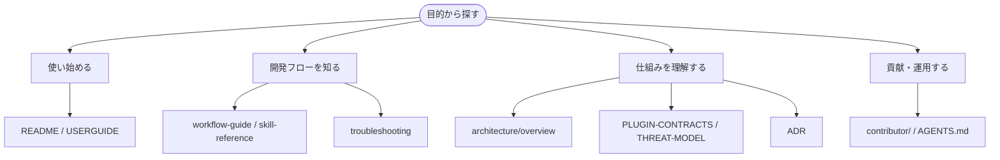

# ドキュメント案内

SDD Forge のドキュメントを目的別に探すための入口です。プロジェクトの概要とインストール手順は [ルートの README](../README.md) にあります。

## 使い始める

| ドキュメント | 内容 |
|---|---|
| [README](../README.md) | 概要、フロー図、インストール／アンインストール手順 |
| [USERGUIDE.md](../USERGUIDE.md) | MCP サーバー / エージェントルーティングのリファレンス |

## 開発フローを知る

| ドキュメント | 内容 |
|---|---|
| [workflow-guide.md](workflow-guide.md) | 開発業務フロー：正常系・異常系・仕様変更・レビュー運用、トラック選択契約 |
| [skill-reference.md](skill-reference.md) | スキル・エージェント・フック・スクリプトの詳細 |
| [troubleshooting.md](troubleshooting.md) | 問題解決と対応策 |
| [verification.md](verification.md) | 検証の考え方：変更が動くことを示す証拠とは何か |

## 仕組みを理解する

| ドキュメント | 内容 |
|---|---|
| [architecture/overview.md](architecture/overview.md) | リポジトリ全体のアーキテクチャ |
| [PLUGIN-CONTRACTS.md](../PLUGIN-CONTRACTS.md) | プラグイン間の契約 |
| [THREAT-MODEL.md](THREAT-MODEL.md) | 脅威モデル：信頼境界・攻撃面・リスク低減策 |
| [agent-capability-matrix.md](agent-capability-matrix.md) | エージェント能力マトリクス：各エージェントが実行できる操作の一覧 |
| [adr/README.md](adr/README.md) | ADR 索引と採番規約 |
| [ai-dlc-foundation-decision-v2.md](ai-dlc-foundation-decision-v2.md) | Multi-target AI-DLC 拡張計画の決定書 |
| [specs/sdd-lite/design.md](../specs/sdd-lite/design.md) | sdd-lite 設計 |
| [plugins/sdd-lite/references/lite-flow-policy.md](../plugins/sdd-lite/references/lite-flow-policy.md) | sdd-lite 規約・昇格 |

## 貢献・運用する

| ドキュメント | 内容 |
|---|---|
| [AGENTS.md](../AGENTS.md) | エージェント向けのリポジトリ規約 |
| [contributor/](contributor/) | 貢献者向け詳細（[workflow-detail.md](contributor/workflow-detail.md) / [skill-reference-detail.md](contributor/skill-reference-detail.md) / [release-runbook.md](contributor/release-runbook.md)） |
| [CHANGELOG.md](../CHANGELOG.md) | 変更履歴と版移行ガイド |
