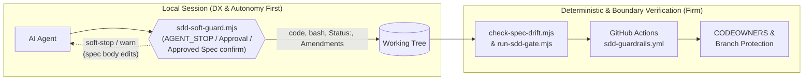

# Threat Model — SDD Forge v2 Lightweight Guardrails

> **v2.0.0 改訂（[ADR-0051](adr/0051-lightweight-guardrails-and-sdd-core.md)）**: 本脅威モデルは、v1 系の「ローカル 7,247 行の敵対的シェルパーサー + 224 ファイル物理ロック + 外部 HMAC 鍵」から、実務の DX とガバナンスを両立する **「Local Soft, Boundary Firm（ローカルはソフトに抑止、マージ境界で確実に検証）」** モデルへ移行しています。

## Trust Model: Local Soft, Boundary Firm

### What Local Guardrails Defend Against (Primary Risk)
1. **意図しない仕様改変・ゴールポスト移動**: テストを通すためにエージェントが承認済み `requirements.md`（特に `REQ-*` / `AC-*`）や `design.md` を無断で緩和・削除してしまう事故。
2. **タスクの自己承認**: エージェントが `tasks.md` に `Approval: Approved` を自ら書き込んでしまう事故。
3. **暴走時の緊急停止**: 人間が `AGENT_STOP` を配置した際に全ツール実行を即座に停止できること。

### What the Merge Boundary (Git / PR / CI) Defends Against
1. **シェル経由・別ツール経由の仕様改変**: ローカルではシェル構文解析を廃止し探索・テスト速度を最大化する代わりに、`sdd-gate` と CI の `check-spec-drift.mjs` が `.spec-baseline.json` と現在ファイルの契約ハッシュおよび `REQ-*` / `AC-*` を決定論的に突き合わせて検出します。**対象はベースライン（`specs/<feature>/.spec-baseline.json`）を記録済みの機能だけ**で、ベースライン未記録の承認済み機能は比較されません。CI はその件数と機能名を毎回警告として列挙し、比較 0 件の成功を全件検査と誤認させません（#852）。
2. **ガード・ゲートスクリプト・設定の改ざん**: ローカルの 224 ファイル物理ロック（`human-copy` 儀式）を廃止し、`.github/CODEOWNERS` と GitHub Branch Protection により、ガード／フック／CI／承認済み仕様への変更にリポジトリオーナーの PR レビューを必須化します。
3. **高リスク変更の複数人承認**: 独自の `Second Approval` パーサーや外部鍵署名を廃止し、GitHub Branch Protection の Required Reviewers 機能へ委譲します。

## Controls Summary

| Control | Layer | Enforcement | Notes |
|---|---|---|---|
| **Kill Switch (`AGENT_STOP`)** | Layer 1 (Local) | Fail-closed (`deny` on all tools) | プロジェクトルートに `AGENT_STOP` がある限り全ツール実行を停止 |
| **Approval Guard** | Layer 1 (Local) | `deny` on net increase of `Approval: Approved` in `tasks.md` | `Status:` 遷移（`Planned` → `Done`）は常に許可 |
| **Soft Spec Guard** | Layer 1 (Local) | `sdd/guardrails.yaml` の `mode: warn \| confirm \| strict`（既定 `confirm`） | `## Spec Amendments` への追記は許可。意図的変更は合意後 `SDD_ALLOW_SPEC_EDIT=1` で解除＋`.sdd/drift-events.jsonl` 記録 |
| **Spec Drift Check** | Layer 2 (`sdd-gate`) & Layer 3 (CI) | `CLEAN` / `AMENDED` / `UNDECLARED_DRIFT` | `tasks.md` の `Status:` 変更は除外。理由なき本文変更・`REQ`/`AC` 削除は `--fail-on-undeclared` で FAIL |
| **Independent Gate (`sdd-gate`)** | Layer 2 | 決定論コマンド実行 + プレースホルダー検査 + 独立 1 パスレビュー | 実装者の自己申告のみで `Done` にしない |
| **CODEOWNERS & CI (`sdd-guardrails.yml`)** | Layer 3 (GitHub) | PR ステータスチェック + オーナーレビュー必須 | プラグイン・フック・スキーマ・仕様・CI 変更の最終防衛線 |
| **Read-Only MCP Servers** | Advisory | `sdd-forge-mcp` / `local-env-mcp` / `ci-mcp` は読み取り専用 | write ツールを持たず、ファイルベース手続きを上書きしない |

## Residual Risks & Explicit Trade-offs

- **ローカルセッション内の意図的な `Bash` 迂回**: `sdd-soft-guard.mjs` は DX 最優先のため `Bash` / `run_shell_command` を解析しません。シェル経由で承認済み仕様を書き換えた場合、ローカル編集中は停止しませんが、直後の `sdd-gate` および PR 上の CI（`check-spec-drift.mjs --fail-on-undeclared`）で必ず `UNDECLARED_DRIFT` として検出・遮断されます。
- **ホスト側権限設定**: Claude Code / Codex / Copilot / Gemini の実行権限は最小権限に保ち、外部 URL や取得テキストはデータとして扱う原則を維持します。
