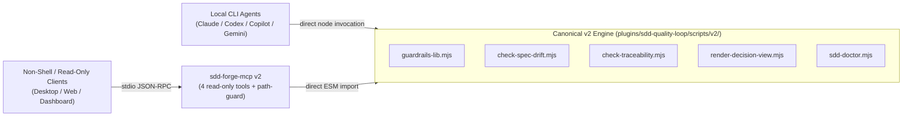

# SDD Forge MCP v2 Architecture Specification

- **Status**: Normative Target Specification (v2.1) — Companion to [ADR-0052](../adr/0052-mcp-architecture-and-v2-consolidation.md)
- **JSON Schema Contract**: [`contracts/sdd-mcp.v2.schema.json`](../../contracts/sdd-mcp.v2.schema.json)
- **Runtime Requirement**: Node.js >= 20 LTS (zero runtime drift from `plugins/sdd-quality-loop/scripts/v2/*.mjs`)

---

## 1. Design Principle: When to Use MCP vs. Direct v2 Scripts

| Execution Surface | Recommended Interface | Rationale |
|---|---|---|
| **Local CLI Agents** (Claude Code, Codex CLI, Copilot CLI, Gemini CLI) | **Direct v2 ESM CLIs** (`node scripts/v2/*.mjs`) + `gh` CLI; MCP **opt-in** (`--with-mcp`) | Agents already have native file/shell tools. Avoiding 3 always-on MCP servers saves ~3,300 tokens/turn and 3 idle Node processes, and avoids Codex non-interactive MCP approval friction. |
| **Non-Shell / Read-Only Clients** (Claude Desktop, ChatGPT, Web IDE, Dashboard viewers, Read-only cross-repo auditors) | **Single `sdd-forge-mcp` v2** (4 coarse-grained read-only tools + 2 resources) | Provides strict path-guarded read-only access without exposing shell execution, delivering complete SDD decision state in 1 round-trip (~600 tokens schema overhead). |
| **Sandboxed CI-Only Auditors** (no `gh` CLI / no shell token access) | Optional `ci-mcp` (`--mcp ci-mcp` opt-in only) | Strictly scoped GET-only GitHub Actions proxy; never enabled by default on local dev machines. |
| **`local-env-mcp`** | **Retired** | Fully superseded by `sdd-doctor.mjs` and native shell probes. |

---

## 2. Single Source of Truth (SSOT) Architecture

`sdd-forge-mcp` v2 MUST NOT re-implement markdown, task-state, traceability, or spec-drift parsers in a parallel codebase. Instead, it is a thin read-only MCP transport wrapper over the canonical v2 ESM library modules:

---

## 3. Tool Surface (4 Coarse-Grained Read-Only Tools)

All tools MUST:
- Declare MCP annotations: `{ "readOnlyHint": true, "destructiveHint": false, "idempotentHint": true }`.
- Never accept a `root` or arbitrary filesystem path argument (repository root is frozen at server startup via `--root` / `SDD_FORGE_ROOT` / `cwd`).
- Return a uniform `Result<T>` envelope (`{ ok: true, data }` or `{ ok: false, error: { code, message } }`) conforming to `contracts/sdd-mcp.v2.schema.json`.
- Enforce path allowlist (`AGENTS.md`, `sdd/guardrails.{yaml,json}`, `specs/`, `reports/`, `.sdd/drift-events.jsonl`, `.sdd/factory-metrics.jsonl`) and strict denylist (`.env*`, signing keys, `SDD_SUDO`).

### Tool 1: `sdd_project_overview`
- **Replaces**: `list_active_specs`, `get_spec_status`, `get_quality_gate_summary`, `get_next_sdd_command` (no-arg).
- **Input**: `{ includeDoctor?: boolean }` (default `true`).
- **Output (`kind: "project-overview"`)**:
  - `activeFeatures`: array of `{ feature, highestRisk, taskCounts: { total, approved, inProgress, implComplete, done, blocked }, driftStatus: "CLEAN" | "AMENDED" | "UNDECLARED_DRIFT" | "UNBASELINED", nextAction: { phase, command, rationale } }`.
  - `doctor`: optional compact `sdd-doctor` summary (`status: "CLEAN" | "WARN" | "NG"`, `ngCount`, `warnCount`, `driftEventCount`).

### Tool 2: `sdd_feature_state`
- **Replaces**: `get_spec_status`, `get_task_state`, `list_approved_tasks`, `list_blocked_tasks`, `get_next_sdd_command(feature)`.
- **Input**: `{ feature: string, includeDecisionViewMarkdown?: boolean }`.
- **Output (`kind: "feature-state"`)**:
  - `feature`, `highestRisk`, `files` (`requirements.md`, `design.md`, `tasks.md`, `.spec-baseline.json` existence).
  - `traceability`: direct output of `check-traceability.mjs` (`complete`, `requirements`, `acceptanceCriteria`, `tasks`, `gaps`).
  - `drift`: direct output of `check-spec-drift.mjs` (`CLEAN` | `AMENDED` | `UNDECLARED_DRIFT` | `UNBASELINED`, `modifiedIdentifiers`, `amendments`).
  - `openQuestions`: `{ total, provisionalCount, provisionalIds }`.
  - `nextAction`: deterministic v2 command (`/sdd-bootstrap:bootstrap`, human approval, `/sdd-ship:ship`, or `feature complete`).
  - `decisionViewMarkdown`: optional rendered Decision View for human review UIs.

### Tool 3: `sdd_gate_audit`
- **Replaces**: `evidence_get_bundle`, `evidence_validate_paths`, `evidence_find_missing`, `evidence_summarize_contract_checks`, `evidence_compare_to_traceability`, `evidence_deep_verify`, `list_review_tickets`.
- **Input**: `{ feature: string, taskId?: string }`.
- **Output (`kind: "gate-audit"`)**:
  - `tasks`: per-task v2 gate audit record:
    - `taskId`, `risk`, `approval`, `status`
    - `executionArtifact`: `{ exists, path, verdict, executedAt, specDriftStatus, failedCommands }` (from `reports/quality-gate/<feature>-<taskId>.execution.json`)
    - `reviewReport`: `{ exists, path, verdict }` (from `reports/quality-gate/<feature>-<taskId>.md`, matching both `VERDICT: PASS` and `- **VERDICT**: PASS`)
    - `readyForDone`: boolean (`approval === Approved`, `executionArtifact.verdict === PASS`, `reviewReport.verdict === PASS`, `driftStatus !== UNDECLARED_DRIFT`).

### Tool 4: `sdd_dashboard_snapshot`
- **Retained from v1/v2**: Read-only snapshot for hosted/local dashboard views (`status` skill / Sites / Artifacts).
- **Input**: `{}`
- **Output**: Existing `dashboard-snapshot` payload, updated to consume v2 `sdd_project_overview` data.

---

## 4. Resources (2 Read-Only Resources)

| URI | Backing Function |
|---|---|
| `sdd://overview` | `sdd_project_overview({ includeDoctor: true })` |
| `sdd://feature/{feature}` | `sdd_feature_state({ feature, includeDecisionViewMarkdown: true })` |

---

## 5. Context Budget Comparison

| Metric | Current v1/v2.0 (3 servers) | Proposed v2.1 (`sdd-forge-mcp` v2 opt-in) | Reduction |
|---|---:|---:|---:|
| Default local CLI MCP servers | 3 | **0** (opt-in `--with-mcp`: 1) | -100% default / -67% opt-in |
| Exposed tools | 23 | **4** | -82.6% |
| Schema payload (bytes) | 13,216 B | ~2,400 B | -81.8% |
| Est. prompt tokens / turn | ~3,304 tokens | **0** (default) / ~600 tokens (opt-in) | -100% / -81.8% |
| Duplicate parser codebases | 2 (v1 TS + v2 ESM) | **1** (v2 ESM SSOT) | Eliminates v1/v2 drift |

---

## 6. Phased Migration Plan

1. **v2.0.1 (Immediate — shipped with Issue #798)**:
   - Fix `sdd-forge-mcp` v2 `Done` validation (no v1 `evidence.json`/`contract.json` requirement on baselined v2 features; recognize bold `- **VERDICT**: PASS` and `.execution.json`).
   - Add `annotations: { readOnlyHint: true, destructiveHint: false, idempotentHint: true }` to all 23 existing MCP tools across all 3 servers.
   - Align `USERGUIDE.md` Node requirement to `Node.js >= 20 LTS`.
2. **v2.1.0 (Consolidation)**:
   - Implement `sdd-forge-mcp` v2 (4 tools backed directly by `scripts/v2/*.mjs`).
   - Switch `install.sh` / `install.ps1` MCP registration to opt-in (`--with-mcp`), deprecate `local-env-mcp`, and move `ci-mcp` to explicit `--mcp ci-mcp` opt-in.
3. **v2.2.0 (Removal)**:
   - Remove retired `local-env-mcp` and legacy v1 `evidence_*` MCP tools.
