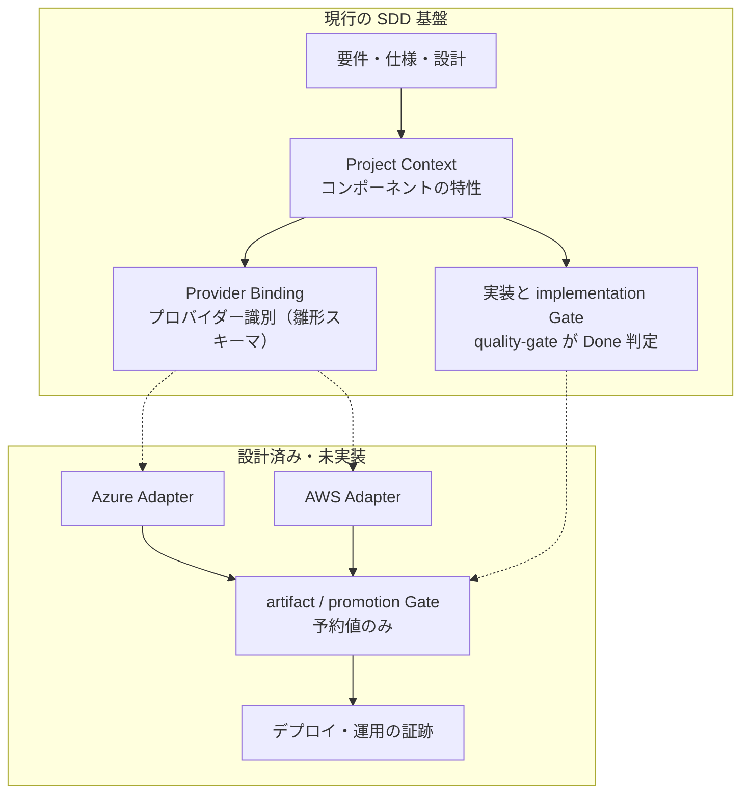
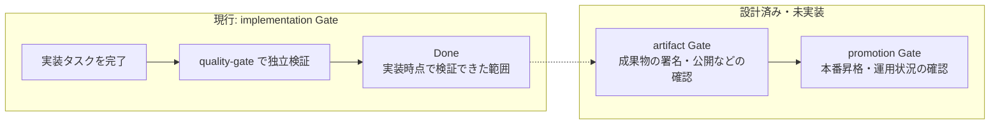

# クラウド開発と SDD Forge

Azure / AWS 上のシステムを SDD Forge で開発するときの、**現行機能と今後の拡張の境界**を示す入口です。クラウド専用のプラグインや検証機能は、現行の 7 プラグインに含まれていません。この文書群は、導入済みと誤認されないことを最優先にしています。

- [Azure で開発する](azure.md)
- [AWS で開発する](aws.md)

## 現在の状態

| 区分 | 内容 | 根拠 |
|---|---|---|
| **現行でできること** | 仕様化、3 段の独立レビュー、人間の承認、実装、`quality-gate` による Done 判定という共通の SDD フロー。アプリや IaC は、他のコードと同じ実装タスクとして扱えます。 | [workflow-guide.md](../workflow-guide.md) |
| 同上 | コンポーネントの特性とクラウドプロバイダーの識別を分ける方針（ADR-0018）と、その雛形のスキーマ。 | [ADR-0018](../adr/0018-provider-binding-separation.md)、`contracts/provider-bindings.schema.json`（skeleton） |
| 同上 | Lite トラックの昇格理由に `production_cloud_runtime` と `durable_workflow` が登録されています。クラウドの本番や Durable Workflow を扱う案件は Full の対象です。 | `contracts/lite-upgrade-reason-catalog.json`、[決定書 v2](../ai-dlc-foundation-decision-v2.md) |
| **設計済み・未実装** | `artifact` / `promotion` Gate（予約値のみ。実装されているのは `implementation` Gate だけ）。 | [ADR-0017](../adr/0017-gate-stage-model.md) |
| 同上 | Azure / AWS 向けの Provider Adapter、cloud-service Pack、durable-workflow Pack、新規プラグイン `sdd-operability`（新設予定で、実案件が付くまで着手しない方針）。 | [決定書 v2](../ai-dlc-foundation-decision-v2.md) の Pack 実装順 |
| 同上 | Promotion の語彙と credentials の語彙。cloud-service Pack に実案件が付いた時点で ADR 化する予定で、現時点では確定していません。 | [決定書 v2](../ai-dlc-foundation-decision-v2.md) |
| **参考（sdd-forge 未対応）** | Azure / AWS の各ツール（what-if、cdk diff など）の使い方。[azure.md](azure.md) と [aws.md](aws.md) に公式ドキュメントの出典つきで整理していますが、SDD Forge が自動で実行・検証するものではありません。 | 各ページの出典 |

> 実装完了とクラウドへの本番デプロイ完了は別物です。`quality-gate` が付ける `Done` は、実装時点で検証できる範囲（テスト、ビルド可否、設計との整合など）を意味します。デプロイが完了した、本番で動いている、という意味ではありません。`/sdd-ship:ship` がクラウドへ本番デプロイを実行することもありません。

## 構成: 共通の SDD とクラウド拡張

実線は現行の機能、点線は設計済みで未実装の拡張です。

Azure と AWS で別々の開発エンジンを作らず、仕様化・レビュー・変更影響分析・リスク判定は共通のまま使います。クラウド製品に固有の検証だけを、Provider Binding と Adapter の側に分ける方針です（[ADR-0018](../adr/0018-provider-binding-separation.md)）。

## 証跡・デプロイ・運用確認の流れ

実線は現行の範囲、点線は設計済みで未実装の範囲です。デプロイの実行や承認の手順は、現状は SDD Forge の外にあります。

運用面の確認項目（カナリア分析、SLO、公開状態など）は、決定書 v2 では参考仕様に留め、語彙を凍結していません。実案件が付いた時点で ADR にする方針です。

## 関連ドキュメント

- [ADR-0017 Gate Stage Model](../adr/0017-gate-stage-model.md)
- [ADR-0018 Provider Binding Separation](../adr/0018-provider-binding-separation.md)
- [AI-DLC 拡張計画の決定書 v2](../ai-dlc-foundation-decision-v2.md)
- [Issue #423](https://github.com/aharada54914/sdd-forge/issues/423)（クローズ済みの提案。Foundation の未完了項目を実装済みとは扱いません）
- [ドキュメント案内](../README.md)
