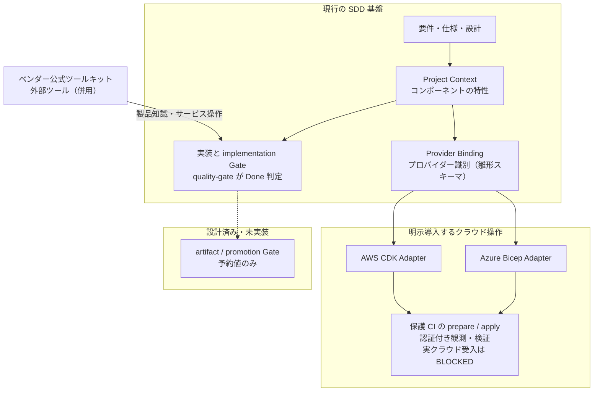
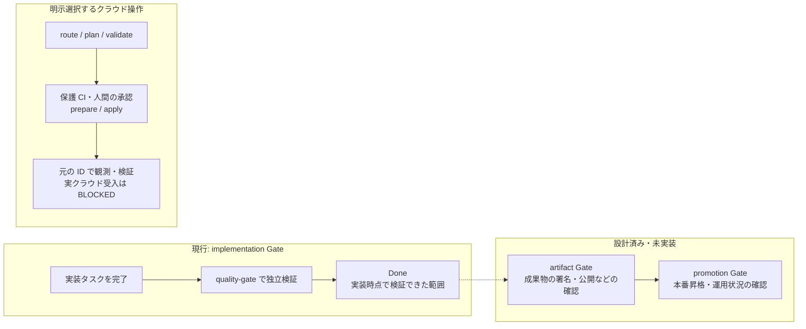

# クラウド開発と SDD Forge

Azure / AWS 上のシステムを SDD Forge で開発するときの入口です。通常の SDD フローに加え、**Azure Bicep / AWS CDK のクラウド操作を明示導入する 2 プラグイン**があります。実装済みの操作と、実クラウドでの受入が未完了であることを分けて説明します。

- [クラウド操作の入力契約・導入・実行・復旧](../cloud-orchestration.md)
- [Azure で開発する](azure.md)
- [AWS で開発する](aws.md)
- [IaC の検証計画の書き方](verification-plan.md)
- [エージェントのクラウド権限を絞る](least-privilege.md)
- [CI の承認付きデプロイ](ci-deploy-pattern.md)

## 現在の状態

| 区分 | 内容 | 根拠 |
|---|---|---|
| **現行でできること** | 仕様化、3 段の独立レビュー、人間の承認、実装、`quality-gate` による Done 判定という共通の SDD フロー。アプリや IaC は、他のコードと同じ実装タスクとして扱えます。 | [workflow-guide.md](../workflow-guide.md) |
| **明示導入でできること** | `sdd-azure-cloud` / `sdd-aws-cloud` による既存の 1 deployment unit の `route` / `plan` / `validate`、保護された CI に限定した `prepare` / `apply`、元の ID を使う `reconcile`、認証付きの `observe` / `verify`。対象は Azure Bicep または AWS CDK です。 | [実行契約](../cloud-orchestration.md) |
| **実クラウド受入は未完了** | TEST-003/005/009 と対応タスクの Done は sandbox 未提供のため BLOCKED。ローカル検証、fixture、コンパイラーの成功やリリースタグで、本番デプロイ・稼働を実証したとは扱いません。現在の実行ツール固定値は Linux x64 用です。 | [受入と制限](../cloud-orchestration.md#verification-and-release-status) |
| 同上 | コンポーネントの特性とクラウドプロバイダーの識別を分ける方針（ADR-0018）と、その雛形のスキーマ。 | [ADR-0018](../adr/0018-provider-binding-separation.md)、`contracts/provider-bindings.schema.json`（skeleton） |
| 同上 | Lite トラックの昇格理由に `production_cloud_runtime` と `durable_workflow` が登録されています。クラウドの本番や Durable Workflow を扱う案件は Full の対象です。 | `contracts/lite-upgrade-reason-catalog.json`、[決定書 v2](../ai-dlc-foundation-decision-v2.md) |
| **設計済み・未実装** | `artifact` / `promotion` Gate（予約値のみ。実装されているのは `implementation` Gate だけ）。 | [ADR-0017](../adr/0017-gate-stage-model.md) |
| 同上 | cloud-service Pack、durable-workflow Pack、新規プラグイン `sdd-operability`。既存の Bicep / CDK 操作アダプターとは別の拡張です。ベンダー公式ツールキットとの分担を見直す [ADR-0046](../adr/0046-vendor-agent-toolkit-coexistence.md) は提案中で、既存実装の削除を決めたものではありません。 | [決定書 v2](../ai-dlc-foundation-decision-v2.md) の Pack 実装順、ADR-0046（未決） |
| 同上 | Promotion の語彙と credentials の語彙。cloud-service Pack に実案件が付いた時点で ADR 化する予定で、現時点では確定していません。 | [決定書 v2](../ai-dlc-foundation-decision-v2.md) |
| **併用（外部ツール）** | AWS と Microsoft が公式に提供するコーディングエージェント向けツールキット。製品知識やサービス操作の手段を担います。SDD Forge が同梱・実行・検証するものではありません。[下記](#ベンダー公式ツールキットとの併用)を参照してください。 | [aws.md](aws.md)、[azure.md](azure.md) |
| **参考（一般的なツール）** | what-if、cdk diff、azd などの使い方を [azure.md](azure.md) と [aws.md](aws.md) に出典つきで整理しています。専用プラグインが許可するのは、固定した入力・ツール・権限で実行する限定経路だけです。一般的なコマンドの任意実行を許可するものではありません。 | 各ページの出典、[実行契約](../cloud-orchestration.md) |

> 実装完了とクラウドへの本番デプロイ完了は別物です。`quality-gate` が付ける `Done` は、実装時点で検証できる範囲（テスト、ビルド可否、設計との整合など）を意味します。デプロイが完了した、本番で動いている、という意味ではありません。`/sdd-ship:ship` がクラウドへ本番デプロイを実行することもありません。

## 構成: 共通の SDD とクラウド拡張

実線は実装済みの経路、点線は設計済みで未実装の拡張です。クラウド実装の存在は、実クラウド受入の完了を意味しません。

Azure と AWS で仕様化・レビュー・変更影響分析・リスク判定は共通のまま使います。クラウド固有の操作と検証は各 Adapter に分け、通常のタスク承認や `Done` をデプロイ権限として流用しません。

専用プラグインはリポジトリの `install.sh` / `install.ps1` で明示導入します。共有 runtime は導入時に組み立てるため、marketplace からの直接導入だけでは動作しません。ネイティブ Windows のパスではクラウド操作を拒否します。導入・対応プラットフォーム・復旧条件は [実行契約](../cloud-orchestration.md#install-and-platform-boundary)に従ってください。

## ベンダー公式ツールキットとの併用

AWS と Microsoft は、コーディングエージェント向けの公式ツールキットを提供しています（[AWS](aws.md#ベンダー公式ツールキット)、[Azure](azure.md#ベンダー公式ツールキット)）。幅広い製品知識やサービス操作はこれらを利用し、SDD Forge のクラウドプラグインは固定した Bicep / CDK の入力・権限・証跡を扱います。役割は次のように分かれます。

| 関心 | 担当 |
|---|---|
| クラウド製品の知識、IaC の書き方、サービス操作 | ベンダー公式ツールキット（外部ツール） |
| 仕様化、3 段の独立レビュー、人間の承認、独立検証、Done 判定 | SDD Forge |
| Bicep / CDK の固定した入力と許可範囲での操作・証跡検証 | 明示導入した SDD Forge のクラウドプラグイン |
| クラウド側の実行権限の上限 | クラウド自身の仕組み（AWS は IAM、Azure はロール割り当て） |

### 統制の境界

SDD Forge のフックは、ベンダーのツールキットが行うクラウド API 呼び出しを止めません。`claude-hooks.json` と `hooks.json` の定義から読み取れる範囲では、次のとおりです。

- キルスイッチ（`AGENT_STOP`）は全ツールが対象です。ファイルがある間は、MCP ツールを含むすべてのツール使用を止めます。
- 承認ガードと保護パスガードは、編集系とシェル系のツール（`Edit`、`Write`、`Bash` など）だけが対象です。MCP 経由のクラウド API 呼び出しは対象外です。
- Bash の `terraform apply`、`az deployment group create`、`cdk deploy` などのデプロイ系コマンドも、承認ガードは止めません（Python 版ガードの直接呼出しで確認）。これを止めるガードは [ADR-0047](../adr/0047-cloud-deploy-command-guard.md) で検討し、素通りする経路が多いため**採用しないと決めました**。デプロイの制御は、クラウド側の権限と CI の承認で行います（[権限の整理](least-privilege.md)、[CI の承認付きデプロイ](ci-deploy-pattern.md)）。
- Copilot CLI 向けの定義は全ツールをガードに通しますが、ガードが検査するのは承認欄や保護パスへの書込みです。クラウド API 呼び出しを止める設計ではありません。

フックの適用範囲は定義ファイルから確認し、上記のデプロイ系コマンドについては Python 版ガードを直接呼び出して確認しました。各ホストのフック経由の動作や、実際のクラウド API 呼出しは未検証です。したがって、エージェントに与えるクラウド側の権限は、クラウド自身の仕組みで絞ってください。たとえば AWS には、MCP 経由のリクエストに付く IAM 条件キーがあります。ただし、これらが示すのはリクエストの経路であり、呼び出した主体ではありません。エージェントが CLI や SDK で直接呼ぶ場合には付かないため、これだけでは足りません（[aws.md](aws.md#ベンダー公式ツールキット)）。本線は、エージェントが使える ID そのものの権限を絞ることです。Azure でも、実行する ID に必要最小限のロールを割り当てます（[azure.md](azure.md) の OIDC の項）。デプロイの承認は人間が行います。

## 証跡・デプロイ・運用確認の流れ

実線は実装済みの範囲、点線は設計済みで未実装の Gate です。クラウド操作は通常の `Done` から自動で進まず、専用プラグインへの明示依頼と、外部の保護 CI・人間の承認が必要です。

運用面の確認項目（カナリア分析、SLO、公開状態など）は、決定書 v2 では参考仕様に留め、語彙を凍結していません。実案件が付いた時点で ADR にする方針です。

## 関連ドキュメント

- [ADR-0017 Gate Stage Model](../adr/0017-gate-stage-model.md)
- [ADR-0018 Provider Binding Separation](../adr/0018-provider-binding-separation.md)
- [ADR-0046 ベンダー公式ツールキットとの併用（提案中）](../adr/0046-vendor-agent-toolkit-coexistence.md)
- [AI-DLC 拡張計画の決定書 v2](../ai-dlc-foundation-decision-v2.md)
- [Issue #423](https://github.com/aharada54914/sdd-forge/issues/423)（クローズ済みの提案。Foundation の未完了項目を実装済みとは扱いません）
- [ドキュメント案内](../README.md)
