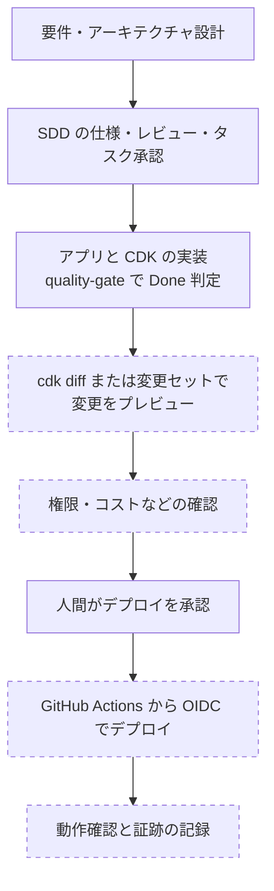

# AWS で開発する

AWS 上のシステムを SDD Forge で開発するときの進め方です。先に [クラウド開発と SDD Forge](README.md) で現行機能と未実装の境界を確認してください。

## できること / できないこと

| 区分 | 内容 |
|---|---|
| **現行でできること** | アプリケーションや CDK / CloudFormation のコードを実装タスクとして SDD の通常フロー（仕様化 → 3 段レビュー → 人間の承認 → 実装 → `quality-gate`）で進めること。 |
| **設計済み・未実装** | AWS 向けの Provider Adapter、AWS 固有の検証、`artifact` / `promotion` Gate。Step Functions を扱う durable-workflow Pack も未実装です（[決定書 v2](../ai-dlc-foundation-decision-v2.md)）。 |
| **参考（sdd-forge 未対応）** | 下記の AWS の各ツール。SDD Forge が自動で実行・検証するものではなく、人間または CI が実行します。 |

## 開発プロセス

点線の枠は AWS 側のツールで、SDD Forge 未対応です。

`quality-gate` の `Done` はデプロイの完了を意味しません。点線の工程は、現状は SDD Forge の外で行います。

## 参考: AWS の各ツール

以下は AWS と GitHub の公式ドキュメントで確認した内容です。SDD Forge がこれらを実行・検証する機能は、現時点ではありません。

| 目的 | ツール | 要点 | 出典 |
|---|---|---|---|
| デプロイ前の差分確認 | `cdk diff` | ローカルの CDK アプリのスタックを、デプロイ済みのスタックまたはローカルの CloudFormation テンプレートと比較します。`--method` の既定は `auto` で、読み取り専用の変更セットを作って置換の有無まで調べ、失敗するとテンプレート比較に切り替わります。`--fail` を付けると差分があるときに終了コード 1 を返します。公式ページの出力例には、アセットのビルドと公開の表示も含まれます。 | [cdk diff](https://docs.aws.amazon.com/cdk/v2/guide/ref-cli-cmd-diff.html) |
| デプロイ前の変更確認 | CloudFormation の変更セット | 変更セットは、CloudFormation がスタックに加える変更をまとめた JSON です。適用前に確認でき、データベースが置換されるといった意図しない変更に気づけます。変更セットを使わない直接更新は速い一方、事前の確認はありません。 | [AWS CloudFormation stack updates](https://docs.aws.amazon.com/en_us/AWSCloudFormation/latest/UserGuide/using-cfn-updating-stacks.html) |
| CI からの認証 | GitHub Actions の OIDC と IAM ロール | 長期的な AWS 認証情報を GitHub のシークレットに置かずに済みます。IAM に OIDC プロバイダー（`https://token.actions.githubusercontent.com`、対象は `sts.amazonaws.com`）を追加し、ロールの信頼ポリシーに条件（たとえば `sub`）を必ず設定します。ワークフローには `id-token: write` が必要で、`aws-actions/configure-aws-credentials` が一時的な認証情報へ交換します。`sub` の形式はリポジトリの作成時期などで異なるため、信頼ポリシーはリポジトリの形式に合わせます。 | [Configuring OpenID Connect in Amazon Web Services](https://docs.github.com/en/actions/how-tos/secure-your-work/security-harden-deployments/oidc-in-aws) |
| 長時間の状態を持つ処理 | AWS Step Functions | ワークフローを「ステートマシン」として定義し、Lambda などの AWS サービスを呼び出して調整します。Standard ワークフローは最長 1 年、Express ワークフローは高イベントレート向けで最長 5 分です。 | [What is Step Functions?](https://docs.aws.amazon.com/step-functions/latest/dg/welcome.html) |

出典を確認していない製品や機能（実行環境の選定、監視基盤など）は、ここには載せていません。対象システムの設計で決めてください。

## ベンダー公式ツールキット

AWS は、コーディングエージェント向けに [Agent Toolkit for AWS](https://github.com/aws/agent-toolkit-for-aws) を提供しています。SDD Forge に同梱されるものではなく、併用する外部ツールです。以下は公開されている README と発表ページで確認した内容で、実際に動かして確認したものではありません。

| 項目 | 内容 |
|---|---|
| 位置づけ | 従来の AWS Labs の MCP サーバーや skills の後継です。発表ページと README では、一般提供（GA）とされています。 |
| 構成 | マネージドの AWS MCP サーバー、skills（CDK / CloudFormation、サーバーレス、コンテナなど）、それらを束ねるプラグイン。 |
| 対応ホスト | Claude Code、Codex、Cursor のプラグインに対応します。その他のエージェントは、MCP サーバーの設定と skills の導入で使います。README に GitHub Copilot の記載はありません。 |
| 権限の絞り込み | エージェントによる操作を人間の操作と区別できる IAM 条件キーがあります。これにより、エージェントは読み取り専用、といったポリシーを書けます。 |
| 監査 | リクエストを CloudTrail に記録でき、CloudWatch のメトリクスも出ます。 |
| 費用 | 追加料金はなく、エージェントが使う AWS リソース分のみ課金されます。 |

出典: [aws/agent-toolkit-for-aws](https://github.com/aws/agent-toolkit-for-aws)、[Announcing Agent Toolkit for AWS](https://aws.amazon.com/about-aws/whats-new/2026/05/agent-toolkit)

SDD Forge との役割分担と、フックが効かない範囲は [README の併用の節](README.md#ベンダー公式ツールキットとの併用)にまとめています。

## 運用上の注意

- AWS の認証情報はリポジトリに置かず、OIDC などの短命な仕組みを使います。`SDD_SUDO` や署名鍵の扱いは [THREAT-MODEL.md](../THREAT-MODEL.md) に従います。
- クラウドの本番や Durable Workflow を扱う案件は、Lite の昇格理由（`production_cloud_runtime` / `durable_workflow`、`contracts/lite-upgrade-reason-catalog.json`）に当たります。Full トラックを前提にしてください（トラック選択は [workflow-guide.md](../workflow-guide.md) を参照）。
- デプロイの承認は人間が行います。承認フィールドをエージェントが書き換えることはできません。
