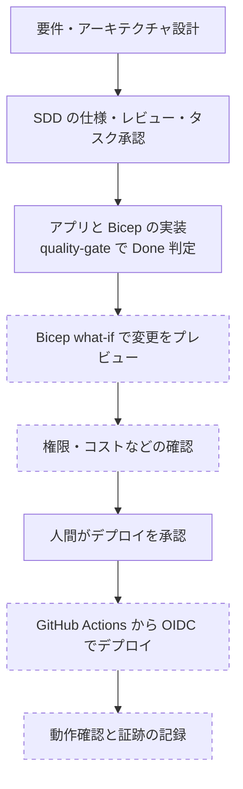

# Azure で開発する

Azure 上のシステムを SDD Forge で開発するときの進め方です。先に [クラウド開発と SDD Forge](README.md) で現行機能と未実装の境界を確認してください。

## できること / できないこと

| 区分 | 内容 |
|---|---|
| **現行でできること** | アプリケーションや Bicep / Terraform のコードを実装タスクとして SDD の通常フロー（仕様化 → 3 段レビュー → 人間の承認 → 実装 → `quality-gate`）で進めること。 |
| **設計済み・未実装** | Azure 向けの Provider Adapter、Azure 固有の検証、`artifact` / `promotion` Gate。Durable Functions を扱う durable-workflow Pack も未実装です（[決定書 v2](../ai-dlc-foundation-decision-v2.md)）。 |
| **参考（sdd-forge 未対応）** | 下記の Microsoft の各ツール。SDD Forge が自動で実行・検証するものではなく、人間または CI が実行します。 |

## 開発プロセス

実線の枠は SDD Forge が扱う範囲、点線の枠は Azure 側のツールで、SDD Forge 未対応です。

`quality-gate` の `Done` はデプロイの完了を意味しません。点線の工程は、現状は SDD Forge の外で行います。

## 参考: Azure の各ツール

以下は Microsoft Learn で確認した内容です。SDD Forge がこれらを実行・検証する機能は、現時点ではありません。

| 目的 | ツール | 要点 | 出典 |
|---|---|---|---|
| デプロイ前の変更確認 | Bicep の what-if | 既存のリソースを変更せず、デプロイした場合の変更（作成・変更・削除）を予測して表示します。`az deployment group what-if` で実行でき、`az deployment group create --confirm-with-what-if` はプレビュー後に確認を求めます。`--no-pretty-print` で機械可読な出力にもできます。 | [Bicep deployment what-if operation](https://learn.microsoft.com/en-us/Azure/azure-resource-manager/bicep/deploy-what-if) |
| CI からの認証 | GitHub Actions の `azure/login` と OIDC | Microsoft Entra アプリまたはユーザー割り当てマネージド ID にフェデレーション資格情報を設定し、ジョブに `id-token: write` を付けます。ID に適切な Azure ロールを割り当てます。公式ページの例では、クライアント ID・テナント ID・サブスクリプション ID を GitHub のシークレットに入れて `azure/login@v2` へ渡しています。 | [Use GitHub Actions to connect to Azure](https://learn.microsoft.com/en-us/azure/developer/github/connect-from-azure-openid-connect) |
| テンプレートとデプロイ | Azure Developer CLI (azd) | azd のテンプレートは、`azure.yaml` と `infra` フォルダー（既定は Bicep、Terraform も可）で構成されます。`azd up` はプロビジョニング、パッケージング、デプロイをまとめて実行します。 | [Azure Developer CLI templates](https://learn.microsoft.com/nb-no/azure/developer/azure-developer-cli/azd-templates) |
| 長時間の状態を持つ処理 | Durable Functions | Azure Functions を拡張し、サーバーレス環境でステートフルなワークフローを書けます。オーケストレーター関数、アクティビティ関数、エンティティ関数をコードで記述し、状態・チェックポイント・リトライ・復旧はランタイムが管理します。 | [Durable Functions overview](https://learn.microsoft.com/en-us/azure/azure-functions/durable-functions-overview) |

出典を確認していない製品や機能（実行環境の選定、監視基盤など）は、ここには載せていません。対象システムの設計で決めてください。

## 運用上の注意

- Azure の認証情報はリポジトリに置かず、OIDC などの短命な仕組みを使います。`SDD_SUDO` や署名鍵の扱いは [THREAT-MODEL.md](../THREAT-MODEL.md) に従います。
- クラウドの本番や Durable Workflow を扱う案件は、Lite の昇格理由（`production_cloud_runtime` / `durable_workflow`、`contracts/lite-upgrade-reason-catalog.json`）に当たります。Full トラックを前提にしてください（トラック選択は [workflow-guide.md](../workflow-guide.md) を参照）。
- デプロイの承認は人間が行います。承認フィールドをエージェントが書き換えることはできません。
