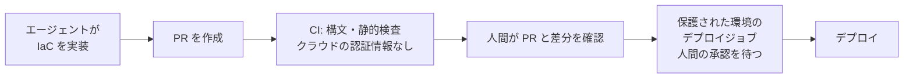

# CI の承認付きデプロイ

エージェントにクラウドの書込み権限を渡さず、差分の確認とデプロイを CI で分けて実行するための考え方です。[権限の整理](least-privilege.md)のとおり、Azure の what-if はデプロイと同じ権限を要するため、権限だけでは両者を分けられません。実行する場所と承認の流れで分けます。

## 流れ

## 前提と、確認できた範囲

| 項目 | 内容 | 出典 |
|---|---|---|
| 環境の必須レビュアー | 環境を参照するジョブは、環境の保護ルールを通るまで開始しません。必須レビュアーは、最大 6 人のユーザーまたはチームを指定でき、1 人の承認で進みます。 | [GitHub Docs: About environments（Enterprise Server 3.10）](https://docs.github.com/en/enterprise-server@3.10/actions/deployment/targeting-different-environments) |
| 環境のシークレット | 環境のシークレットは、保護ルールを通るまでジョブから使えません。 | 同上 |
| 管理者の回避 | 既定では、管理者は保護ルールを回避できます。環境ごとに無効にできます。 | 同上 |
| OIDC での認証 | Azure は `azure/login`、AWS は GitHub OIDC を使います。 | [azure.md](azure.md)、[aws.md](aws.md) の出典 |

上の出典は GitHub Enterprise Server 3.10 のページです。github.com の現行の挙動と一致するかは、この文書の作成時に確認していません。

## 設計の要点

- **エージェントが書き換えられる経路に、書込み権限を置かない。** PR のワークフローは、エージェントが変更できる対象です。PR で動くジョブに、クラウドの書込み権限を持つ認証情報を渡すと、エージェントがワークフローを書き換えて実行できてしまいます。書込み権限を持つ認証情報は、保護された環境のジョブだけが使えるようにします。
- **差分の確認はデプロイと別のジョブにする。** Azure の what-if はデプロイと同じ権限を要するため、差分の確認も保護された環境のジョブで行うか、人間がローカルで実行します。保護された環境のジョブにするなら、差分の確認でも承認を待つことになります。
- **差分の出力を証跡として保存し、削除と置換は人間が確認する**（[検証計画の書き方](verification-plan.md)）。
- **管理者の回避を無効にする。** 既定では回避できるため、環境の設定で無効にします。

## 限界

- このページは一般的な CI の設計指針です。通常の `ship` や承認ガードが、任意のワークフローの内容や承認を検査するものではありません。明示導入するクラウドプラグインの `prepare` / `apply` は、別途、固定ワークフロー・保護環境・OIDC と外部 policy の条件を検査します。その実行契約と設定手順は [cloud-orchestration.md](../cloud-orchestration.md)を参照してください。実クラウド受入は BLOCKED のままです。
- ワークフローのファイル自体の変更を人間がレビューすることが前提です。CODEOWNERS などで、`.github/workflows` の変更を人間の承認に必ず回す設定が望ましいです（この文書では設定方法を確認していません）。
- Azure のフェデレーション資格情報を環境や参照で絞る設定は、この文書では扱っていません。
