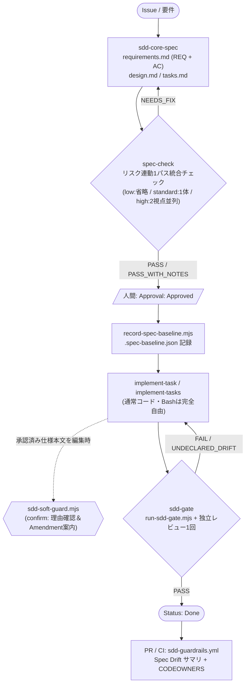

# SDD 開発業務フローガイド（SDD Core v2）

SDD Forge v2（[ADR-0051](adr/0051-lightweight-guardrails-and-sdd-core.md)）では、従来の `Full` / `Lite` の二極トラックを廃止し、**単一トラック `SDD Core` ＋ リスクレベル伸縮（`low` / `standard` / `high`）** と **3 層ソフト・ガードレール** による明快なフローへ統一しました。

## 2 コマンドクイックリファレンス

| コマンド | 役割 | 実行者 |
|---|---|---|
| `/sdd-bootstrap:bootstrap <mode> <source>` | 仕様化フェーズ: 要件 (`REQ`+`AC`)・設計・タスク生成 + 1 パス `spec-check` | AI + 人間確認 |
| `/sdd-ship:ship specs/<feature>/tasks.md` | 実装・品質保証フェーズ: ベースライン固定 → 自律実装 → 統合 `sdd-gate` → `Done` | AI（人間承認後） |

## 標準フロー（feature / bugfix / refactor）

## 実装中に仕様変更が必要になったとき（Spec Amendments 手順）

v2 のソフトガードは「仕様を絶対に変えさせないロック」ではなく、**「意図しない無断改変だけを抑止し、正当な仕様変更は透明な記録として残す」** ための仕組みです。

1. 実装中に要件や受入条件（`AC-*`）の修正が必要だと判明した場合、`sdd-soft-guard.mjs`（既定 `confirm` モード）が編集を 1 ステップ停止し、確認を促します。
2. ユーザー（または PO）と仕様変更の内容・理由を合意します。
3. 対象仕様ファイル末尾の `## Spec Amendments` セクションへ変更理由を追記します（このセクションへの追記はソフトガードにより自動許可されます）。
4. 合意済みの本文修正を反映します（エージェント経由で反映する場合は `SDD_ALLOW_SPEC_EDIT=1` を指定、または人間が直接編集）。
5. 後段の `sdd-gate` および CI（`check-spec-drift.mjs`）が `AMENDED (Reviewable)` として変更箇所と記録済み理由を自動サマリ表示し、PR レビュアーが一目で確認できます。

## バグ修正とオプトイン専門レーン

- **原因不明なバグ・回帰・性能退行**: 先に `/sdd-implementation:diagnose` で最小再現と回帰テストを特定し、その結果から `/sdd-bootstrap:bootstrap bugfix --risk low` へ進みます（`spec-check` 自動スキップ）。
- **SQL / DB 変更**: `/sdd-implementation:sql-develop` および [SQL 開発ガイド](sql-development.md) を参照。
- **DDD (`sdd-domain`) / デザインシステム (`design-system/`) / Cloud (`sdd-azure-cloud`, `sdd-aws-cloud`)**: 明示導入・該当ディレクトリ存在時のみ有効化され、非対象プロジェクトへのオーバーヘッドはゼロです。

## 状態モデル

- **Approval（人間のみ）**: `Draft` → `Approved`（`sdd-soft-guard.mjs` がエージェントによる `Approval: Approved` 純増を抑止）
- **Status（スキル遷移可）**: `Planned` → `In Progress` → `Implementation Complete` → `Done`（および `Blocked`）。`tasks.md` の `Status:` 更新はソフトガードおよび Spec Drift チェックの双方で常に安全扱いとなり、誤検知は発生しません。
