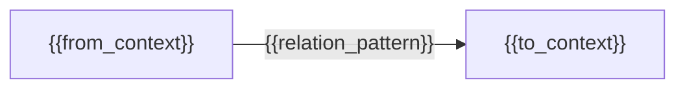

# Context Map: {{domain_name}}

Domain-Model-Status: Pending
Stage: 5 of 7 (Context Map)
Seed-Source: {{seed_source}}

`Domain-Model-Status` tracks this domain model's review/approval state:
`Pending` (default; not yet reviewed), `Reviewed` (domain-review-loop
reached PASS), or `Approved` (a human has signed off). Approving takes two
human steps. Follow the approval and publication procedure in `domain-review-loop`,
which uses `validate-domain-contract.sh <candidate>` (`.ps1` on Windows).
Set this line to `Approved`, then publish the domain contract
(`domain/domain-contract.json` with `meta.status` `Approved` and the next patch
version, checked by `validate-domain-contract`). Changing only this line leaves
the contract `Pending`, and the Concept Test stops with
`domain model must be approved`. Only a human may set `Approved`; the hook
guard rejects an agent-authored write of that value. Nothing resets this field automatically:
`/sdd-domain:domain-model update` sets it back to `Pending` (requiring
re-review), while a direct edit of an approved `domain/` file leaves it
`Approved`. If the edited file is one of an existing Concept Test proposal's
pinned inputs (every path its `inputs` lists with a hash: the domain contract,
this context map, the contract's `generated_from` files, the seed and any other
listed `domain/` file), the proposal no longer matches and bootstrap stops with
`concept-test: BLOCK`; edits to `domain/` files it does not list do not
invalidate it.
Regenerate the proposal (and re-review if the model changed) before
continuing (AC-014).

## Bounded Contexts

| Context | Description | Core Terms | Aggregates |
|---|---|---|---|
| {{context_name}} | {{context_description}} | {{core_terms}} | {{context_aggregates}} |

## Context Relations

Relation `pattern` values match
`contracts/domain-contract.v2.schema.json`'s `contextRelation.pattern` enum:
`partnership`, `shared-kernel`, `customer-supplier`, `conformist`,
`anticorruption-layer`, `open-host-service`, `published-language`,
`separate-ways`.

| From Context | To Context | Pattern | Note |
|---|---|---|---|
| {{from_context}} | {{to_context}} | {{relation_pattern}} | {{relation_note}} |

## Context Map Diagram

## Open Questions

{{open_questions}}

## Unknowns

{{unknowns}}

Record anything the human could not yet answer here, verbatim. Never invent
an answer to fill this section.
