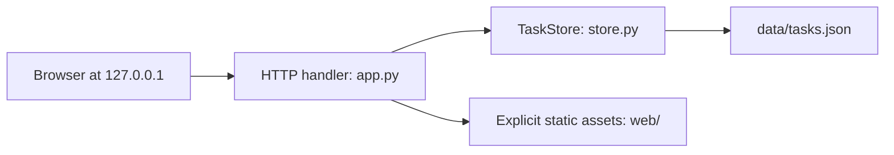

# Design: ローカルタスク管理

Impl-Review-Status: Pending
Feature Type: project

## Technical Summary

Python 3.12標準ライブラリのHTTPServer、json、uuid、pathlib、tempfile、osを使う単一プロセスのローカルアプリ。ブラウザは素HTML/CSS/JavaScript。時間優先のためビルド・DB・外部依存を導入しない。REQ-001〜010、AC-001〜013を対象とする。

## Architecture

## Components

| Component | Responsibility (Owns / Does Not Own) | Public Contract & Encapsulated Knowledge | State, Failure & Change Blast Radius | Technology | New/Existing |
|---|---|---|---|---|---|
| TaskStore | 検証済みタスクと永続保存 / HTTPを扱わない | list/add/set-completed/delete、固定保存先、atomic replace | 保存前候補を複製し成功後だけ確定。失敗は呼出元へ通知 | Python標準 | New |
| HTTP handler | Host/Origin/入力検証とAPI/static / UI状態を扱わない | contracts/task-board-api.md、既知URLのみ配信 | 単一HTTPServerで更新直列化。内部例外は一般的500 | Python標準 | New |
| Task view | 表示・入力・通信・フォーカス / 永続保存しない | GET/POST/PATCH/DELETE、textContent描画 | loading/ready/saving/error、失敗は入力保持 | HTML/CSS/JS | New |

## Layer Specifications

| Layer | Summary | Canonical Detail | Owner | Status |
|---|---|---|---|---|
| UX | 日本語単画面とレスポンシブ状態 | [UX](ux-spec.md#scope-and-user-journeys) | implementer | Specified |
| Frontend | 素JS、同一Origin fetch | [Frontend](frontend-spec.md#technology-stack) | implementer | Specified |
| Infrastructure | ローカル単一Pythonプロセス | [Infra](infra-spec.md#deployment-topology) | implementer/operator | Specified |
| Security | Host/Origin、型・容量・文字列描画、固定保存先 | [Security](security-spec.md#trust-boundaries) | implementer | Specified |

## Design System Compliance

N/A — ds_profile: none

## Cross-Layer Dependencies

| From | To | Contract / Decision | REQ | AC | Verification |
|---|---|---|---|---|---|
| requirements.md | ux-spec.md / frontend-spec.md | 追加・切替・削除の到達経路 | REQ-001,002,003,009 | AC-001,002,003,008,011 | TEST-001,002,003,008,011 |
| frontend-spec.md | contracts/task-board-api.md | 同一Origin通信、保存完了後反映 | REQ-004,008 | AC-004,009,010 | TEST-004,009,010 |
| security-spec.md | infra-spec.md | ループバックと固定ファイル、Host/Origin拒否 | REQ-005,010 | AC-005,012,013 | TEST-005,012,013 |

## ADR Change Log

| ADR | Decision | Status | Layer Impact | Supersedes | Date |
|---|---|---|---|---|---|
| docs/adr/0001-local-python-json.md | Python標準HTTPとJSON原子的置換 | Proposed | all | none | 2026-11-07 |

## Data Plan

Data Entities: Task(id UUID string, title string, completed boolean)。ファイルはversion:1のtasks配列。追加順を維持。
Existing Data Affected: なし。
Migration Strategy: 初回ファイル不在は空一覧。未知version・破損・重複IDは起動失敗し保存しない。自動migrationはしない。
保存処理: 同じディレクトリに一時ファイルを作りUTF-8 JSONをwrite/flush/fsync後os.replace。replace前の失敗で確定ファイルとメモリを変えない。一時ファイルは可能な範囲で除去。クラッシュ時は旧版または新版の妥当なJSONになる設計で、電源断後のディレクトリエントリ耐久性は保証範囲外。

## API / Contract Plan

正本: ../../contracts/task-board-api.md と task-board-data.schema.json。/ と /app.js、/style.cssのみ静的配信。任意パスのファイルを配信しない。Content-Lengthは0〜8192 bytes。型を厳密に検証しPython boolをintと混同しない。GETは最新確定一覧、変更応答は保存後の全一覧。DELETEは200で全一覧。エラー時は固定codeと日本語message。

## Test Strategy

unittestでTaskStoreと実HTTPの統合テスト、一時データディレクトリで再起動と失敗注入。ブラウザは実起動して主要経路・JSON・console/network・320/1280pxを照合。全ACはacceptance-tests.mdに対応。テスト・スクリーンショットは未実行。ゲートはinstalled pluginの正規手順で実施しraw結果を保存。

## Security Boundaries

| Trust Boundary | Auth/Authz Mechanism | Data Classification | OWASP Concerns |
|---|---|---|---|
| Browser → HTTP | 単一ローカル利用者。Host検証、変更は完全一致Origin必須 | 個人ローカル本文 | CSRF/DNS rebinding/XSS |
| HTTP → file | サーバー指定固定パス、スキーマ検証 | 個人ローカル本文 | path traversal/破損/情報露出 |

Detailed controls: [Security](security-spec.md#trust-boundaries)。

## Deployment / CI Plan

python3 app.py --port 3000 --data-file data/tasks.json を予定。localhost公開は行わず127.0.0.1だけ待受。ローカルのcompileall/unittest/ブラウザ確認を使い、CI・公開は適用外。[Infra](infra-spec.md#deployment-topology)。

## Constraint Compliance

| Requirement Constraint | Design Response |
|---|---|
| JSON / local only | サーバーJSON、127.0.0.1、外部通信なし |
| 時間優先・既存ライブラリ優先 | Python標準機能、素UI、ビルドなし |
| 日本語・モバイル | ux-spec.mdの状態と幅条件 |
| full SDD | 七文書、ADR、契約、独立レビュー、Draftタスクと人間承認、品質ゲート |

## Assumptions

OS上の同一ユーザーを信頼。単一アプリプロセス・小型一覧（目安1000件）で使用。多重プロセス書込・ネットワーク共有・電源断耐久・アカウント分離は対象外。

## Open Questions

製品判断の未解決項目なし。レビュー実行環境のidentity初期化とinstalled gateの配置互換性は別途実行確認する。タスク承認は未取得。

## Risks

誤削除は即時反映しUndoなし（小型MVPの判断）。OS権限を持つ他プロセスはJSONを読める。保存中断はatomic replaceで軽減。保存成功後の応答消失は再取得で確認し変更を自動再送しない。
