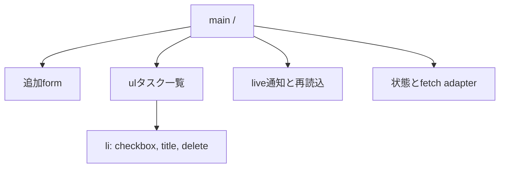

# Frontend Specification: task-board

## Technology Stack

| Layer | Technology | Version | Rationale | Constraint |
|---|---|---|---|---|
| Server | Python標準ライブラリ | 3.12（観測3.12.14） | 指定・追加依存不要 | localhost専用 |
| UI | HTML5/CSS/素JavaScript | ES2020+ browser | 指定・ビルド不要 | 現行Chromium実ブラウザで検証 |
| Tests | unittest + 実ブラウザ自動操作 | Python3.12、browser harnessは利用可能版を証拠化 | 標準優先 | harness依存は製品runtimeに含めない |

## Component Tree

web/index.html、web/style.css、web/app.js。serverはAPIと既知assetを配信。clientにファイルI/Oなし。routeは/だけ。lazy loadなし。

## State Shape

state = {status: loading|ready|saving|error, tasks: Array<{id,title,completed}>, draft: string, errorMessage: string|null}。
一覧はGET/成功した変更応答で置換。draftは追加成功時のみクリア。保存失敗で以前の確定一覧とdraftを保持し、状態が不確定な通信失敗では再取得成功まで変更を禁止。永続化の正本はJSON、localStorageを使わない。REQ-004,008,010 / AC-004,009,010。

## Routes and Components

| Route | Component | Auth | Parameters | Data Source | Loading/Error Boundary | REQ | AC |
|---|---|---|---|---|---|---|---|
| / | task view | 不要・local user | なし | /api/tasks | view全体、再読込 | REQ-001,002,003,009 | AC-008,011 |

## API Client Strategy

正本は../../contracts/task-board-api.md。fetch相対URL、same-origin。変更にContent-Type:application/json、ブラウザOriginを使用。AbortControllerで10秒timeout。自動retryなし、特にPOSTは自動再送しない。responseの型とokを確認し、JSON失敗も一般エラーへ正規化。cache:no-store。認証header・telemetry・外部通信なし。再読込ボタンでGET、成功後に操作再開。本文はDOM textContentで描画。現在focusのtask IDと操作を記録して描画後に復帰する。

## Code Splitting and Size Budget

小型3assetをeager読み込み、分割不要。HTML+CSS+JS合計非圧縮100KiB以下を設計目安にする。外部assetゼロをTEST-005、構成をTEST-006で確認。性能予算のため新たな製品依存は追加しない。

## Performance Budget

1000件までを小型利用の目安とする。ローカル主要操作は10秒timeout内に完了し、保存中表示はrequest送信直前に反映。公開サービスのLCP/INP p75 SLOはローカル単一利用・時間優先に適用しない。CLSは固定の通知領域とfont/image通信なしで抑制し実ブラウザで観察する。厳密な性能ベンチマークは今回の必須ACに追加しない。

## Empty, Loading, Error, and Success Behavior

ux-spec.mdの状態表を正本とする。spinnerのみを表示せず日本語状態を出す。入力検証と保存中disabledを送信call siteでも確認。変更成功は永続保存完了後の応答だけで確定。AC-009,010,011。

## Dependencies

製品外部依存ゼロ。Python standard libraryを再利用、UI frameworkなし。テスト用ブラウザharnessを新たに導入した場合は版・導入コマンドをreportsに記録しruntimeから分離。ビルド・package lockは製品依存がないためN/A。

## Testing

TEST-001〜004/008/009/010/011/012を実ブラウザで検証。TEST-005は通信先を確認、TEST-006はasset/依存確認。unittestのintegrationでAPI境界と実ファイルを検証。画面とキーボード検査を320/1280pxで証拠化し、未実行は明示する。操作中disabledのテストのみ応答を制御し、通常経路は実API・実JSONを使う。

## Open Questions

なし。
