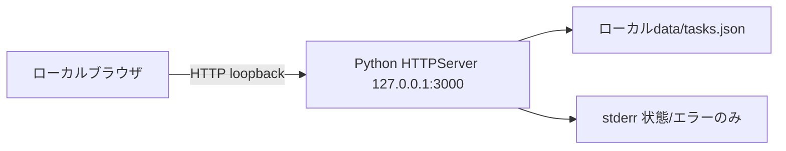

# Infrastructure Specification: task-board

## Deployment Topology

単一ホスト・単一プロセス。ネットワーク公開・クラウドregionなし。全assetをローカル配信し外部依存なし。REQ-004,005,006 / AC-004,005,006。

## CI/CD Sequence

ローカルで仕様レビュー→人間タスク承認→実装→compileall/unittest→実ブラウザ→独立quality-gate。実行コマンドとrawログをreportsへ保存。CI host/registry/publish/deployは依頼対象外のためN/A。ローカルhostなのでGitHub/GitLabテンプレートは作らない。REQ-007 / AC-007。

## Environments

| Environment | URL | Auth | Trigger | Classification | Promotion Rule |
|---|---|---|---|---|---|
| local | http://127.0.0.1:3000/ | OS単一ユーザー | python3 app.py --port 3000 --data-file data/tasks.json | 個人local | approved taskとquality gate |
| test | loopback動的port、一時data-file | OS user | python3 -m unittest discover -s tests -v | 合成データ | 実データに触れない |
| staging/production | N/A | N/A | 公開不要 | N/A | N/A |

## Infrastructure as Code

N/A: クラウド資源なし。READMEとPython CLIが実行契約。データパスはCLIからoperatorだけが指定しAPI入力には公開しない。製品設定は実装タスクが所有。

## Scaling Strategy

単一HTTPServerによる直列リクエスト処理で更新欠落を防ぐ。多重プロセス同一ファイル利用は禁止。目安1000件、1requestは8192bytes以下。読み書きtimeoutを設定し無期限body待ちを防ぐ。autoscaling・load balancer・分散lockはN/A。

## Service Level Objectives

常時稼働サービスの月次availability/p95 SLOはN/A。利用者が起動停止するローカルアプリ。AC-004/013を起動・再起動の復元契約とし、AC-010を失敗時の保全契約とする。10秒client timeoutで復旧経路を表示。異常時は停止してJSONを保全し、成功を表示しない。

## Data Residency and Retention

| Entity | Residency | Retention | Backup | Deletion Verification | REQ | AC |
|---|---|---|---|---|---|---|
| Task | 固定ローカルJSON | ユーザー削除まで | 停止後operatorが別名copy、復元も停止中 | 再読込とJSON照合。バックアップの消去はoperator | REQ-003,004 | AC-003,004,013 |

JSONはソース管理から除外。バックアップ自動化・安全消去・暗号化は今回対象外。破損/未知versionは起動失敗し上書きしない。

## Observability

stderrに起動アドレス、HTTP status、一般エラー。本文・request body・秘密値はログしない。外部telemetry、分散trace、alert routing、dashboardは単一local利用なのでN/A。operatorは保存失敗表示とstderrを確認。検証ログ・screenshot・コマンドはreportsへ。AC-007,010。

## Cost Estimate

クラウド課金0、ローカルCPU/メモリ/JSONのみ。常時起動や外部送信を不要とする。利用者の端末費用以外の見積はN/A。

## Rollback

operatorがプロセス停止→JSONをコピーして保全→直前のソースへ戻す→同versionバックアップが必要なら停止中に復元→起動→GETとブラウザ再読込で一致確認。自動source変更やファイル削除はしない。復旧目安5分（人的手順、保証SLOではない）。成功条件AC-004/013、証拠はreports/implementationまたはquality-gate。未知versionを旧版で上書きしない。

## Open Questions

なし。レビュー用ホストのidentity可用性は製品infraと別にreports/bootstrapへ記録。
