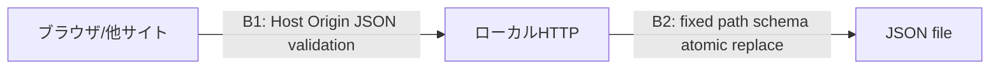

# Security Specification: task-board

## Trust Boundaries

| Boundary | Source | Destination | Assets | Validation | AuthN/AuthZ | REQ | AC |
|---|---|---|---|---|---|---|---|
| B1 | browser/他site | server | タスクと変更操作 | Host完全一致、変更Origin完全一致、JSON厳密型/サイズ | 認証なし・local user、127.0.0.1限定 | REQ-005,010 | AC-005,012 |
| B2 | server | JSON | 確定タスク | 固定パス、version/schema、atomic replace | OS user file permissions | REQ-004,010 | AC-010,013 |

## STRIDE Analysis

| Boundary | Threat | STRIDE | Abuse Case | Mitigation | Verification | REQ | AC |
|---|---|---|---|---|---|---|---|
| B1 | 他siteから変更 | Spoofing/Tampering | CSRFとDNS rebinding | Host=127.0.0.1:実port、変更Origin=http://127.0.0.1:実port必須、JSONのみ、CORS許可なし | TEST-012 | REQ-010 | AC-012 |
| B1 | 入力HTMLを実行 | Elevation of privilege | タイトルscript | textContent、外部scriptなし、CSP self | TEST-012 | REQ-010 | AC-012 |
| B1 | 過大/型不正body | Denial of service/Tampering | 無制限入力 | 8KiB制限、socket timeout、title 1–200、completed厳密boolean | TEST-009,012 | REQ-008,010 | AC-009,012 |
| B2 | ファイル破損 | Tampering | 保存途中の障害 | tmp+flush/fsync+replace、成功後のみメモリ確定、破損を上書きしない | TEST-010,013 | REQ-004 | AC-010,013 |
| B2 | 任意ファイル露出 | Information disclosure | dataや相対pathをGET | 静的asset allowlistのみ、URLで保存先を指定不可 | TEST-012 | REQ-010 | AC-012 |

## Authentication Flow

認証不要が明示選択。login/IdP/token/TTL/MFA/復旧はN/A。HTTPは127.0.0.1だけでOS userを信頼。同じOS userの悪意あるプロセスからの防御・多tenantは対象外。公開時はこの設計を流用せず新しい仕様と承認が必要。

## Authorization

local userは全タスクを操作。serverがHostを全request、Originを変更requestで検証し不一致/欠落を403。GETはOriginなしを許可するがHost必須。OPTIONSにCORSを付与しない。未知IDは404。ドメインlocalhost等の別Hostは意図的に未対応。認証境界ではなく悪意あるWeb Originへの制限と明記する。AC-012。

## Data Classification and Protection

タスク本文は個人のローカルデータ。OSファイル権限で保護、保存JSONは可能なら0600。暗号化なし、HTTPはloopbackのみ。保持は明示削除まで。安全消去・backup消去は保証しない。request本文をlogに記録しない。固定保存先のみ、symbolic linkへの保存を避ける。AC-004,010,012,013。

## OWASP Mapping

| OWASP Risk | Exposure | Control | Verification | Owner |
|---|---|---|---|---|
| Broken Access Control | 他site/任意static path | loopback/Host/Origin/allowlist | TEST-005,012 | implementer |
| Injection | HTML/型不正 | textContent/JSON schema/サイズ検証 | TEST-009,012 | implementer |
| Cryptographic Failures | local平文ファイル | 公開なし、OS権限、暗号化なしを明示 | TEST-006,012 | operator/implementer |

レスポンスにCSP default-src 'self'; object-src 'none'; frame-ancestors 'none'、X-Content-Type-Options nosniff、Cache-Control no-storeを設定。inline scriptは使わない。

## Secrets Management

製品の秘密値なし。credentials/tokenを導入しない。JSON本文・環境の秘密値はソースやreportsへ取り込まない。secret rotation/revocationは対象なし。検証は合成タイトルのみ。

## SBOM and Supply Chain

runtime third-party dependencyはゼロ。Python標準ライブラリ版を記録し、手動依存一覧をREADMEに記載。lockfile/SBOM package scanは外部packageなしでN/A、Python更新はoperator責任。browser harness導入時のみ版・出所・コマンドを記録し、製品コードに混ぜない。外部依存追加はADR/契約を確認してから行う。

## Security Tests

| Test | Boundary | Attack / Control | Expected Result | Evidence | AC |
|---|---|---|---|---|---|
| TEST-012 | B1 | wrong/missing Host/Origin、非JSON、不正bool、8KiB超 | 400/403/413/415、状態不変 | 将来のtestログ | AC-012 |
| TEST-012 | B1 | script文字列タイトル | 文字列表示・script不実行 | browser screenshot/DOM | AC-012 |
| TEST-012 | B2 | 任意URLとdataファイルURL | 404、内容を漏らさない | integrationログ | AC-012 |
| TEST-010,013 | B2 | 書込失敗と破損ファイル | 旧内容維持/起動失敗、上書きなし | 一時dir testログ | AC-010,013 |

secret scanは対象ソースと生成物を検査し本文を外部送信しない。公開service向けrate-limit/監査基盤/暗号設定検証はN/A、local向け容量制限とtimeoutは検証する。

## Open Questions

なし。残存リスクは同OSユーザーによる読取、手動backup、認証なし、電源断耐久性の非保証。設計とREADMEに明示する。
