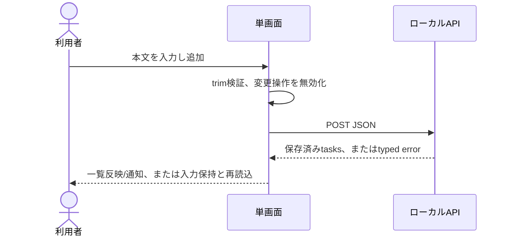

# UX Specification: task-board

## Scope and User Journeys

ローカル単一ユーザーがトップページ / から追加・完了切替・削除を行い再読み込み後も継続する。REQ-001〜004,008,009 / AC-001〜004,008〜011。認証・別画面・公開・編集・期限・検索は対象外。

## Target Views

| View | User | Purpose | Entry | Exit | REQ | AC |
|---|---|---|---|---|---|---|
| タスク一覧 | local user | 全タスク操作 | http://127.0.0.1:3000/ | 同じ画面で状態更新 | REQ-001,002,003,009 | AC-008,011 |

## Component States

| Component | State | Trigger | Visible Feedback | Recovery | REQ | AC |
|---|---|---|---|---|---|---|
| 一覧 | Loading | 初回/再読込 | 「読み込み中…」、操作無効 | 10秒でエラー、再読込 | REQ-004 | AC-010 |
| 一覧 | Empty | 0件 | 「タスクはまだありません」 | 入力＋追加 | REQ-001 | AC-001 |
| 一覧 | Ready | 取得成功 | 本文・完了checkbox・削除button | 通常操作 | REQ-001,002,003 | AC-001,002,003 |
| 全変更操作 | Saving | API変更処理 | 「保存中…」、追加/checkbox/削除無効 | 応答後解除 | REQ-008 | AC-009 |
| フォーム | Invalid | trim後0/201文字以上 | 本文の近くに日本語エラー | 入力修正 | REQ-008 | AC-009 |
| 一覧/フォーム | Error | 通信/保存失敗 | 「保存できませんでした。再読み込みして状態を確認してください」、入力保持 | 再読込ボタン、成功後再操作 | REQ-010 | AC-010 |
| 状態通知 | Success | 保存成功 | 「追加しました」等のlive通知 | 次の操作 | REQ-009 | AC-011 |

## Interaction Sequence



## Wireframe Attachments

None — manual visual refinement skipped
No mockup provided — optional visualization skipped
追加入力による文字仕様を正本とする。見た目は実装後の実ブラウザで検証。

## Navigation Map

```mermaid
flowchart LR
 URL[/] --> List[タスク一覧]
 List --> Save[保存中]
 Save --> List
 Save --> Error[エラーと再読込]
 Error --> List
```

別route/deep linkなし。ブラウザ再読み込みはサーバーから確定データを再取得。戻る操作は通常ブラウザ動作で未送信入力の保持は保証しない。

## Accessibility

WCAG 2.2 AAを目標とする。main、h1、form、明示label、ul/li、button、checkboxを使用。Tab順は入力→追加→各行checkbox→削除→再読込。Enterで追加、Spaceでcheckbox操作。checkbox名に本文を含め、削除も対象本文をaccessible nameに含める。エラーをaria-describedbyで入力に紐付け、通知はrole=status/aria-live=polite。エラーはrole=alert。フォーカスリングを表示。追加成功後は入力、切替後は同じcheckbox、削除後は次行checkbox/前行/入力の順で復帰。本文は折返し。文字コントラスト4.5:1、操作輪郭3:1。アニメーションなし。200% zoomと320pxリフローで内容欠落なし。AC-011 / TEST-011。

## Responsive Behavior

| Breakpoint | Width | Layout | Navigation | Input Method |
|---|---:|---|---|---|
| Small | 320–639px | 1列、フォームを必要に応じ縦積み、本文折返し | 単画面 | touch/keyboard |
| Medium | 640–1023px | 中央配置、フォーム横並び | 単画面 | touch/pointer |
| Large | 1024px+ | 最大幅720px | 単画面 | pointer/keyboard |

操作ターゲット44px目安、横スクロールなし。ソフトキーボード表示時も追加へ到達可能。縦横回転で再配置。AC-011。

## Design Tokens

ds_profile: none

デザインシステム契約は作らない。ローカルCSS値: 背景#ffffff、本文#172033、アクセント#1d4ed8、エラー#b91c1c、余白8/16/24px。白背景上でアクセントと本文のコントラストを検査する。外部font/icon/imageなし。

## Open Questions

なし。追加入力で確定。タスク承認とは別。
