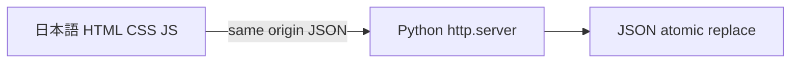

# Implementation Policy: タスクボード
Impl-Review-Status: Passed
Feature Type: fullstack

## Technical Summary
新規のローカル単一ユーザー用タスク管理。以下の既存設計内容は保持し、新規fullstackアプリとしてtemplateの明示項目を補完する。

## Components
| Component | Responsibility (Owns / Does Not Own) | Public Contract & Encapsulated Knowledge | State, Failure & Change Blast Radius | Technology | New/Existing |
|---|---|---|---|---|---|
| server.py | HTTP/CLI、保存内部は所有しない | 下記API、store呼出、静的allowlist | request単位のerror、bind失敗は起動中止 | Python stdlib | New |
| store.py | 検証/lock/atomic保存、HTTPは所有しない | snapshotと明示mutation、JSON配置を隠蔽 | 保存失敗で旧state保持 | Python stdlib | New |
| web/app.js | 表示/fetch/pending、永続化は所有しない | AddForm/TaskList/TaskRow/StatusMessage | draft/error/loading、API失敗をinline表示 | vanilla JS | New |
| web/index.html・styles.css | semantic構造/配置、保存は所有しない | ラベル付き操作とtoken CSS | 単一画面のresponsive外観 | HTML/CSS | New |
| scripts/token generator | token変換、product stateは所有しない | design-system JSON→build/tokens.css | 不正tokenは生成失敗 | Python stdlib | New |

## Layer Specifications
| Layer | Summary | Canonical Detail | Owner | Status |
|---|---|---|---|---|
| UX | 日本語単画面・状態・accessibility | [ux-spec](ux-spec.md) | feature implementer | Review input |
| Frontend | vanilla UIとfetch状態 | [frontend-spec](frontend-spec.md) | feature implementer | Review input |
| Infrastructure | loopback/JSON/local運用 | [infra-spec](infra-spec.md) | feature implementer | Review input |
| Security | input/Origin/static保護 | [security-spec](security-spec.md) | feature implementer | Review input |

## Architecture

server.pyがloopback上で静的allowlistとAPIを提供。store.pyがtaskデータ検証・thread lock・一時ファイル置換を担う。web/app.jsは描画と単一pendingロックを所有。web/index.html、web/styles.cssを分離。外部CDN、framework、DB不要。

## Contracts
Canonical API/data contract: contracts/task-board.md。GET/POST/PATCH/DELETEはすべてJSON。サーバーの保存成功後だけ表示stateを確定する。UUID id、title、completed以外の属性を追加しない。

## Persistence and Failure Handling
起動時にdata/tasks.json未作成なら空リスト。既存破損はエラーとして明示し自動初期化しない。書込中はlock内で全体を更新してatomic replace。失敗時はメモリstateも確定しない。ブラウザfetchは10秒timeout、書込自動retryなし。pendingをfinallyで解除。応答不明なら再読込を促す。

## Security
127.0.0.1のみbind。Host/Origin検証、application/json要求、64KiB body上限、title 1〜500文字、bool厳密検証。ファイルはallowlistのみ配信、textContentによる表示。詳細security-spec。

## Design System Compliance
design-system/ version 0.1.0を使用。新規プロジェクトのためAddForm/TaskRow/StatusMessageを新設。画像の白系面・navy見出し・tealボタン・丸角と余白のみ採用。画像内sidebar/count/filter/hamburgerは生成しない。削除を明示ラベルで提供。

## Test Strategy
stdlib unittestによる一時保存先API/persistence/negative tests、Playwright実Chromiumによるdesktop/mobile操作・保存遅延・失敗・reload。ブラウザ検証用依存はruntime依存にしない。品質gate前に実行証拠をreportsへ保存。レビューおよび承認gateが通るまではアプリ実装しない。

## Decisions
`docs/adr/0001-local-json.md`。単一ローカルプロセスとatomic JSONを選択。SQLite/クラウドはユーザー制約により不要。

## Open Questions
なし。

## Module Responsibilities and Dependency Direction
`server.py` owns CLI startup (`--port`, default 8000; `--data-file`, default project data/tasks.json), HTTP routing and error normalization. Bind address is a constant 127.0.0.1, never a host option. `store.py` has no HTTP/UI imports and owns load/validate/mutate/persist. `web/app.js` owns the single view and fetch adapter; there is no framework or build dependency. Server imports store; store never imports server. Static content is limited to `/`, `/app.js`, `/styles.css`, `/tokens.css` (the last maps to design-system/build/tokens.css); other paths return 404, including data/ and specification files.

## Data Plan
Data Entities: Task {id: UUID string, title: trimmed Unicode string of 1..500 code points, completed: boolean}; store envelope {version: 1, tasks: Task[]}.

Existing Data Affected: None — 新規アプリで既存アプリデータ・table・columnは存在しない。アプリ自身が後に保存したversion=1 JSONは保持し検証する。

Migration Strategy: 初回にfile不在なら空snapshot、最初の保存でversion=1を作成。既存version不正・破損はerrorで保持。移行や自動初期化はしない。

The complete API/data definition is contracts/task-board.md. GET returns a snapshot; POST appends a fresh UUID task with completed=false; PATCH assigns an explicit boolean (never a blind toggle); DELETE removes the selected UUID. These mutations return the complete saved task list. Unknown properties, duplicate object keys, non-object bodies, wrong scalar types, invalid UUIDs and titles outside 1..500 characters after Python str.strip are rejected. Missing/unknown task returns 404 without writing. Title limits are Unicode code points, validated server-side; the browser does not rely on UTF-16 maxlength to establish validity.

## API / Contract Plan
以下がreview対象内の完全なHTTP契約であり、contracts/task-board.mdと同一。base URLは同一origin `http://127.0.0.1:<port>`。Task schemaは `{ "id": "UUID string", "title": "trim済み1..500 Unicode code points", "completed": boolean }`。成功一覧envelopeは `{ "tasks": Task[] }`、error envelopeは `{ "error": "日本語文字列" }`。追加順を保持し、保存完了後だけ成功を返す。

| Method | Path | Request schema | Success status / response schema | REQ / AC |
|---|---|---|---|---|
| GET | `/api/tasks` | bodyなし | 200 `{tasks: Task[]}` | REQ-004 / AC-006 |
| POST | `/api/tasks` | JSON object `{title: string}`、他field不可 | 201 `{tasks: Task[]}`、server生成UUID・completed=falseを追加 | REQ-001/004/005 / AC-002/003/007/008 |
| PATCH | `/api/tasks/{id}` | pathのidはUUID、JSON object `{completed: boolean}`、他field不可 | 200 `{tasks: Task[]}`、指定Taskへ明示代入 | REQ-002/004/005 / AC-004/007/008 |
| DELETE | `/api/tasks/{id}` | pathのidはUUID、bodyなし、UI確認後のみ送信 | 200 `{tasks: Task[]}`、指定Task除去 | REQ-003/004/005 / AC-005/007/008 |

全APIのerror responseはUTF-8 JSON `{error: string}`。400: malformed/duplicate-key JSON、object以外、未知field、型/UUID/title長/空白違反、不正Content-Length/未対応Transfer-Encoding。403: Host/Origin拒否。404: 未知path/id（存在しないTask）。413: body >65536 bytes。415: body付き変更のContent-Typeがapplication/jsonでない。405: 未対応method。500: 保存/読込失敗・破損store。invalid UUID形式は400、形式が正しい未知UUIDは404。API失敗でデータを変更しない。GETにもHost検証と読込失敗errorを適用。静的pathはModule Responsibilitiesのallowlist、`/`成功は200 text/html、JS/CSSは適切なMIMEで返す。静的配信ではTask JSONを公開しない。

Validate Content-Length as a nonnegative integer and bound the body to 65536 bytes before reading. Mutation requests with bodies require application/json (optional charset=utf-8). Reject unsupported transfer encoding and close malformed requests to avoid reusing an ambiguous connection. DELETE has no body. Unknown HTTP methods return 405. Errors use the status/error envelope from the contract; raw exception paths or task text are not exposed. Responses are UTF-8, Content-Length specified, Cache-Control: no-store for API.

## Storage Transaction and Restart Semantics
Initialize an absent store as an in-memory empty snapshot; first successful mutation creates the file. Validate version=1 and every persisted task (unique UUID, normalized nonempty title, boolean completed); malformed existing JSON blocks reads and mutations without overwriting it. Each operation acquires a process-local threading.Lock. Build a candidate copy, serialize it as UTF-8 JSON to a tempfile in the target directory, flush and fsync that file, then os.replace it onto the target. Publish candidate in memory only after replace succeeds. On pre-replace failure keep the previous snapshot/file and remove only the operation's temporary file. A successful replace is the commit point. This guarantees normal process restart persistence; machine power-loss durability and directory fsync guarantees are outside this local MVP. No multiple-process writers are supported.

## Request Trust Checks
Allow only Host authorities localhost:<actual-port> and 127.0.0.1:<actual-port>. Mutation Origin, when present, must exactly match http:// plus an allowed authority; null and external origins fail 403. No permissive CORS responses. Missing Origin remains allowed for local stdlib clients, with Host/JSON checks in force. This is local browser isolation, not authentication against another local process. Static serving uses exact decoded route allowlist, not filesystem traversal or directory listing. Task titles use textContent and no innerHTML interpolation.

## UI State and Reference Mapping
Reference: `specs/task-board/mockups/imagegen-reference.png`, SHA-256 `60049c2b9d49f059afbe50ec43cc0d0802bae75b15b5dde090c4acdaf00127d8`. Use its navy heading hierarchy, teal primary button, white surfaces, rounded outlined rows and generous spacing. No counts, filters or navigation. Use a single ordered task list; completion changes checkbox/strike-through while preserving creation order. Tokens from design-system/design-tokens.json are transformed to CSS variables by a small stdlib generation utility under scripts/, with output under design-system/build/. All visual constants are declared as tokens before use.

Initial loading blocks mutations. On each mutation, synchronously test/set a shared pending flag before any await and disable form submission, checkboxes and delete controls. Keep the rendered task snapshot until success; restore checkbox from that snapshot on failure. A 10-second timeout or malformed response clears pending in finally, retains the draft and advises reload before further action; never auto-resend. Native confirmation for delete uses Japanese 削除/キャンセル semantics (a labeled HTML dialog may be used when browser confirm labels cannot be controlled). Cancel issues no request. Successful add clears and focuses input. Successful deletion focuses the next row, previous row, or input if none remains. Status uses aria-live, failure uses role=alert.

## Verification Strategy and Evidence Matrix
Use fresh temporary directories and synthetic tasks for each test; never copy a completed app/diagnostic fixture. `python3 -m unittest discover -s tests -v` will cover TEST-001/002/005/009/011 with a real ephemeral-port server and controlled storage failures. Assert API status and unchanged disk bytes for negative mutations, HTML literal rendering in the browser, restart recovery, and atomic-write failures before replace. Use invalid request variants including duplicate keys, wrong boolean, oversized body, Host/Origin denial, traversal and unknown id.

Run actual Playwright Chromium at 1440px, 390px and 320px for TEST-001/003/004/006/007/008/010: create, check/reload, uncheck/reload, cancel/confirm deletion/reload, whitespace rejection, keyboard flow and empty/loading/error recovery. Delay a mutation response and count server-bound requests during repeated Enter/click/checkbox/delete attempts; exactly one must be sent. Inject rejected writes/GET failure and verify draft preservation, no automatic retry and restored controls. Record console/page errors. Capture desktop/mobile screenshots with task data and compare against the hash-verified reference using AC-009's selected attributes, never generated counts/copy.

TEST-012 / AC-013 starts the actual server, identifies its PID and port, records `ss -ltnp` (or equivalent OS socket evidence) proving only 127.0.0.1 listens, verifies loopback GET=200, and probes a real local nonloopback IPv4 using a direct socket (no proxy); connection must fail. Record actual addresses and probe outcomes. Without a nonloopback interface leave this acceptance unverified, never substitute Origin rejection for exposure verification.

Save exact commands, exit codes, Python/browser/Playwright versions, API results, screenshots, timing and reference hash under reports/implementation/task-board/ and reports/visual-evidence/. Runtime has no external dependency; Playwright is a verification tool only. Quality-gate owns independent final verification and Done.

## Planned Delivery Boundary
One cohesive implementation task is reasonable for this small vertical slice: HTTP/storage/UI and their acceptance evidence share the same API contract and are not independently usable. Risk proposal: medium, acceptance-first (durable local writes and input/security boundaries). Phase 2 task contract/traceability are generated only after genuine impl-review PASS, followed by task review and parent-provided human approval fixture provenance. No app source or executable tests are created in this design phase.

## Frontend Plan
UI State and Reference Mappingおよびfrontend-spec.mdの通り。server成功envelopeのtasksのみでsnapshot置換し、error envelopeを日本語inline表示。単一pendingで全変更を直列化。routesは `/` のみ、別navigationは作らない。

## Backend Plan
Module Responsibilities、API / Contract Plan、Storage Transactionを実装する。ユニット境界はstore入力検証とcandidate transaction、HTTP統合境界は実serverからdiskまで。外部serviceなし。

## Security Boundaries
| Trust Boundary | Auth/Authz Mechanism | Data Classification | OWASP Concerns |
|---|---|---|---|
| Browser→HTTP | 認証なし、127.0.0.1限定、Host/Origin検証 | 合成local task | cross-site mutation、input injection、body size |
| Server→filesystem | 固定store path・静的allowlist・process権限 | local plaintext JSON | path traversal、破損/部分保存 |
詳細はRequest Trust Checksおよびsecurity-spec.md。認証なしのlocal process防御限界を保持する。

## Deployment / CI Plan
infra-spec.mdのlocalのみ。`python3 server.py`、127.0.0.1:8000（port option可）。stdlib tests→実Chromium→quality gate、publish/cloud/CI deploymentなし。source rollbackはserver停止して保存JSONを保持し検証済sourceへ戻す。

## Constraint Compliance
| Constraint | Design response |
|---|---|
| Python標準library＋HTML/CSS/JS | runtime依存なし、test専用Playwright |
| JSON永続化 | process lockと同一directory atomic replace、破損を保持 |
| 日本語単画面・mobile | UX/front layers、ImageGenの選択視覚要素のみ |
| 保存中重複防止・空白拒否 | 同期pending guard、server str.stripと型検証 |
| local単一user・公開不要 | constant IPv4 loopback、AC-013実socket検証 |

## Assumptions
ユーザー指定の新規アプリ・単一process・単一local user。既存ソースへのintegrationや既存DB移行を仮定しない。原本ImageGen生成は親の成果物で、このrunは実view_image確認済referenceを使用する。

## Cross-Layer Dependencies
UX状態→frontend pending/focus（REQ-001〜005/008、AC-001〜008/011）。security loopback→infra listener（REQ-007、AC-010/013）。JSON契約→store/HTTP/frontend envelope（REQ-001〜005、AC-002〜008/012）。各TESTはVerification Strategyに定義。

## ADR Change Log
ADR-0001 local JSON: Proposed、全layerへlocal/stdlibrary境界を適用、supersedesなし、2026-11-07。canonical ADR pathはDecisions節の宣言を使用。

## Risks
保存応答喪失は再読込で回復し自動再送しない。power lossとmulti-process writersは保証外。nonloopback interface不在ならAC-013未検証として保持。これらは既存仕様の制限でありgate免除ではない。
