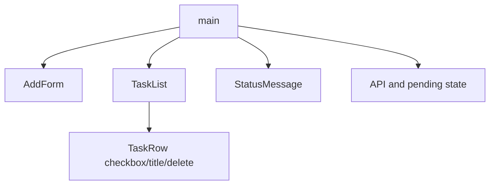

# Frontend Specification: task-board

## Technology Stack
Vanilla HTML5/CSS/JavaScript ES2020、current Chromium。runtime packageなし。Playwrightは実ブラウザ検証用のみ。REQ-006/008、AC-009/011。

## Component Tree

serverは保存、clientは表示と単一pendingの所有者。全体viewがerror boundary、lazy loadingなし。

## State Shape
`{tasks: Array<{id:string,title:string,completed:boolean}>, loading:boolean, pending:boolean, error:string|null, draft:string}`。初期tasks=[]/loading=true。GET成功でready。mutation中pending=true、応答成功時だけtasks置換。draftは追加成功後だけ消去。永続化はserverのみ。REQ-001〜005。

## Routes and Components
`/` は唯一の画面、認証なし。初期GET `/api/tasks`。一覧、フォーム、statusを同じ画面へ表示。AC-001。

## API Client Strategy
same-origin相対URL、手書きfetch、Content-Type application/json、credential不要。10秒AbortController、GETのみ明示reloadで再取得。変更自動retryなし。response schemaを検査、失敗を日本語errorへ正規化。DOM表示はtextContent。pending checkをevent handler冒頭に置き、disabledと併用する（AC-007/008/010）。

## Code Splitting and Size Budget
単画面のため分割不要、ローカル初期HTML+CSS+JSの合計100KiB未満をファイルサイズで確認（画像referenceはruntime配信不要）。

## Performance Budget
ローカル100件で入力・checkbox操作後の再描画は200ms未満をbrowser timingで観測。外部資源なし、固定control geometryでlayout shiftを抑制。ネットワーク性能SLOはローカルテスト範囲外。AC-009実操作に含める。

## Empty, Loading, Error, and Success Behavior
ux-spec Component Statesがcanonical。読み込み/保存は更新disabled。保存失敗時draft保持。GET失敗時空一覧と誤認しない表示をして再読込を案内する。

## Dependencies
runtimeはbrowser built-inのみ。供給網に外部CDN/scriptなし。

## Testing
TEST-001〜011はacceptance-tests.md参照。API/persistenceはstdlib、controls/keyboard/reload/negative/desktop/mobileは実Chromium。画像比較だけで機能PASSにしない。

## Open Questions
なし。
