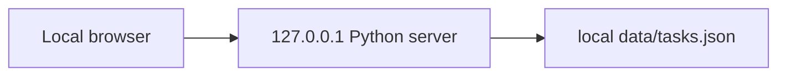

# Infrastructure Specification: task-board

## Deployment Topology

REQ-004/007、AC-006/010/012/013。単一マシン・単一server process。外部依存なし。AC-013 / TEST-012で実processの127.0.0.1限定listenと非loopback addressへのTCP接続不成立を検証する。

## CI/CD Sequence
local hostのためCI/CD・registry・deployはN/A。独立fullレビュー→承認済task→実装→stdlib tests→実Chromium→quality gate。publish/pushはこのrun対象外。

## Environments
localのみ、`python3 server.py`、127.0.0.1:8000、認証なし、合成タスクデータ。port衝突なら明示port optionで起動。staging/productionは対象外。

## Infrastructure as Code
N/A — cloud resource、IaC state、network公開なし。

## Scaling Strategy
単一ユーザー・単一process。ThreadingHTTPServerの書込はstore lockで直列化。64KiB request上限。大規模データ/多process保証なし。

## Service Level Objectives
商用availability SLOなし。local smokeは起動後GET成功、100件で通常操作応答を実測。AC-006/009。操作失敗は日本語errorで可視化。

## Data Residency and Retention
tasks.jsonはlocalディスク、削除まで保持。バックアップサービスなし。必要時server停止して手動copy。削除後JSONから該当idが消えることをAC-005で確認。破損は保持して起動/読込error、silent reset禁止。

## Observability
stderrへHTTP statusとstorage failure種別。title/bodyはlogしない。外部telemetry、traces、alertsはN/A。運用者はlocal起動者。reportsへ検証コマンド/結果を保存。

## Cost Estimate
既存local環境のみ、従量課金資源なし。

## Rollback
失敗時server停止、既存JSON保持、検証済sourceへ戻し再起動。data形式version=1は固定。書込失敗で旧JSON不変、破損で非2xxをAC-012で検証。repo revert自動実行なし。

## Open Questions
なし。
