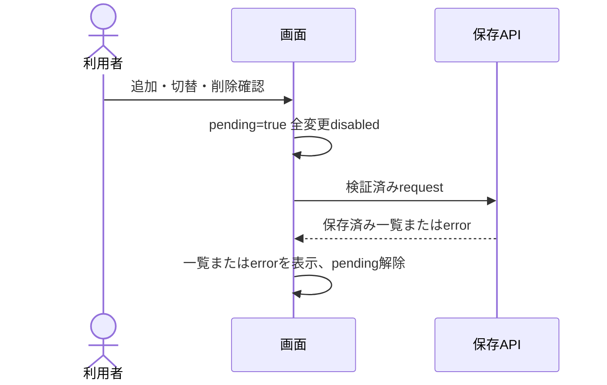
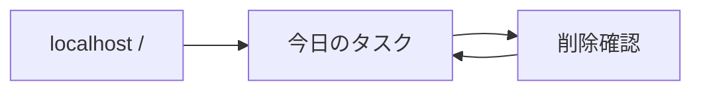

# UX Specification: task-board

## Scope and User Journeys
ローカル利用者が `/` から入力→追加→完了双方向切替→削除。成功はreload後も同じ状態であること（REQ-001〜005、AC-001〜008）。他画面、深いリンク、認証は不要。ブラウザbackは通常ページ動作、未保存入力の保持保証なし。

## Target Views
| View | User | Purpose | Entry | Exit | REQ | AC |
|---|---|---|---|---|---|---|
| タスクボード | local user | タスク操作 | `/` | 同一画面 | REQ-001〜008 | AC-001〜012 |

## Component States
| Component | State | Trigger | Feedback | Recovery | REQ | AC |
|---|---|---|---|---|---|---|
| List | Empty | GET [] | タスクはまだありません | 入力追加 | REQ-008 | AC-011 |
| View | Loading | initial GET | 読み込み中・全更新disabled | 応答/失敗 | REQ-008 | AC-011 |
| View | Saving | mutation | 保存中・全更新disabled | finally解除 | REQ-005 | AC-007 |
| View | Error | network/storage failure | 日本語error、入力保持、再読込案内 | reload | REQ-005 | AC-008 |
| Row | Success | saved update | checkboxと打消線一致 | 再操作 | REQ-002 | AC-004 |

## Interaction Sequence

## Wireframe Attachments
mockups/imagegen-reference.png。ユーザー指定の本セッション親ImageGen生成済成果をview_imageで2026-11-07に確認。装飾参考のみ。

## Navigation Map

## Accessibility
lang=ja、main、h1、form label、ul/li、native checkboxとbutton。Tabで自然順、Spaceで切替、Enterで追加。追加後入力へfocus、削除後隣接行または入力へfocus。取消は起点へfocus。errorはrole=alert、保存statusはaria-live=polite。色のみで完了を伝えない。44px操作領域、可視focus、文字contrast 4.5:1、motionなし。AC-009/011。

## Responsive Behavior
320〜639px: 単列、入力と追加は縦並び、左右16px余白。640px以上: 入力/追加横並び、最大880pxで中央寄せ。行titleは折返し、削除buttonの領域保持。navなし。200%zoomと長文でも横overflowなし（AC-009）。

## Design Tokens
ds_profile: custom
Design-system-version: 0.1.0
design-system/design-tokens.jsonを参照。primary/text/background、spacing、radius、typography、layoutのtokenをCSS変数へ生成。UI方向はユーザー指定に基づくD6 template seed。ui-ux-pro-max unavailable — D6 template interview used（既知の回答で充足）。

## Design-Source
design tools unavailable — manual workflow used
Ds-Upload-Consent-Setting: per-feature (absent default)
Egress outcome: no upload attempted; provider unavailable. No grant record claimed.
Provider/tool: ImageGen (parent session generation, user-attested provenance); local view_image inspection in this session. No new generation invocation in this run.
Brief: Japanese compact single-screen task manager, white/navy/teal, desktop/mobile (original exact parent prompt unavailable).
Artifact: specs/task-board/mockups/imagegen-reference.png
Artifact-SHA-256: 60049c2b9d49f059afbe50ec43cc0d0802bae75b15b5dde090c4acdaf00127d8 (REQ-006 / AC-009と同一baseline)
Actual result: existing PNG successfully inspected and retained. One-way reference; neither DesignSync nor Claude Design synchronization.
Accepted mapping: whitespace, rounded rows, navy hierarchy, teal primary action → tokens and AC-009.
Rejected illustrative elements: counts, sidebar, filters, hamburger, generated English text. Canonical copy remains Japanese and requirements-owned.
Mockup-Status: Reference inspected; no fabricated protected approval.

## Open Questions
なし。元provider prompt原文は本runでは観測できず、実行証拠を捏造しない。
