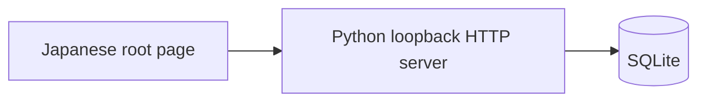

# Design: SQLite Task Board

Impl-Review-Status: Passed
Feature Type: project

## Technical Summary
Proposed local Python standard-library server, SQLite and plain browser assets. This Phase 1 proposal has not passed implementation-policy review; no architecture approval is claimed.

## Architecture

Python 3 standard-library ThreadingHTTPServer, per-request SQLite connections, plain local HTML/CSS/JS. No framework or external runtime dependencies.

ThreadingHTTPServer allows the browser to fetch local assets/read tasks while another connection waits for a bounded request body; a sequential HTTPServer could stall the page behind that connection. This is local convenience, not a multi-user/scaling promise. app.py owns the loopback server and handler, repository.py owns SQLite access, validation.py owns pure input/framing validation, and schema.py owns startup schema initialization. Dependencies are app → validation/repository/schema; repository → sqlite3; schema → sqlite3; no reverse imports. The browser calls HTTP and never opens the database.

Use HTTP/1.0 responses with connection close to avoid idle keep-alive handlers, socket read timeout 5s (short/truncated body returns 400 without mutation), request backlog 8, and a BoundedSemaphore of 8 acquired before starting a handler thread. Refuse excess sockets promptly without reading a body; this resource refusal is not a successful API mutation. Release semaphore in handler cleanup. Each request opens its own SQLite connection with timeout=2s, avoiding cross-thread connection sharing and default sqlite3 thread-affinity violations. Short write transactions serialize through SQLite; UI also serializes its mutations. Busy/locked/disk failures yield 500 storage_error without false success, with rollback/close in finally. No worker or DB connection pool is needed for one local user. Close all per-request connections before response completion; daemon handlers have bounded reads, and Ctrl-C stops acceptance and closes the listening socket. Acknowledged commits remain durable; interrupted unacknowledged requests must not be auto-retried by the client. Browser abort is 10s, above normal bounded server operations. Unit/integration tests verify timeout and resource cleanup; actual restart verifies durability.

## Components
| Component | Responsibility (Owns / Does Not Own) | Public Contract & Encapsulated Knowledge | State, Failure & Change Blast Radius | Technology | New/Existing |
|---|---|---|---|---|---|
| HTTP server | Owns routing/validation/errors, not presentation or SQL details | contracts/task-api.md; framing and status codes | Per-request validation rejects without mutation; routing affects API | Python stdlib | New |
| Task repository | Owns SQL/transactions, not HTTP or transient UI state | Task entity and committed CRUD; schema hidden behind repository | Durable source of truth; rollback on error, close per-request connection | sqlite3 | New |
| TaskForm/List/Row | Owns draft/rendering/feedback, not durable storage | frontend-spec.md and API task representation | Serializes mutations; updates only after acknowledged success, retains draft/list on failure | Plain HTML/CSS/JS | New |

## Layer Specifications
UX: ux-spec.md. Frontend: frontend-spec.md. Infrastructure: infra-spec.md. Security: security-spec.md. Implementer owns all four; status Draft. REQ-001–008 / AC-001–008 map to matching TEST-001–008.

## Design System Compliance
Design-System-Version: 0.1.0. Tokens: color, typography, spacing, radius. Generate local CSS variables from design-system/design-tokens.json under design-system/build/. TaskForm/List/Row are new because this is greenfield. Parent fixture evidence/parent-design-fixture.json grants Phase 1 visual design-system consent ONLY. It does not approve this architecture, implementation policy, tasks or implementation.

## Data Plan
Data Entities: Task (id, title, completed).

Existing Data Affected: None; fresh disposable project, no prior application data.

Migration Strategy: Initial schema is implemented in schema.py::initialize_database(db_path), named initial schema v1, with PRAGMA user_version=1. Subsequent numbered migrations would be migration_vNNN functions in schema.py under separate review; no later migration is implemented in this scope. app.py calls initializer successfully before binding/listening.

For a missing target database, create its parent directory if needed, create a uniquely named temporary SQLite sibling owned by this invocation, and run explicit BEGIN / CREATE TABLE tasks / PRAGMA user_version=1 / COMMIT there. On schema failure roll back, close and remove only that invocation-owned temporary file; the requested DB path remains absent, no backup required. After successful close, publish without overwrite via same-directory exclusive hard-link creation then unlink only the temporary name. If the target appeared concurrently, do not replace it: discard only the owned temporary and validate the existing target. If exclusive publication is unsupported or fails, fail startup safely; never fall back to overwrite. SQLite default DELETE journal mode avoids WAL sidecar publication. No HTTP socket is opened until validation succeeds.

For an existing database, open in read-only URI mode for startup validation of user_version=1 and the expected tasks schema; do not create/alter/drop anything, recreate an empty file, or delete/restore it on error. A schema/version mismatch or corrupt database fails startup with a clear local diagnostic; it needs a separately reviewed migration or operator recovery. For the single-user fresh-app scope, existing matching files then open normally per request. On initial failure without a prior DB, leave target absent; after successful publication normal stop/restart retains the database. Rollback after launch is stopping the app and preserving the file, not destructive schema rollback.

New table tasks(id INTEGER PRIMARY KEY AUTOINCREMENT, title TEXT NOT NULL, completed INTEGER NOT NULL DEFAULT 0 CHECK(completed IN (0,1))). Initial-create startup as above; no existing application data and no automatic upgrade migration. Parameterized SQL and commit before HTTP success. Ascending ID order. Configurable --db, default data/tasks.sqlite3. Each request closes connection; errors roll back.

## API / Contract Plan
The complete normative v1 API is in this admitted section, mirrored by contracts/task-api.md; no external contract read is needed for review. This is a new API: no deprecation, existing clients, breaking change or version migration.

TaskDTO = {id: positive integer, title: trimmed string of 1–200 Unicode codepoints, completed: JSON boolean}. repository.py returns rows; app.py serializer converts SQLite INTEGER completed 0/1 to false/true using bool(row[completed]), never exposes integer completion. Write conversion maps validated JSON false/true to SQL 0/1; reject numeric 0/1 as request booleans. IDs reject bool values and non-positive/nondecimal path IDs. List order is ascending id. No timestamps or hidden DTO fields.

| Method and route | Request | Success JSON | Behavior |
|---|---|---|---|
| GET /api/tasks | No body | 200 {tasks: [TaskDTO]} | Read committed rows, empty array valid |
| POST /api/tasks | {title: string} | 201 {task: TaskDTO} | Trim, validate, insert exactly one unchecked task, commit before response |
| PATCH /api/tasks/{id} | {completed: boolean} | 200 {task: TaskDTO} | Set specified value, commit, return full saved DTO; unknown ID 404 |
| DELETE /api/tasks/{id} | Empty body, Content-Length: 0 | 200 {deleted: id} | Delete one existing row after client confirmation, commit; unknown ID 404 |

All errors are JSON {error: string_code}, without exception/internal details. 400 invalid_json/invalid_input/invalid_framing for malformed UTF-8/JSON, wrong types/fields, invalid IDs or truncated/unsupported framing; 403 forbidden_origin for foreign Host/Origin; 404 not_found for unknown route/task; 405 method_not_allowed for unsupported method; 411 length_required for absent mutation length; 413 body_too_large; 415 unsupported_media_type for non-JSON POST/PATCH or compressed bodies; 500 storage_error for DB failures. Unknown keys are rejected for POST/PATCH. DELETE body must be empty after size/framing checks. Validate Host/Origin and framing before any mutation; declared oversize always gets 413 after valid Host/framing even when JSON has not been read. Every error preserves saved rows. Return application/json; charset=utf-8 and explicit response byte length. GET/static routes are non-mutating. Static allowlist: /, /app.js, /styles.css, /tokens.css; map to local assets only, never serve arbitrary paths or database/reference files.

Host is exactly 127.0.0.1 or localhost with configured port; supplied Origin must equal the request origin, with null/foreign rejected. No CORS.  Require single nonnegative decimal Content-Length without Transfer-Encoding on mutations; missing length is 411, malformed/duplicate length or Transfer-Encoding is 400. Cap raw transmitted UTF-8 JSON bodies at 4096 bytes including syntax/escapes/whitespace, excluding headers; reject larger declarations with 413 before reading or mutation. Exactly-4096-byte valid JSON is supported; truncated bodies/read timeout return 400 without mutation. DELETE uses Content-Length: 0 and no body. Title length counts trimmed Unicode codepoints, not UTF-16 units or UTF-8 bytes; exactly 200 including astral characters succeeds. Startup GET restores state. No automatic mutation retry or localStorage. Japanese confirmation before DELETE.

## Cross-Layer Dependencies
REQ-001/006/007: UX to frontend, TEST-001/006/007. REQ-002–005: frontend to API/storage, TEST-002–005. REQ-008: security to infrastructure, TEST-008.

## ADR Change Log
| ADR | Decision | Status | Layer Impact | Supersedes | Date |
|---|---|---|---|---|---|
| `docs/adr/0001-local-stdlib-sqlite.md` | Local stdlib server and SQLite | Proposed; not architecture approval | All layers | None | 2026-11-07 |

## Test Strategy
Acceptance-first browser scenarios, isolated DB integration negatives, real process restart, desktop/mobile screenshots and independent quality gate remain required in full (TEST-001–008). Test tooling may be separate; runtime remains stdlib. Record unavailable tooling honestly. Unit tests use Python unittest and unittest.mock; names tests/test_<module>.py correspond to application module ownership, not generated tasks.

| Unit module | Scope | Real dependencies / mocks and responsibility |
|---|---|---|
| tests/test_validation.py | validation.py title trim/codepoints, bool/ID types, Host/Origin, length/framing decisions, 4096/4097 boundaries | Pure functions, no DB/network mocks; byte data tests distinguish JSON bytes from Unicode title length |
| tests/test_repository.py | repository.py insert/list/set/delete, ascending IDs, commit/rollback, missing ID and SQL parameters | Real fresh temporary SQLite for successful behavior and injection/transaction assertions; unittest.mock connection failure only for deterministic commit/locked/disk exception cleanup, not substitutes for durability |
| tests/test_app.py | app.py serializer, dispatch/status/DTO envelopes, read bounds and resource cleanup | Synthetic bounded rfile/wfile and fake socket for early 413/no read, truncation/timeout and connection-close checks; mock repository only to prove invalid input never calls mutation and storage errors normalize to 500. Assert bool DTO conversion using real 0/1 rows |
| tests/test_schema.py | schema.py initial-create transaction, exclusive publication and read-only existing-schema validation | Real temp files/SQLite for success, restart reuse and target preservation; mocks only inject create/commit/link failures and target-appeared race. Assert no target file after failed initial creation and byte-identical existing file on rejected schema |

Integration tests use a real loopback process and temporary DB, not mocked repository/framing; verify response bytes/status and persistent rows. Real browser tests still cover keyboard/control interaction, Japanese text, error/retry, actual request headers, astral titles and exact boundary acceptance, desktop/mobile visual evidence and actual stop/start new PIDs. Unit mocks cannot satisfy browser/restart/4096-byte acceptance gates.

## Deployment / CI Plan
Local only: python3 app.py --db PATH --port 8000; Ctrl-C then restart same path. No remote CI host detected or deployment.

## Security Boundaries
| Trust Boundary | Auth/Authz Mechanism | Data Classification | OWASP Concerns |
|---|---|---|---|
| Browser to loopback HTTP | Single local user, no account auth; validate Host/Origin, framing and JSON at mutation entry | Local task text, potentially private | Cross-site writes, input tampering, request exhaustion; reject before mutation |
| Server to SQLite/local files | OS file access and fixed configured DB path; parameterized SQL and explicit static allowlist | Local task text | SQL injection, unintended file disclosure, failed writes; transactions and bounded routes |

Detailed controls: security-spec.md#trust-boundaries. This is a proposed Phase 1 design, not architecture approval.

## Constraint Compliance
| Requirement Constraint | Design Response |
|---|---|
| REQ-001–004 | Japanese root page with validated add, checkbox toggle and confirmed deletion |
| REQ-005 | SQLite commit before acknowledgment; actual process restart verification |
| REQ-006–007 | Local custom visual tokens, responsive/accessibility/error-state browser checks |
| REQ-008 | Stdlib/local assets, loopback boundary and explicit byte/codepoint validation |

## Assumptions
One local user, Python 3 and writable local disk. No existing application data, deployment, auth, cloud or sharing.

## Risks
Loopback is not account authentication. Validate Host/Origin, body/types, fixed static paths, SQL parameters, text rendering. Disk failures require negative/restart tests. See security-spec.md.

## Open Questions
No product questions. Parent fixture grants Phase 1 visual design-system consent ONLY. Spec-Review is Passed on genuine specification round 3 evidence; Impl-Review remains Pending; task review/approval is pending and no task contracts or implementation exist. Independent specification, implementation-policy and task reviews and task approval remain required before implementation.
