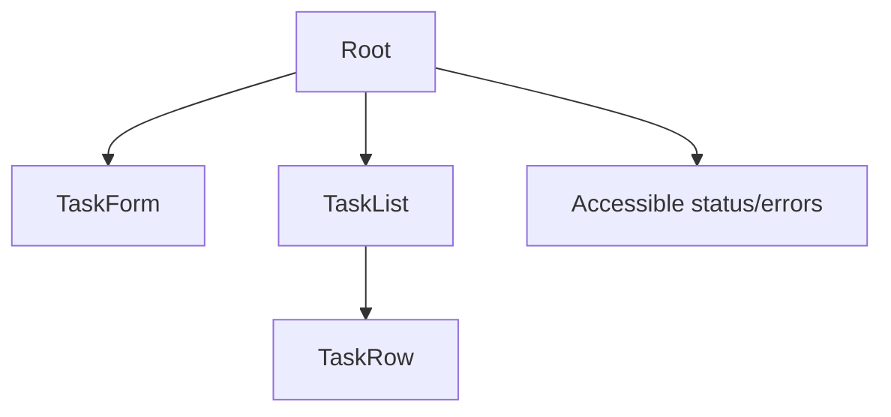

# Frontend Specification: SQLite Task Board

## Technology Stack
Plain local HTML/CSS/JS and native browser APIs. No framework/CDN/fonts or runtime dependencies. Browser test tooling separate from shipped app (REQ-008).

## Component Tree

## State Shape
tasks array of {id: integer,title: string,completed: boolean}; draft string; loading/ready/error status; pending boolean; error nullable string. Server owns saved rows, client owns transient draft/status. No localStorage. Successful requests update list, failed writes retain prior list/draft.

## Routes and API Client Strategy
`/` only, same-origin relative fetch per contracts/task-api.md. AbortController 10s timeout; check status, normalize errors to Japanese, no automatic mutation retries. Pending disables writes. Render titles with textContent. Japanese native delete confirmation. Count trimmed titles by Unicode codepoints (for example Array.from(title).length), not UTF-16 string.length or native maxlength. Allow exactly 200 including astral characters without truncation. Browser owns Content-Length framing; serialize POST/PATCH as UTF-8 JSON, avoid streamed/chunked bodies, and send zero-byte DELETE body producing Content-Length: 0. Do not manually set forbidden Content-Length in JS. Server independently enforces the 4096 raw-byte cap and framing. TEST-008 must observe actual browser headers; no silent framing exemption.

## Admitted API and DTO Contract
The complete normative v1 API is in this admitted section, mirrored by contracts/task-api.md; no external contract read is needed for review. This is a new API: no deprecation, existing clients, breaking change or version migration.

TaskDTO = {id: positive integer, title: trimmed string of 1–200 Unicode codepoints, completed: JSON boolean}. repository.py returns rows; app.py serializer converts SQLite INTEGER completed 0/1 to false/true using bool(row[completed]), never exposes integer completion. Write conversion maps validated JSON false/true to SQL 0/1; reject numeric 0/1 as request booleans. IDs reject bool values and non-positive/nondecimal path IDs. List order is ascending id. No timestamps or hidden DTO fields.

| Method and route | Request | Success JSON | Behavior |
|---|---|---|---|
| GET /api/tasks | No body | 200 {tasks: [TaskDTO]} | Read committed rows, empty array valid |
| POST /api/tasks | {title: string} | 201 {task: TaskDTO} | Trim, validate, insert exactly one unchecked task, commit before response |
| PATCH /api/tasks/{id} | {completed: boolean} | 200 {task: TaskDTO} | Set specified value, commit, return full saved DTO; unknown ID 404 |
| DELETE /api/tasks/{id} | Empty body, Content-Length: 0 | 200 {deleted: id} | Delete one existing row after client confirmation, commit; unknown ID 404 |

All errors are JSON {error: string_code}, without exception/internal details. 400 invalid_json/invalid_input/invalid_framing for malformed UTF-8/JSON, wrong types/fields, invalid IDs or truncated/unsupported framing; 403 forbidden_origin for foreign Host/Origin; 404 not_found for unknown route/task; 405 method_not_allowed for unsupported method; 411 length_required for absent mutation length; 413 body_too_large; 415 unsupported_media_type for non-JSON POST/PATCH or compressed bodies; 500 storage_error for DB failures. Unknown keys are rejected for POST/PATCH. DELETE body must be empty after size/framing checks. Validate Host/Origin and framing before any mutation; declared oversize always gets 413 after valid Host/framing even when JSON has not been read. Every error preserves saved rows. Return application/json; charset=utf-8 and explicit response byte length. GET/static routes are non-mutating. Static allowlist: /, /app.js, /styles.css, /tokens.css; map to local assets only, never serve arbitrary paths or database/reference files.

Host is exactly 127.0.0.1 or localhost with configured port; supplied Origin must equal the request origin, with null/foreign rejected. No CORS.  Require single nonnegative decimal Content-Length without Transfer-Encoding on mutations; missing length is 411, malformed/duplicate length or Transfer-Encoding is 400. Cap raw transmitted UTF-8 JSON bodies at 4096 bytes including syntax/escapes/whitespace, excluding headers; reject larger declarations with 413 before reading or mutation. Exactly-4096-byte valid JSON is supported; truncated bodies/read timeout return 400 without mutation. DELETE uses Content-Length: 0 and no body. Title length counts trimmed Unicode codepoints, not UTF-16 units or UTF-8 bytes; exactly 200 including astral characters succeeds. Startup GET restores state. No automatic mutation retry or localStorage. Japanese confirmation before DELETE.

The client consumes GET.tasks as its full saved list. POST.task inserts the returned full DTO, PATCH.task replaces the matching row, and DELETE.deleted removes that id only after acknowledgment. Validate response DTO types; a malformed success is a protocol error, not an optimistic success. A 400 title validation error is associated with the input; other 4xx/500/timeouts use Japanese inline error feedback. Preserve draft and last saved list, restore controls, and allow explicit retry without automatic mutation replay. Server-generated completed must be a JSON boolean; the frontend does not reinterpret numeric completion.

## Code Splitting and Performance Budget
One eager page, no chunks; total local runtime assets under 100KiB uncompressed, excluding non-served reference. Local 100-row list usable within 2s and normal actions settle within 1s; measure browser observations, no hosted SLO claim.

## Empty, Loading, Error, and Success Behavior
Use ux-spec.md states and focus rules (AC-007). Read retry reloads authoritative rows. An empty successful read is distinct from loading/error.

## Dependencies and Testing
No shipped dependencies beyond browser/Python stdlib. Record actual test browser/tool versions. TEST-001–007 real browser CRUD, failures, keyboard, screenshots and process restart. TEST-008 verifies text rendering and local assets.

## Open Questions
No product questions. evidence/parent-design-fixture.json grants Phase 1 visual design-system consent ONLY. Architecture/implementation-policy review remains Pending; task contracts remain unapproved and no implementation exists. All independent gates remain required.
