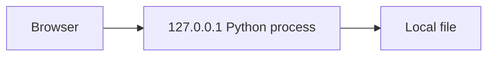

# Infrastructure Specification: SQLite Task Board

## Deployment Topology

One local machine/user. No staging, production, cloud, deployment, registry or remote services (REQ-008 / AC-008).

## CI/CD Sequence and Environments
Local compile/integration checks → real browser CRUD → stop/start persistence → desktop/mobile screenshots → quality gate. Local host only; no CI templates. Start python3 app.py --db data/tasks.sqlite3 --port 8000. Test with fresh temporary DB/free loopback port.

## Infrastructure as Code and Scaling
N/A provisioned infrastructure. One local user; ThreadingHTTPServer uses bounded 8-handler admission/backlog 8, HTTP/1.0 connection-close, socket reads bounded at 5s, per-request SQLite connection with 2s busy timeout and finally-close. Short transactions serialize SQLite writes; return 500 storage_error on lock/disk failure without false acknowledgment. See design.md Architecture for rationale and lifecycle. No horizontal scaling.

## Service Level Objectives
No hosted availability target. Local 100-task fixture usable within 2s, normal mutations within 1s; AC-005 requires actual process restart and acknowledged-state durability.

## Data Residency and Retention
Tasks remain in selected local file until logical deletion. No automatic backups or secure-erasure claim. Restart same DB path. Disposable fixtures only.

## Observability and Cost
Local stderr statuses/errors without bodies; no analytics, remote logs, traces or alerts. Local user operates process. Local disk/compute only, no service charges.

## Rollback
Startup calls schema.py::initialize_database before binding a socket. Initial schema v1 uses explicit transaction in a new invocation-owned temporary sibling file, validates successful creation and publishes exclusively without replacing any existing target. Initial creation failure rolls back, closes and removes only the owned temporary file; when no prior DB exists the requested target remains absent and no backup is required. Concurrent target appearance or unsupported exclusive publication fails safely or validates the existing target, never overwrites it. Existing database startup validation is read-only; mismatched/corrupt schema fails without create/alter/drop/delete. Future migration_vNNN functions require separate review.

Stop process for application rollback and preserve the database; no destructive schema recovery or automatic backup restoration is assumed. Never delete/recreate an existing DB on restart. After successful initialization, restart same path and smoke-check root/saved tasks; actual browser restart acceptance remains mandatory.

## Open Questions
None.
