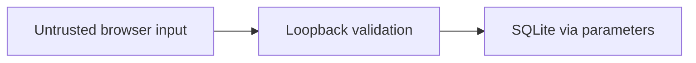

# Security Specification: SQLite Task Board

## Trust Boundaries

B1 browser→HTTP: validate Host/Origin and JSON content type for POST/PATCH; require one nonnegative decimal Content-Length and no Transfer-Encoding for mutations. Maximum body is 4096 raw transmitted UTF-8 JSON bytes including syntax/escapes/whitespace, excluding headers; reject larger declarations with 413 before reading or mutation. Missing length: 411; malformed/duplicate length or Transfer-Encoding: 400. Truncation/read timeout: 400 without mutation. Empty DELETE uses Content-Length: 0. Count trimmed title length in Unicode codepoints, including astral characters once, separately from body bytes; validate positive integer ID and boolean completion. B2 server→SQLite/files: configured DB path, parameterized SQL, fixed static allowlist. REQ-008 / AC-008.

## STRIDE Analysis
| Boundary | Threat | STRIDE | Mitigation | Verification |
|---|---|---|---|---|
| B1 | Foreign webpage writes | Spoofing/Tampering | Loopback Host, same-origin JSON writes, reject null/foreign Origin | TEST-008 |
| B1 | Malformed/oversized request | DoS/Tampering | Body/read bounds and typed validation | TEST-008 |
| B2 | SQL-like title alters schema | Tampering | Parameterized fixed statements | TEST-008 |
| B2 | Traversal exposes DB/files | Disclosure | Explicit static allowlist, no directory serving | TEST-008 |

## Authentication and Authorization
No accounts/credentials per scope. One local user may mutate all tasks; OS and loopback are boundary, not account security. Reject foreign Host/Origin before writes, unsupported routes/methods and unknown IDs. No tenant separation or network operation.

## Data Classification and Protection
Local task text may be private. No remote transfer or telemetry; no app encryption at rest. OS permissions apply, retain until logical deletion. No body logging, secure erasure or compliance claim.

## OWASP Mapping
Injection: SQL parameters and textContent. Access control/CSRF: loopback Host/Origin and JSON validation. Cryptography: no credentials/TLS required for local disposable app. Verify via TEST-008.

## Secrets Management and Supply Chain
No application secrets/keys. Python stdlib and browser APIs only; no shipped packages/CDN/lockfile. Record Python/SQLite/browser versions and separate test tooling. Keep real personal data out of fixtures.

## Security Tests
TEST-008 accepts padded valid JSON at exactly 4096 raw UTF-8 bytes, rejects 4097 with 413 and rejects an oversized declaration before sender transmits the body. Missing/invalid/duplicate length, Transfer-Encoding and truncated bodies fail with specified statuses and unchanged rows. Reject malformed JSON, wrong types (including boolean IDs), blank/long title, foreign Host/Origin, traversal and unsupported routes without mutation. TEST-002 accepts 200-codepoint titles including astral characters and rejects 201 independently of request bytes. HTML/SQL-like text stays literal and schema intact. TEST-007 forced storage failure never claims success; TEST-005 proves restart persistence.

## Open Questions
None.
