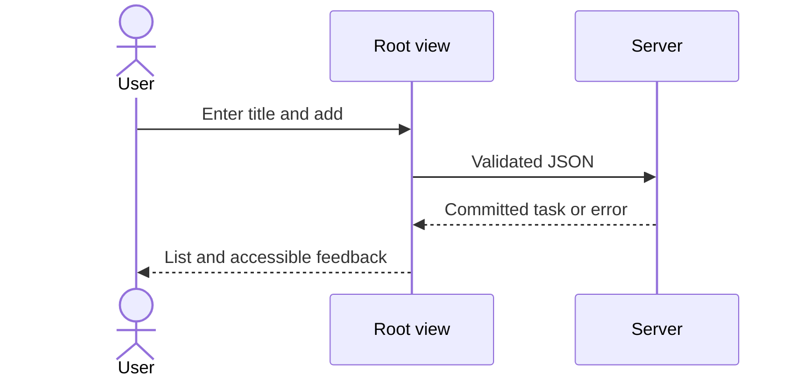
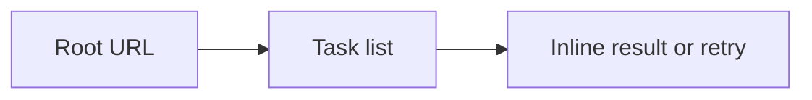

# UX Specification: SQLite Task Board

## Scope and User Journeys
One user opens root, adds, toggles and deletes tasks (REQ-001–007 / AC-001–007). One view, no navigation shell.

## Target Views and States
Root: 今日のタスク, labelled タスクのタイトル input, 追加, task rows with named checkbox and 削除. Empty: タスクはまだありません. Loading: 読み込み中…. Read error: 読み込めませんでした with 再読み込み. Write error: 保存できませんでした。もう一度お試しください。 Success announced in polite live region; errors use alert. Keep draft/list on failed writes. Disable writes while pending, 10s timeout restores controls.

## Interaction Sequence

Japanese browser confirmation before deletion; cancel sends no request.

## Navigation Map

Reload restores saved rows. Unsent title is transient. No deep links.

## Accessibility
lang=ja, main/h1, label, native inputs/buttons; keyboard order input/Add then row checkbox/delete. Visible focus and text contrast 4.5:1, control contrast 3:1. 44px action targets. Focus input after add; next surviving row/input after delete. Long titles wrap; 200% zoom and keyboard checked by TEST-007. No animation.

## Responsive Behavior
Below 640px stack input/Add and use padded full-width rows; above 640px inline form and bounded centered page. Verify 375×812 and 1280×900 screenshots, no horizontal overflow (AC-006).

## Design Tokens
ds_profile: custom
Design-System-Version: 0.1.0
White background, blue primary, dark text, local Japanese sans fallback, 16px base and 4/8/16/24/40px spacing. Canonical machine values: ../../design-system/design-tokens.json.

## Design-Source and Wireframe Attachments
mockups/imagegen-reference.png: actual supplied parent-generated ImageGen reference, visually inspected in this session. Original /workspace/generated_images/exec-d01a9bc2-1fe7-4412-9fec-affd29529e66.png. No new ImageGen or Claude connector call claimed. Accept spacious rows and responsive stacking; use requested blue/Japanese and omit unrequested sidebar, counts and filters.

design tools unavailable — manual workflow used
ui-ux-pro-max unavailable — D6 template interview used
Ds-Upload-Consent-Setting: per-feature (default); no upload or consent claim. Local supplied reference only. Phase 1 visual design-system consent ONLY: parent disposable-test fixture, evidence/parent-design-fixture.json. This grants no architecture, implementation-policy or task approval. No new provider call claimed.

## Open Questions
Product: none. Parent fixture covers Phase 1 visual design-system consent ONLY. Impl-Review remains Pending; tasks are unapproved/not generated; no implementation exists. Independent review and task approval gates remain required.
