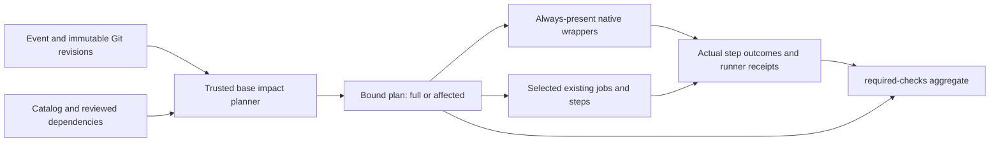
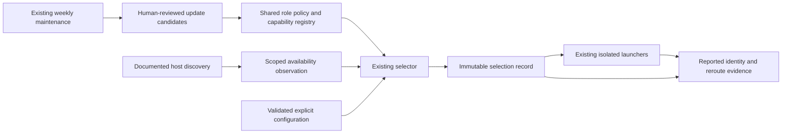

# Design: CI efficiency and current model selection

Impl-Review-Status: Passed
Feature Type: repository CI and runtime model policy

## Technical Summary

### CI workstream

Extend the existing catalog, impact planner and bounded workflow interpreter. Preserve the current direct test commands and native matrix; add explicit selection conditions, a revision-bound plan and an aggregate that checks actual GitHub job/step results plus existing runner receipts. Unknown selection inputs restore full execution. Missing execution proof fails aggregation.

The caller-facing shape is a new explicit planning mode in `tests/verification-impact.py`, leaving the current default shadow interface unchanged. The workflow checks out exact trusted-base and tested trees separately, passes immutable event/revision fields through environment or argument arrays, saves one canonical plan and exposes bounded booleans for conditions. Tests run with their existing shell/argument semantics. `required-checks` consumes the same plan and actual Actions observations after all selected jobs finish.

### Model workstream

Keep one role/capability decision engine: extend the existing Bash/PowerShell selector with an explicit policy-aware input mode. Use a small standard-library host observation/launch-binding helper for discovery and identity normalization. A versioned policy contract references existing registry IDs and defines reviewed current-family preferences and native ID mappings; it does not duplicate risk, tier or effort facts.

Desired caller: resolve(role, risk, host, explicit overrides, live observation) → immutable selection; pass its exact native model/effort to the existing authorized launcher; collect actual host identity and reroute information; bind the result to the same selection/run. Ordinary managed workflows request latest-compatible. Legacy selector inputs retain their existing semantics when no policy-aware input is supplied; updated managed callers do not silently choose the legacy mode.

## Architecture

### CI workstream

Keep GitHub and source-review as the existing trust boundaries. A PR-controlled workflow can itself be modified by that PR; this design relies on the repository's current workflow review protections and does not claim an independent enforced required-workflow service.

### Model workstream

The product controls managed entry points. It cannot change the parent ChatGPT session model or enforce its policy on arbitrary direct host invocations. Model access remains controlled by the provider and organization.

## Components

### CI workstream

| Component | Responsibility (Owns / Does Not Own) | Public Contract & Encapsulated Knowledge | State, Failure & Change Blast Radius | Technology | New/Existing |
|---|---|---|---|---|---|
| verification catalog | Suite identity, dependencies and selection categories; not run outcomes | Optional versioned impact section; exact suite and group references | Invalid references or unproven categories cannot enable selection | JSON | Existing |
| impact planner | Git diff, dependency closure and full fallback; not test execution | Explicit plan mode; legacy shadow remains unchanged | Invalid selective inputs produce full with reason; inability to bind execution is reported | Python stdlib | Existing |
| workflow interpreter | Admit exact command/OS/matrix/condition obligations; not execute arbitrary shell | Existing coverage API plus bounded plan condition context | Unknown expressions are rejected, never treated as enabled | Python + installed js-yaml | Existing |
| common runner and shard runner | Execute catalog suites and preserve exit status/receipts | Existing CLI and receipt semantics, explicit plan selection where needed | No omitted suite is written as passed | Python/Bash | Existing |
| workflow planner job | Obtain trusted base, event data and bound plan | Artifact and fixed validated output keys | Missing trusted planner in adoption PR forces full | GitHub Actions | New job in existing workflow |
| aggregate verifier | Match expected actual executions and receipts | CLI accepting plan and same-run Actions metadata | Missing/ambiguous/failed selected execution fails | Python stdlib | Small new verifier |
| cache setup | Retrieve identical dependency bytes | OS/runtime/lock/digest cache identity | Miss reacquires; failed integrity never reaches execution | Existing setup actions and SHA-pinned cache action | Existing integration |

### Model workstream

| Component | Responsibility (Owns / Does Not Own) | Public Contract & Encapsulated Knowledge | State, Failure & Change Blast Radius | Technology | New/Existing |
|---|---|---|---|---|---|
| Capability registry | Tier, effort, risk and existing role floors | Preserve v1/v2 contracts and historical IDs | Unknown capabilities never become eligible by name | JSON | Existing |
| Model policy | Role preferences, lifecycle, successor relationships and exact host IDs; no duplicate tier algorithm | Versioned model-policy/v1 referencing registry IDs | Invalid/unknown references stop policy selection | JSON | Small new contract |
| Selector | Intersect policy, availability, role/risk and explicit settings | Existing CLI plus policy observation/config arguments | Legacy inputs preserved; policy errors typed | Bash/Python and PowerShell | Existing |
| Host helper | Discovery normalization, binding and actual response validation; no second selector | Versioned observation/selection/delivery schemas | Incomplete discovery or required proof blocks; no fabricated prices | Python standard library | Small new helper |
| Managed launch/render/install paths | Pass exact selection, respect native precedence and protected-file procedure | Existing entry points plus immutable selection path/hash | No input/identity/read-only/consent bypass | Existing host transports | Existing |
| Freshness workflow | Fetch candidate/deprecation metadata and retain existing deduplicated notifications | Existing weekly/manual surface | Fetch failures visible; no automatic adoption | Existing scripts/workflow | Existing |

## Layer Specifications

### CI workstream

| Layer | Summary | Canonical Detail | Owner | Status |
|---|---|---|---|---|
| UX | Plans, omission reasons and full recovery | [UX specification](ux-spec.md#scope-and-user-journeys) | Maintainer | Proposed |
| Frontend | N/A — no change: no UI application | [Frontend specification](frontend-spec.md#technology-stack) | Maintainer | N/A |
| Infrastructure | Trusted planning, jobs, caches and evidence | [Infrastructure specification](infra-spec.md#deployment-topology) | Maintainer | Proposed |
| Security | PR input, dependency cache and receipt trust | [Security specification](security-spec.md#trust-boundaries) | Maintainer | Proposed |

### Model workstream

| Layer | Summary | Canonical Detail | Owner | Status |
|---|---|---|---|---|
| UX | Selection reasons, explicit pinning and limitations | [UX](ux-spec.md#scope-and-user-journeys) | Maintainer | Proposed |
| Frontend | N/A — no graphical application | [Frontend](frontend-spec.md#technology-stack) | Maintainer | N/A |
| Infrastructure | Host transports and maintenance | [Infrastructure](infra-spec.md#deployment-topology) | Maintainer | Proposed |
| Security | Configuration, identity, consent and isolation | [Security](security-spec.md#trust-boundaries) | Maintainer | Proposed |

## Design System Compliance

### CI workstream

N/A — ds_profile: none

### Model workstream

N/A — ds_profile: none

## Cross-Layer Dependencies

### CI workstream

| From | To | Contract / Decision | REQ | AC | Verification |
|---|---|---|---|---|---|
| requirements.md | infra-spec.md | Complete diff and conservative selection | REQ-001–003 | AC-001–003 | TEST-001–015 |
| ux-spec.md | infra-spec.md | Stable contexts and actual execution summary | REQ-004–006 | AC-004–006 | TEST-016–027 |
| security-spec.md | infra-spec.md | Dependency cache and event trust | REQ-007–008 | AC-007–008 | TEST-028–033 |
| requirements.md | ux-spec.md | Measured rollout, documentation and immutable tag | REQ-009, REQ-010 | AC-009, AC-010 | TEST-034–TEST-038 |

### Model workstream

| From | To | Contract / Decision | REQ | AC | Verification |
|---|---|---|---|---|---|
| Policy | Host/selector | Only verified available compatible candidates | REQ-011–REQ-014 | AC-011–AC-014 | Linked acceptance branches |
| Launcher | Evidence | Frozen selection and honest identity scope | REQ-015/REQ-016/REQ-018 | AC-015/AC-016/AC-018 | Including TEST-131–TEST-137 |
| Maintenance | Adoption | Reviewed updates and controlled comparison | REQ-017/REQ-019 | AC-017/AC-019 | Fixed evaluation artifacts |
| Documentation | Delivery | Supported managed boundaries and immutable release | REQ-020 | AC-020 | Actual final validation |

## ADR Change Log

`docs/adr/0037-conservative-ci-selection.md`

`docs/adr/0038-current-model-role-policy.md`

- [0037-conservative-ci-selection.md](../../docs/adr/0037-conservative-ci-selection.md)
- [0038-current-model-role-policy.md](../../docs/adr/0038-current-model-role-policy.md)

### CI workstream

ADR 0037 records reuse of the catalog and direct-step evidence instead of a new CI engine. Its namespace was checked at creation; recheck the shared index and file before design review and implementation.

### Model workstream

ADR 0038 records extending the existing selector with versioned runtime policy and discovery. Its namespace was checked at creation; recheck the shared index and file before design review and implementation. Do not introduce an independent router or a new scheduler.

## Data Plan

### CI workstream

Data Entities: catalog selection declarations; revision-bound CI plan; actual Actions job/step observations; existing verification receipts; category comparison records.

Existing Data Affected: current catalog gains versioned selection metadata; v1 shadow output and historical receipts remain readable and unchanged. Existing recorded suite timing weights remain measurements, not invented values.

Migration Strategy: initial rollout defaults to full. An old base without the new trusted planner cannot enable affected mode. Active categories require committed comparison evidence for their current rule and dependency hashes. A rule change invalidates activation until revalidated. Activation identity hashes the rule/dependency-definition and suite/group command projection with activation-proof pointers/digests excluded, avoiding a self-reference. It does not require unchanged contents of every classified PR product file. The proof binds its actual baseline full run and consumer/mutation evidence; each runtime plan separately binds the exact current catalog/workflow bytes. Changes to rule definitions, suite arguments or grouped execution topology invalidate the corresponding activation proof. Prior release tags and frozen reports are never rewritten.

No persistent service/database is introduced. Artifacts belong to the run and follow existing retention. A plan carries a digest excluding its own digest field; consumers recompute it and compare expected run/revision metadata. A digest proves consistency, not independent authorization against a malicious same-PR workflow.

### Model workstream

Data Entities: policy/catalog, scoped availability observation, immutable per-run selection, model delivery proof, adoption evaluation record and maintenance candidate report.

Existing Data Affected: additive policy references and optional current evidence links. Preserve frozen historical reports, v1/v2 candidate inputs and existing effort vocabulary. Generated current files may change; frozen human-copy manifests require the established sanctioned current addendum/update procedure.

Migration Strategy: update all managed callers coherently to policy-aware mode. Preserve old explicit selector callers. Mark historical retained models as ineligible for latest-compatible rather than deleting them. New candidates enter discovery/maintenance output before adoption evaluation makes them eligible. Unsupported native hosts remain explicitly unverified; do not advertise fixture-only coverage as native support.

## API / Contract Plan

### CI workstream

### Plan

Add a strict versioned `verification-ci-plan/v1` contract with event and run identity, mode (`full` or `affected`), reason codes, base/head/merge-base/tested commit, trusted planner and catalog digests, tested workflow digest, complete changed-path count, selected suite/group/OS obligations, omissions with reasons and activation evidence references. Fixed condition outputs are derived from this plan, never independently authored. Reject unknown enum values, duplicate keys/IDs, absolute/traversal references and inconsistent selected/omitted sets.

On PRs validate the actual merge-tested commit against exact PR/base identities and compare changes from the verified merge base to head. Use `git diff --no-renames --name-status -z` or an equally complete NUL-safe form so a rename contributes deletion and addition paths. Include merge conflict resolution changes affecting the tested tree; inconsistent or unexpected topology takes full. For a head checkout without a merge commit, identify it explicitly and do not claim merge-tested evidence. Non-PR execution binds its exact tested revision and selects full. Never concatenate user-controlled path text into shell code.

The plan interface uses explicit argument names for event, base, head, tested revision and force-full. Defaults cannot activate selective execution. The workflow reads the repository variable SDD_CI_FORCE_FULL: exact lowercase false permits otherwise-proven PR selection; missing, true or any other value forces full. Manual runs remain full regardless of this value. This single conservative operator switch wins over category activation.

### Dependency declarations

Keep classification metadata in the existing catalog. Categories have exact paths or bounded prefixes, required suites/groups, dependencies and activation evidence. Shared/protected/unknown classes have full precedence over selective categories. Multiple categories form a union. Fixtures and generated inputs reference consumers explicitly. Select all suites co-located in an indivisible direct step when any is required; iterate dependency/step closure to a fixed point. Unrecognized workflow command bodies remain unconditional or force full; do not infer partial execution from them.

Known documentation paths are individually justified with caller searches; `docs/**`, `specs/**`, `reports/**`, and `*.md` are not global light-change classes. README is a public contract and has install/release/guard consumers; retain these consumers until actual comparison supports narrower execution. New/changed suites run themselves and their relevant consumer groups. Missing categories or new dependencies force full.

### Execution evidence

Preserve direct `run` bodies, shells, environment and assertion behavior, adding only reviewed conditions and stable unambiguous step names. The aggregate reads paginated actual Actions job/step results for the current run and exact head, matches the structurally validated workflow's expanded matrix identities and step names, and requires selected steps and jobs to succeed. It does not infer suites from job success alone: the admitted exact command/OS/matrix establishes which obligation the actual successful step executed. MCP typecheck/build/tests/audit and generated-projection checks have explicit non-suite obligations.

Require existing runner-generated receipts for selected runner steps, with matching revision/catalog/source hashes and actual selected results. Upload/download artifacts by run/attempt/job identity; absent artifacts fail. When only failed jobs are rerun, use the latest observation for each unique job instance in the same run/head, preserve its source attempt and bind each receipt to that execution. Never combine different commits or ambiguous duplicate job names. The plan records planning_attempt separately from each execution observation/source attempt. A failed-jobs-only rerun may reuse its same-run/head original plan; it must not relabel inherited results or receipts as newly executed. Artifact names bind run ID, source attempt and deterministic expanded job identity, and collection resolves each to the actual API job. A changed plan/revision requires fresh execution rather than combining receipts from incompatible attempts. Unexpected missing, skipped, cancelled, timed-out or failed selected work fails. Planned omissions have NOT_SELECTED outcomes and no fabricated receipt.

GitHub API `head_sha` on a pull_request run is the PR head identity, while the checkout may execute the synthetic merge commit. Record and validate these as separate fields: `api_head_sha` matches the run/job API and PR head; `tested_revision` matches checkout Git HEAD and actual runner receipts. Do not require them to be equal for a merge checkout. Bind the verified merge parents to the exact base/head and detect stale PR updates. This distinction was observed in PR592/run39122240433 (current API head ee976dee2dd1f9a8aed394af6df4e963b3d42027); capture the checkout proof before treating the merge SHA as observed.

The three required native jobs always execute cheap integrity checks. Optional jobs can use exact plan conditions. `required-checks` runs with `always()` and explicit needs for planner and all execution groups, validates the plan even after dependency failure, and fails if planner/evidence collection fails. Preserve the independent A9 active-success/inactive-skipped rule rather than treating advisory activation as a performance category.

### Coverage interpreter

Extend `enabled`/coverage handling only for the exact generated planner condition syntax, combined with current runner/matrix comparisons. Test both full and affected plans. Continue rejecting arbitrary expressions and continue-on-error execution as proof. Full mode must reproduce the current inventory; affected mode must prove each selected suite/OS obligation and retain complete fallback partition membership among selected suites. Update tests that intentionally lock old unconditional syntax to assert the stronger full/affected behavior, not delete their coverage requirement.

### Model workstream

Policy uses exact registry IDs with host-specific native IDs, source URL/date, lifecycle, verified role adoption evidence and explicit successor/preference references. Different families are ranked by reviewed role preference, not lexical ID, list order or timestamp. A newly discovered unverified successor is reported as an update candidate; a still-current verified catalog candidate may run with an explicit latest-verified label and warning. A catalog-marked retired/historical candidate cannot silently fill that gap; it requires an eligible explicit pinned selection or the run stops. Validate duplicate IDs, unresolved references, cycles and host mappings. Native ID mapping is explicit because current registry IDs mix provider-qualified names and native bare IDs (contracts/agent-model-capabilities.v2.json); stripping a prefix heuristically is not valid.

Configuration precedence and conflict semantics follow requirements.md Model configuration precedence exactly: CLI, environment, project role/default, shipped default, with separately resolved model and policy and recorded provenance. SDD_MODEL_POLICY is the only environment policy key; role-specific model keys include SDD_MODEL_IMPLEMENTER and SDD_MODEL_EVALUATOR. SDD_MODEL is rejected. Validate every present supported value before precedence, including shadowed values. Effective explicit ID implies pinned only when no explicit policy exists; explicit latest-compatible plus ID and pinned without ID are conflicts. Native higher-priority agent settings must match or be safely aligned through managed generation; otherwise reject with native-precedence conflict. Organization/host bounds and role floors always apply. Acceptance branches TEST-152–TEST-162 define the observable oracle.

Availability observations record host/CLI/provider/account-scope identity without credentials, capture time, completeness and supported model/effort values. Refresh before a new run; no reuse across accounts or CLI versions. Codex uses all pages of model/list with duplicate/cursor-cycle/error checks. Other hosts use only documented supported metadata; explicit verified configuration may be required as approved. No invented universal endpoint, automatic SDK dependency, provider account, or credential collection.

Selection intersects policy eligibility, actual host availability, existing role/risk/escalation and permitted effort. Current generation preference narrows candidates before existing cost tie-breaking. Unknown price remains unknown. A configured monetary budget without a compatible unit/estimate blocks; subscription credits are not USD. Legacy cost-required candidate validation remains unchanged. Policy-aware no-budget selection can use reviewed role preference without pretending an unknown cost is zero. Existing low/medium/high/xhigh limits remain; max/ultra and extra agents are not enabled.

Selection record binds policy, registry and observation hashes; role/risk; requested policy/ID; resolved registry/native IDs; effective effort/control; host/CLI; source/time; reason; and run/session/attempt when allocated. Record generation is atomic, create-only once bound. A resumed run uses the same record; changing model or effort creates a new attempt. Preserve accepted host-specific evaluator floors and record actual effort application rather than upgrading record-only settings into control.

Delivery records configured/resolved ID separately from actual execution ID and its evidence source. Generated Codex schema explicitly labels Thread.model as configured/persisted state, not per-turn telemetry (reports/verification/model-selection-host-schema-20261018.json). Capture matching thread/turn model/rerouted notifications, preserve any changed identity, and do not fill actual ID from Thread.model. Ordinary permitted runs may record actual ID null/unverified; a gate whose contract requires actual execution-ID proof must stop if that proof is unavailable. Absence of reroute is not positive backend-model attestation. Do not weaken an existing proof requirement or silently impose it on every historical gate. Comparison reports state the scope of host-resolved versus actual identity evidence.

Managed callers include implementation/investigation, specification/design/task review, quality evaluation, domain review, workflow auditors, diagnosis, self-improvement automation and existing GPT/Gemini panelists (INV-014). Preserve canonical preflight, exact input pins, fresh reserved identities, tool/read-only restrictions, role separation and vendor-send consent. Sonnet-only checks in both plugins/sdd-review-loop/scripts/launch-impl-review.py:342–348 and plugins/sdd-review-loop/scripts/validate-nontty-spec-launch.py:109–113 migrate together; a launcher-only change is incomplete. Renderer comments do not select a runtime model. Copilot custom-agent model precedence must be checked. Generated installed paths and both shell families receive integration tests.

### Concrete CI command and wire contracts

All new JSON uses strict UTF-8, one object, duplicate-key rejection, finite numbers, exact version/enum case, no undeclared fields, repository-relative contained file references and lowercase SHA-256. SHA-1 Git object IDs are 40 lowercase hex for this repository. Canonical digests use UTF-8 JSON with sorted keys, compact separators and no final newline; a self-digest excludes only its named digest field. New commands emit diagnostic JSON on stderr and nonzero exit on invalid mandatory input; a valid conservative full plan is a successful result, not an error. Existing shadow CLI output/exit behavior is unchanged.

| Entry point | Exact new arguments | Output and errors |
|---|---|---|
| `python3 tests/verification-impact.py --plan` | `--root DIR`, `--trusted-root DIR`, `--event EVENT`, `--run-id DECIMAL`, `--run-attempt POSITIVE_INT`, `--api-head-sha SHA1`, `--tested-revision SHA1`, optional `--base SHA1`, `--head SHA1`, `--force-full STRING`, `--output FILE`, `--github-output FILE` | `verification-ci-plan/v1` to stdout and optional create-only output; fixed validated condition outputs append to GitHub output file. Missing or non-false force-full means full. Exit 0 valid plan, 2 input/binding error. Legacy use without `--plan` retains all existing options/behavior. |
| `python3 tests/verification-ci.py collect` | `--repository OWNER/REPO`, `--run-id DECIMAL`, `--output-dir DIR` | Read-only paginated Actions run/jobs metadata and exact source-attempt receipt artifacts into a new directory, with `collection.json` manifest. Uses existing authenticated `gh` without printing credentials. Exit 0 complete acquisition, 2 API/artifact/input failure; acquisition never declares verification success. |
| `python3 tests/verification-ci.py aggregate` | `--root DIR`, `--plan FILE`, `--observations DIR`, `--run-id DECIMAL`, `--api-head-sha SHA1`, optional `--output FILE` | `verification-ci-result/v1`; exit 0 verified PASS, 1 failed/incomplete selected execution, 2 malformed contract/input. It independently verifies exact workflow/catalog/plan hashes and all expected evidence; caller-supplied success flags are not accepted. |

`--trusted-root` is a local checkout whose exact Git revision must equal `--base` for PR selection; planner code/rules/imported modules must be executed/read from that trusted checkout, never imported from the PR tree. The workflow enforces this source path and verifies the code inventory. A missing old-base planner uses a small current bootstrap path restricted to full mode; it cannot issue affected plans. Non-PRs bind the tested tree and remain full. Missing mandatory run/tested identities fails; unavailable optional selective identity yields a bound full plan with null unavailable fields.

`verification-ci-plan/v1` has these required fields:

| Fields | Type and semantics |
|---|---|
| `schema`, `mode`, `reason`, `event` | Exact schema; mode full/affected; lowercase hyphenated reason; event pull_request/push/merge_group/workflow_dispatch/release. |
| `run_id`, `planning_attempt` | Nonzero decimal string; positive integer. |
| `api_head_sha`, `tested_revision` | SHA1; API head and actual checkout are separately verified. |
| `base_revision`, `pr_head_revision`, `merge_base_revision` | SHA1 or null; all nonnull for affected mode. |
| `catalog_sha256`, `workflow_sha256`, `trusted_planner_sha256`, `plan_sha256` | SHA256; trusted planner may be null only for explicit first-adoption full fallback. Trusted digest binds the sorted executed planner/module/rule path+hash inventory. |
| `changed_path_count` | Nonnegative integer or null when the complete diff is unavailable; positive for affected. |
| `groups` | Unique nonempty array of catalog group IDs selected for execution. |
| `obligations` | Nonempty array of selected obligation objects below; IDs unique. |
| `omissions` | Array of `{id:string, reason:string}` for each omitted obligation, disjoint from selected IDs. Full mode has no selection omissions. |
| `activation_evidence` | Array of `{category:string, path:relative-path, sha256:SHA256, rule_sha256:SHA256, baseline_revision:SHA1}`; affected mode requires valid evidence for every classified category. |

An obligation is `{id, job, matrix, runner, step, command_sha256, suites, receipt_required}`. `id`, `job`, and `step` are nonempty strings; `matrix` is a string-keyed object of finite scalar string/number/boolean values; `runner` is ubuntu-latest/macos-latest/windows-latest; `suites` is a unique array of catalog suite paths (empty only for explicitly declared non-suite integrity/build/audit obligations); `receipt_required` is boolean. ID binds expanded job/matrix/step identity. Command digest hashes normalized `{run, shell, env}` after admitted matrix expansion; unknown shell syntax never proves a suite. Environment values are structural workflow expressions or non-secret literals, never resolved secrets. Workflow inventory validation determines the complete selected/omitted partition and mandatory native obligations, rather than trusting the plan's own claims.

`collection.json` uses schema `verification-ci-observations/v1`, `repository:string`, `run_id:string`, `api_head_sha:SHA1`, `collected_at:UTC`, `run:{path,sha256}`, `jobs:[{path,sha256}]`, and `artifacts:[{path,sha256,job_id:positive-integer,source_attempt:positive-integer}]`. Files preserve the actual GitHub REST run/job/step JSON and existing runner receipt payloads; the collector accepts only artifacts whose deterministic name binds run/source-attempt/job identity. The aggregate validates API IDs/attempts/conclusions and admitted job/step names itself. API pagination must be complete; duplicate/conflicting instances fail. The aggregate never treats local fixture collections as native proof in reports.

`verification-ci-result/v1` is `{schema, status, reason, run_id, api_head_sha, tested_revision, plan_sha256, results}`. Status is PASS/FAIL; each result is `{obligation_id:string, status:PASS|FAIL|NOT_SELECTED, reason:string, job_id:positive-integer|null, source_attempt:positive-integer|null}`. NOT_SELECTED requires a plan omission and null execution identifiers. Missing actual execution is FAIL, never NOT_SELECTED. Exit 2 uses `verification-ci-error/v1` with `{schema, reason, message}` and cannot create a PASS result. Reason vocabulary includes input-invalid, binding-invalid, diff-unavailable, base-planner-unavailable, force-full, event-full, unknown-path, shared-change, unproven-category, evidence-missing, evidence-mismatch and execution-failed; adding a reason requires schema/consumer tests.

### Concrete model command and wire contracts

The existing selector gains `--policy-input FILE` (PowerShell `-PolicyInput FILE`); its existing risk/registry arguments remain available and legacy invocation without this option remains unchanged. Policy-aware input is schema `model-policy-request/v1`. It contains `role:string`, `risk:low|medium|high|critical`, `host:claude-code|codex-cli|copilot-cli|gemini-cli`, `policy_path:relative-path`, `observation_path:relative-path`, `project_config_path:relative-path|null`, `cli:{model_id:string|null, policy:latest-compatible|pinned|null}`, `budget:{amount:nonnegative-number, unit:USD}|null`, `requested_effort:low|medium|high|xhigh|null`, and `resume_selection_path:relative-path|null`. Shell environment is read only through the documented keys below; callers cannot claim environment provenance inside JSON. Existing failure/escalation parameters continue through the established selector path. Risk supplied in both places must match. New policy output is `model-selection/v1`, with exit 0 selected, 2 blocked/invalid; legacy blocked/exit semantics remain unchanged.

Shared helper commands are `python3 plugins/sdd-implementation/scripts/model-policy.py discover --host HOST --scope-id NONSECRET_ID --output FILE`, `bind --selection FILE --run-id ID --session-id ID --attempt POSITIVE_INT --output FILE`, and `verify-delivery --selection FILE --events FILE --require-actual-id true|false --output FILE`. Discover never performs inference; output is `model-observation/v1`. Bind writes a create-only bound selection; conflicting reuse fails. Verify-delivery consumes documented actual host response/events, not model-authored prose, and returns `model-delivery/v1`; exit 0 acceptable permitted delivery, 2 invalid/blocked/mismatched proof. `--require-actual-id` is supplied from the existing consuming gate contract, not an arbitrary user bypass flag. Unknown command/argument/host is rejected. Unavailable native discovery produces an explicit unavailable observation and exit 2; a manually configured documented capability observation must label its source and cannot claim live discovery or satisfy a consumer requiring live proof.

The common error envelope is `model-policy-error/v1` with `{schema, reason:string, message:string}`; closed initial reasons are config-invalid, config-conflict, native-precedence-conflict, discovery-unavailable, discovery-incomplete, discovery-stale, scope-mismatch, model-unavailable, model-unverified, model-tier-unavailable, effort-unavailable, budget-unverifiable, resume-conflict, actual-id-unavailable, actual-id-mismatch and input-invalid. Errors include actionable non-secret descriptions. Positive records never substitute an error-shaped candidate.

All records reject unknown properties, duplicate keys/IDs, nonfinite numbers and unsafe paths. Model/native IDs are bounded 1–128 ASCII characters matching `[A-Za-z0-9][A-Za-z0-9._:/-]*`; leading flags, spaces and shell separators fail. Exact mapping, not string rewriting, converts registry to native IDs. Times are UTC RFC3339 with Z; hashes use the same canonical digest rules as CI. Source links are HTTPS metadata only, never executable instructions.

| Contract | Required typed fields |
|---|---|
| `model-policy/v1` in `contracts/model-policy.v1.json` | `schema`, `source_date:UTC`, `observation_max_age_seconds:positive-integer` (initial 300), `default_policy:latest-compatible`, `roles:object`, `models:array`. Each role maps to `{capability_role:string|null, model_env:string, preferences:array-of-registry-IDs}`. Each model is `{id:registry-ID, lifecycle:current|candidate|historical|retired, source_url:HTTPS, source_date:UTC, successor_of:array-of-IDs, hosts:object-of-host-to-native-ID, adoption:array}`. Adoption entries are `{role:string, path:relative-path, sha256:SHA256}`. No tier/risk algorithm is duplicated. |
| `model-observation/v1` | `schema`, `host:string`, `cli_version:string`, `scope_id:string` (non-secret opaque account/client scope), `observed_at:UTC`, `source:live-discovery|verified-configuration|unsupported`, `status:complete|incomplete|unavailable`, `models:array`, `reason:string`, `observation_sha256:SHA256`. Each model is `{native_id:string, efforts:unique-array-of-supported-effort-enums, available:boolean}`. A complete live observation requires all pages and no duplicate IDs/cursor loops. |
| `model-selection/v1` | `schema`, `role:string`, `risk:enum`, `host:string`, `cli_version:string`, `scope_id:string`, `requested:{policy:enum, model_id:string|null, policy_source:cli|environment|project-role|project-default|shipped, model_source:same-enum|null}`, `resolved:{catalog_id:string,native_id:string,effort:enum,effort_control:string}`, `policy_sha256:SHA256`, `catalog_sha256:SHA256`, `observation_sha256:SHA256`, `observed_at:UTC`, `source_date:UTC`, `reason:string`, `update_candidates:unique-string-array`, `binding:{run_id:string,session_id:string,attempt:positive-integer}|null`, `selection_sha256:SHA256`. An explicit historical pin is labelled pinned; a candidate never obtains current eligibility from a hint alone. |
| `model-delivery/v1` | `schema`, `selection_sha256:SHA256`, `run_id:string`, `session_id:string`, `turn_id:string`, `configured_id:string`, `actual_id:string|null`, `proof:host-reported|unverified`, `source:string`, `reroutes:array-of-{thread_id:string,turn_id:string,from_model:string,to_model:string,reason:string}`, `status:accepted|blocked`, `reason:string`. Only matching thread/turn events affect this delivery. Configured ID cannot fill actual_id; actual_id without an admitted host evidence source fails. |
| project configuration `model-role-config/v1` | `schema`, `default_policy:enum|null`, `roles:object`; each supported role value is `{model_id:string|null,policy:enum|null}`. Absence uses the shipped defaults; present unknown fields or roles fail. |

Managed roles are implementer, investigator, spec-reviewer-a, spec-reviewer-b, impl-reviewer-a, impl-reviewer-b, task-reviewer-a, task-reviewer-b, evaluator, domain-reviewer-a, domain-reviewer-b, workflow-auditor-a, workflow-auditor-b, diagnosis, self-improvement, panelist-gpt and panelist-gemini. Model environment keys are SDD_MODEL_ plus the uppercase role with hyphens changed to underscores, except implementer/evaluator naturally give SDD_MODEL_IMPLEMENTER/SDD_MODEL_EVALUATOR. SDD_MODEL_POLICY is the sole environment policy key. The generic SDD_MODEL and unsupported role-policy keys fail; arbitrary unrelated environment variables are not scanned or logged. For paired roles, explicit per-role variables remain independent; no unrequested general reviewer override is invented.

Policy role mapping references existing registry role floors: investigator → sdd-investigator; evaluator → sdd-evaluator with the existing host-specific profile; spec/design/task pairs → their existing reviewer roles. Implementation uses the existing risk matrix; domain/auditor/diagnosis/automation retain their current at-least-standard constraints through explicit registry role defaults. Panelist models remain within the already authorized provider/consent boundary. Cross-host eligibility must come from documented supported capabilities, never from mapping a new host name to pretend another host's support. New registry role metadata and policy maps are validated together.

The selector owns capability/risk/effort ranking. The helper normalizes observation/configuration and record binding, and must not introduce a competing tier algorithm. Policy-aware branches may leave prices unknown when no budget exists; configured budget requires a real compatible estimate. Neither wrapper fabricates a zero-cost legacy candidate. Native launcher response parsing and run-record emission verify the same selection digest and binding. Bash/PowerShell wrappers pass paths and values as argument arrays and expose matching success/rejection behavior.

### External integration inventory

| External system | Contract/version and purpose | Authentication and failure handling |
|---|---|---|
| GitHub Actions REST | Explicit `X-GitHub-Api-Version: 2026-03-10`, `Accept: application/vnd.github+json`. GET `/repos/{owner}/{repo}/actions/runs/{run_id}`, `/actions/runs/{run_id}/attempts/{attempt}/jobs?per_page=100`, `/actions/runs/{run_id}/artifacts?per_page=100`, and `/actions/artifacts/{artifact_id}/zip`. Follow all same-origin pagination links; attempt-specific queries and returned `run_attempt` bind inherited reruns. Official [jobs](https://docs.github.com/en/rest/actions/workflow-jobs), [runs](https://docs.github.com/en/rest/actions/workflow-runs), [artifacts](https://docs.github.com/en/rest/actions/artifacts) contracts; read-only header/schema verification saved in reports/verification/ci-model-modernization-api-recheck-20261018.json. | Existing token, minimal actions:read/contents:read; collect never creates issues or starts runs. Denied, incomplete, expired, conflicting or malformed evidence fails. Validate zip member paths/symlinks/duplicates and bounded archive size before extraction; do not log signed redirect query strings. Cross-origin download redirects follow documented artifact storage behavior without forwarding GitHub credentials. |
| Codex app-server | Installed 0.159.2 JSON-RPC initialize, model/list pagination, thread/start, turn/start and model/rerouted notifications. Use generated schema for that installed version and [official protocol](https://learn.chatgpt.com/docs/app-server); revalidate at adoption. Current Thread.model is configured identity. | Existing account; no credential-file reads/new login. Scope observation to the actual client/provider/account context available from documented metadata; metadata limits remain explicit. Unsupported schema, incomplete pages or required absent execution-ID proof blocks. No model turn during discovery. |
| Claude Code | Existing CLI settings/model invocation and documented model precedence, plus supported structured response fields on the installed version; [model config](https://code.claude.com/docs/en/model-config) and [model versions](https://platform.claude.com/docs/en/about-claude/models/model-ids-and-versions). No new SDK dependency. | Native CLI unavailable in this development shell: adapter fixtures do not establish native adoption. Require documented verified settings or explicit eligible pin when discovery is unsupported; label source and limit. Preserve protected non-TTY preflight/transport. SDK aggregate model_usage is not automatically main-turn execution identity. |
| GitHub Copilot CLI | Existing CLI model option and custom-agent precedence; [programmatic reference](https://docs.github.com/en/copilot/reference/copilot-cli-reference/cli-programmatic-reference#model-precedence). Reuse installed supported machine metadata when present; no SDK solely for listing. | Current native version unverified; record unsupported rather than inventing a CLI API. Higher-precedence agent mismatch blocks. Organization access and existing review restrictions remain authoritative. |
| Gemini CLI | Existing panelist model invocation and documented routing; [model selection](https://geminicli.com/docs/cli/model/) and [routing](https://geminicli.com/docs/cli/model-routing/). | Current native version unverified; no blind auto/latest alias adoption or API-list-as-CLI-access proof. Existing external-send consent remains required. Unsupported discovery/identity is explicit. |

Collection manifests additionally require `api_version:string`, fixed to the admitted GitHub version above. Recheck the API version before implementation/adoption; protocol changes require contract/fixture updates, not permissive parsing. Host observations additionally require `scope_kind:account|client` and `purpose:diagnostic|launch`. Where documented account metadata cannot uniquely identify a principal, use a fresh client-context identifier, label it client, and prohibit reuse across client processes. `discover` creates diagnostic observations; managed launch captures a fresh launch observation in its own context immediately before resolution, without sharing diagnostic snapshots. CLI/version/account updates invalidate reusable state; model listing never grants access, and actual provider rejection remains authoritative. Scope identifiers are opaque non-secret values, not raw emails, account dumps or tokens.

Policy requests additionally allow `estimates:array|null`; each entry is `{catalog_id:string, amount:nonnegative-number, unit:USD, source_url:HTTPS, source_date:UTC}` with unique catalog IDs. This supplies explicit invocation estimates for the existing budget/cost boundary, not inferred subscription prices. Selection records additionally require `budget` and `estimate` with the same request/entry shapes or null. Unknown/incompatible estimate plus configured budget blocks; an estimate above budget cannot select that model. Without a budget, unknown estimates remain null and reviewed preference applies before any comparable cost tie-break.

GitHub condition keys are derived as `run_` plus group ID with hyphens replaced by underscores; collisions or undeclared output keys fail. Values are exact lowercase true/false strings. Only the corresponding literal `needs.plan.outputs.run_<group> == 'true'` conditions and the already admitted runner/matrix combinations are accepted by the bounded interpreter. Native wrappers remain unconditional with cheap checks; full mode sets all non-advisory group outputs true. Existing A9 activation is validated separately.

## Test Strategy

### CI workstream

The acceptance matrix names selection, identity, omission and event branches. High-risk task preflight pairs every persisted field with its consumer and a mismatch mutation. Capture real Red failures before implementation; then exercise positive and negative fixtures, Bash/PowerShell behavior and full workflow coverage. Use current baseline exact-commit local and hosted records as historical evidence only; new changes require their own relevant and final full checks.

Category activation compares complete full observations against the proposed selected set and rejects missed failures, incomplete observation and dependency omissions. A passing full run alone does not prove every dependency; combine source consumer inventory and deliberate relevant-failure mutations. Keep unsupported categories full. Test official GitHub execution for the PR conditions/native contexts and manual full path; a local merge_group fixture is not a real merge queue run.

### Model workstream

Capture meaningful Red behavior before each implementation task. Test selector/discovery/schema negatives, migration compatibility and Bash/PowerShell case-sensitive parity. Use host fakes only for deterministic protocol boundaries; label real Codex trials separately and record unavailable Claude/Copilot/Gemini native execution. Define candidate adoption rubric and fixed fixture/prompt/effort/budget before outputs; compare actual artifacts with an available validated baseline and fixed judge where supported. Never claim unavailable baseline or backend identity proof. Skill comparisons keep the model fixed.

Every high-risk persisted field has a counterpart and failing mismatch test before implementation. Final local/hosted checks exercise installed entry points, maintained selection and relevant documentation. Unrelated CI runs do not invoke paid behavior evaluation or send public update notifications.

## Security Boundaries

### CI workstream

| Trust Boundary | Auth/Authz Mechanism | Data Classification | OWASP Concerns |
|---|---|---|---|
| PR files → planner | Exact trusted-base checkout; read-only data | File/revision metadata | Injection, unsafe path handling |
| External cache → dependency | Complete key and package/tool integrity checks | Dependency bytes only | Poisoning and stale dependencies |
| Job observations → aggregate | Same-run API identity, exact workflow obligations and receipts | Test metadata | Forged, stale or missing success |

Detailed controls: [Security specification](security-spec.md#trust-boundaries).

### Model workstream

| Trust Boundary | Auth/Authz Mechanism | Data Classification | OWASP Concerns |
|---|---|---|---|
| Config → launcher | Exact validated policy/native IDs and argv | Non-secret model metadata | Injection, precedence confusion |
| Host → observation/evidence | Bound account/session/turn and typed schema | Sanitized capabilities/usage | Spoofed or stale identity |
| Model candidate → adoption | Source and behavior evidence, human-reviewed catalog | Public metadata/test artifacts | Untrusted fetched instructions |
| Managed model → tools/provider | Existing role/consent isolation unchanged | Existing authorized task inputs | Privilege or egress expansion |

## Deployment / CI Plan

### CI workstream

Use existing triggers and full SHA action pins. Cache npm/pip package downloads and exact pinned tool archives where beneficial; preserve installed-module behavior and validate both the pinned Pester version and package/file digest on reuse; a version string alone is not an integrity check. Never cache authorization or test verdicts. Use only documented workflow/job cache-mode syntax supported by the runner, not a nonexistent setup-node input. PRs never gain trusted cache writes. Keep tool download digest checks after a cache hit. A bounded network acquisition retry records failures and stops; it does not wrap test assertions.

Use existing measured shard logic. Move independent long-running native groups only when their invocation/OS parity is proven, keep the required wrapper names stable, and include each new lane in the aggregate. PR concurrency uses workflow/event/PR number; non-PR groups remain run-specific. Release requires exact committed full-local/full-hosted success before a new tag. Existing v1.19.0 remains immutable.

Detailed topology and operations: [Infrastructure specification](infra-spec.md#deployment-topology).

### Model workstream

Reuse existing weekly Monday03:00 UTC/manual maintenance (.github/workflows/model-freshness-check.yml:13–18). Keep current notification deduplication and no-auto-merge safeguards. Update the existing self-improvement model invocation without changing its schedule, permissions or send behavior. Deterministic model-policy tests enter the existing catalog/CI selection dependency map; shared policy or host changes trigger all relevant consumers. Release the combined approved additions at a newly tested immutable tag; prior v1.19.0 remains unchanged.

## Constraint Compliance

### CI workstream

| Requirement Constraint | Design Response |
|---|---|
| Existing catalog and runner | Extend current interfaces with an explicit plan mode |
| Four required contexts | Retain native wrappers and always-running aggregate |
| Unknown/shared/main/merge/release | Full precedence and operator full switch |
| No false execution proof | Actual selected steps plus exact command/OS mapping and existing receipts |
| No external protection changes | Preserve existing review boundary and report limitations |
| Latest tagged app | New exact-tested tag; no historical retag |

### Model workstream

| Constraint | Response |
|---|---|
| Latest compatible, not blind aliases | Reviewed lifecycle/role policy plus live access intersection |
| Existing capability/isolation contracts | Reuse selector and preflight; migrate paired validators |
| Fixed runs and comparisons | Immutable selection with explicit identity-proof level |
| No extra effort/delegation | Preserve existing effort vocabulary and session authorization |
| All managed paths | Caller inventory, generated installation and launcher tests |
| Unsupported host evidence | Typed unverified/block behavior, no fabricated native claim |

### Complete requirement constraint inventory

| Requirement / constraint | Compliance statement |
|---|---|
| REQ-001 / complete revision-bound diff | Concrete CI contract and Plan bind every Git identity, use complete NUL-safe input and fall back to full for unprovable selective input. |
| REQ-002 / trusted conservative source | Trusted-base implementation/rules and full-first adoption; unknown/shared/invalid inputs never authorize omission. |
| REQ-003 / dependency and omission completeness | Dependency closure, indivisible-step closure, exact selected/omitted partition and category activation evidence; no Markdown-wide skip. |
| REQ-004 / stable statuses | Three native wrappers and required-checks remain always reachable on unchanged supported triggers; no workflow path filter. |
| REQ-005 / evidence integrity | Actual same-run step/job/OS binding, receipts, source attempts, strict digests and separate A9 activation; missing proof fails. |
| REQ-006 / full recovery and compatibility | Exact false is the only selective permission; main/merge/manual/release stay full and preserve existing arguments/native obligations. |
| REQ-007 / dependency cache security | Deployment / CI Plan and security-spec.md restrict caches to reproducible dependency bytes keyed by OS/runtime/lock/digest, verified after every hit. Event trust isolation remains; source trees, credentials/authorization, verdicts and cloud state are never cached. |
| REQ-008 / performance and cancellation | Measured independent partitioning preserves each native obligation; cancellation only within the same PR/workflow; bounded acquisition retries never erase assertion failure. |
| REQ-009 / honest rollout | Source-consumer and mutation/full-result comparisons before activation, explicit real/fixture classification and measured rather than invented timing. |
| REQ-010 / delivery | Current documentation and exact-commit full local/hosted validation before one immutable new tag; no live-cloud validation claim. |
| REQ-011 / role and consent boundaries | Shared policy maps each managed role to existing capability/risk/host floors; selection grants no tools, access, delegation or external-send consent. |
| REQ-012 / discovery fidelity | Complete documented host responses, scoped fresh observations, no inference during discovery and explicit unsupported status. |
| REQ-013 / current verified candidates | Lifecycle/source/adoption metadata and reviewed preferences; unknown successors remain update candidates, no lexical chronology or silent historical fallback. |
| REQ-014 / configuration and injection | Concrete input/precedence contracts validate all supported present values; native conflicts fail; IDs use exact mapping and argv. Host/organization allowlists remain authoritative. |
| REQ-015 / fixed runs and comparisons | Immutable selection/delivery binding, unchanged resume model/effort, new attempt for changes, fixed evaluation inputs/judge/budget and honest actual-ID proof level. |
| REQ-016 / availability, cost and mismatch | No eligible current model/access/required actual-ID proof stops. Configured budget with unknown or incompatible price unit stops; estimates above budget cannot select. No fabricated zero/USD conversion; provider reroute/mismatch cannot count as successful pinned execution. |
| REQ-017 / maintenance safety | Existing weekly/manual schedule and deduplicated notifications only; fetched prose is data, no autonomous registry rewrite or merge. |
| REQ-018 / launch isolation and privacy | Actual native argv/model fields, paired validators and installed paths; fresh reserved read-only review contexts and existing vendor consent remain mandatory. |
| REQ-019 / compatibility and evaluation | Legacy v1/v2/effort contracts and historical bytes preserved; Bash/PowerShell parity plus actual controlled candidate artifacts, with unavailable native hosts disclosed. |
| REQ-020 / docs and release | Complete current capability/operation/runbook/CHANGELOG updates and immutable exact-tested release; no retag. |
| Non-goals / permissions | No external protection changes, privileged PR trigger, new secrets/accounts/providers, automatic main merge, actions.lock preview, extra schedule, parent UI model control or production cloud execution. |

## Assumptions

### CI workstream

Observed baseline is 2aaac49c528d0dfe28437082d54fb86a32f04a15. The current workflow has the required native matrix and aggregate (`.github/workflows/test.yml:244`, `:1553`); reverify these shared surfaces during design review and before integration. Current suite argument validation and receipt production live in `tests/verification.py:29`, `:138`; preserve them. The interpreter currently rejects unknown conditions (`tests/verification-workflow.py:63`) and validates complete fallback partitions (`:205`); extend their contract rather than bypassing them.

### Model workstream

Host APIs, model availability and organization restrictions can change. Reverify official schema, installed CLI version, role registry and protected-file membership at design review and immediately before consuming them. Initial observations establish available Codex listing and schema only; they do not prove model behavior or other native hosts.

## Open Questions

### CI workstream

### OQ-001: Actual merge queue validation

Owner: repository administrator. Blocks Implementation: no. Resolution Path: inspect current availability at rollout; retain full trigger and fixture checks, record real execution only if actually available. No external setting changes are approved. If final release requirements demand an unavailable actual event, record the exact remaining blocker rather than assert completion.

### Model workstream

### OQ-002: Native discovery/actual-ID support on each supported host version

Owner: integration maintainer. Blocks Implementation: no for deterministic core; yes for unsupported native-host adoption. Resolution Path: verify official schema and installed CLI, use validated configuration where allowed, and explicitly block proof-requiring gates when required metadata is absent. Record each adapter status and evidence limitation in a non-frozen verification addendum. No new credentials or scope expansion is requested.

## Risks

### CI workstream

Selection can reduce test sensitivity if declarations miss consumers. Conservative full fallback, mutation checks and category activation evidence limit this risk. Additional Actions metadata/artifact reads can fail; selected execution then cannot be proven and aggregate fails. Step names must remain unique after matrix expansion; ambiguous observations are rejected. Changes to command grouping can alter exit behavior; preserve existing commands and independently test every changed boundary.

### Model workstream

New models can regress, verified metadata can age, and host aliases/precedence can change. Controlled adoption, startup discovery and immutable evidence reduce these risks without guaranteeing deterministic model outputs. Newer models may cost more; preserve configured budgets and disclose unknown pricing units. Catalog and live availability are separate facts.

