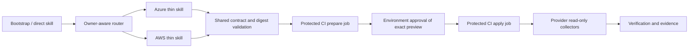

# Design: Azure / AWS cloud orchestration

Impl-Review-Status: Passed
Feature Type: developer-tooling / cloud orchestration

## Technical Summary

Add two thin provider plugins and a small shared validation component. The
existing implementation-stage selected-plan evaluator remains an evidence
gate, not a deployment engine (`plugins/sdd-quality-loop/skills/quality-gate/SKILL.md:72`).
Cloud operations have their own versioned contracts and lifecycle. Reuse
provider bindings by ID; do not put provider command/configuration details into
neutral Context. The normative detailed design is in this file, so design
review binds it rather than leaving an unreviewed detailed-design sidecar.

## Architecture

There is no resident cross-cloud service. GitHub Actions owns scheduling,
concurrency and authorization; the cloud owns deployment state. The library
validates artifacts and reduces observations; it does not invent native cloud
success. Cross-cloud requests reference predecessor receipt digests and stop
dependent units when a predecessor is not VERIFIED.

## Components

| Component | Responsibility (Owns / Does Not Own) | Public Contract & Encapsulated Knowledge | State, Failure & Change Blast Radius | Technology | New/Existing |
|---|---|---|---|---|---|
| Bootstrap routing seam | Detect cloud intent and ownership; does not execute | Binding ID and route decision | Existing non-cloud paths unchanged | Existing skill/scripts | Existing extension |
| sdd-azure-cloud | Route/Govern/Observe/Verify for Azure; no duplicate upstream VM authoring | Azure Bicep artifacts, scope, what-if and deployment ID | Azure unit only; unknown state reconciles | Skill, Python stdlib, Azure CLI | New |
| sdd-aws-cloud | Route/Govern/Observe/Verify for AWS; no generic CDK engine | CDK assembly, assets, Change Set ARN, stack ID | AWS unit only; no resynthesis after approval | Skill, Python stdlib, AWS CLI/CDK | New |
| Shared validation | Strict parsing, safe paths, digests, result envelopes and approval binding; no authorization authority | Versioned cloud contracts | Fail closed on unknown versions/fields/identity | Python stdlib and existing schema tools | New small module |
| Cloud verification profiles | Deterministic selected checks; no write commands | Versioned verification contract and protected registry | Legacy profiles retain existing gates | Existing registry/evaluator consumers | Existing extension |
| Governed CI templates | External approval, OIDC, locks and exact execution | Immutable artifacts and environment/run identity | Scope serialization; rejection before credentialed step | GitHub Actions and provider IAM | New |
| Current #423 audit inventory | Current source anchors and CI coverage; no historical rewrite | New current inventory snapshot | Isolated audit repair | Existing checker/test patterns | Existing extension |

## Layer Specifications

| Layer | Summary | Canonical Detail | Owner | Status |
|---|---|---|---|---|
| UX | CLI journey and explicit blocked/unknown outcomes | [UX specification](ux-spec.md#scope-and-user-journeys) | Plugin maintainers | Proposed |
| Frontend | N/A — no change: no graphical interface | [Frontend specification](frontend-spec.md#technology-stack) | Plugin maintainers | N/A |
| Infrastructure | Protected CI and two single-scope examples | [Infrastructure specification](infra-spec.md#deployment-topology) | Platform maintainer | Proposed |
| Security | External authorization, immutable inputs and readback | [Security specification](security-spec.md#trust-boundaries) | Platform/security owners | Proposed |

## Design System Compliance

N/A — ds_profile: none

## Cross-Layer Dependencies

| From | To | Contract / Decision | REQ | AC | Verification |
|---|---|---|---|---|---|
| requirements.md | ux-spec.md | One owner, actionable blocked/unknown output | REQ-002 | AC-002 | TEST-002 |
| security-spec.md | infra-spec.md | Authenticated CI approval at write boundary | REQ-005 | AC-005 | TEST-005 |
| infra-spec.md | design.md | Operation reconciliation and observation identities | REQ-006 | AC-006 | TEST-006 |
| design.md | security-spec.md | Input and evidence integrity | REQ-004 | AC-004 | TEST-004 |

## ADR Change Log

`docs/adr/0036-thin-cloud-orchestration.md`

| ADR | Decision | Status | Layer Impact | Supersedes | Date |
|---|---|---|---|---|---|
| [0036](../../docs/adr/0036-thin-cloud-orchestration.md) | Thin provider adapters with CI authorization and separate operation lifecycle | Proposed, scope approved; review pending | Infrastructure/security/CLI | None | 2026-10-18 |

## Data Plan

Data Entities: run request, dependency lock, preview, authorization receipt,
operation observation, verification result and evidence manifest.

Existing Data Affected: new current inventory replaces no historical bytes;
existing binding IDs are referenced; legacy verification evidence stays readable.

Migration Strategy: introduce an explicit new cloud verification version and
profile discriminator. Existing-version dispatch remains unchanged and rejects
unknown cloud fields. New cloud profiles must be allowlisted in the protected
registry. Review all schema mirrors, parsers, emitters, validators and CI test
drivers before implementation; do not special-case missing old gates as PASS.

Store operation artifacts under `specs/<feature>/verification/<task>/cloud/<run>/`
using canonical contained paths and atomic no-overwrite publication. Content
hashes identify exact bytes. Hashes establish integrity, not provenance or
authorization. Runtime secret values are never serialized. Large raw cloud
responses stay in restricted CI storage; repository evidence references their
redacted digest/locator and classification. Retention is configured explicitly
by the environment owner before live use.

## API / Contract Plan

Introduce strict, versioned JSON schemas in `contracts/` and plugin packaging
mirrors only where the established installer requires them. Reject duplicate
JSON keys, unknown fields/versions, NaN, malformed digests, non-UTC timestamps,
unsafe paths and unrecognized enum values. No schema field alone grants access.

| Contract | Mandatory content | Validation boundary |
|---|---|---|
| cloud-run-request/v1 | run_id, unit_id, provider, binding_id, environment, explicit scope, owner, route, operation, predecessor receipt digests, source revision, input artifact digests, verification profile | Router and every CI phase |
| cloud-dependency-lock/v1 | upstream repository/commit, referenced file hashes including transitive references, tool versions/package integrity, adapter version, tool-schema digests and managed endpoint identity | Local validation and CI before credentials |
| cloud-preview/v1 | run/unit/scope, input/lock/policy/profile digests, provider preview identity and semantic digest, changes, replacements/deletes, created/expires timestamps | Approver and apply preflight |
| cloud-authorization-receipt/v1 | operation prepare/apply, authenticated issuer/principal, CI repository/workflow/environment/run/attempt, target scope, bound artifact/preview digests, issuance/expiry, approval evidence locator | Trusted CI producer and executor; offline copies cannot grant writes |
| cloud-observation/v1 | native operation/resource IDs, run/unit, principal, query and timestamp, actual exit code, status, result digest and evidence locator | Trusted collector and verification reducer |
| cloud-verification/v1 | profile/version, required check IDs, observation digests, per-check PASS/FAIL/BLOCKED, overall result, evidence completeness | Reducer and final evidence gate |

### Normative detailed design: routing and dependencies

Scan the deployment unit's declared roots for existing owner metadata; never
infer permission from file extension alone. Explicitly select one owner from
detected candidates. Ambiguity produces a decision request with no executor.
Recognize Terraform, SAM, raw CloudFormation and azd but return unsupported
execution for this release. Support Azure Bicep and AWS CDK only. Upstream
specialists may produce artifacts in local planning, with cloud-write tools
unavailable; they cannot bypass CI. Upstream skill text is reference material,
not authorization. Reject transitive references escaping the pinned source
tree or requiring an unlocked mutable dependency.

Initial researched baselines are Azure skills commit
`cf79ce8778ad063eeac19dbe8bf982d71b466ce0` and AWS agent toolkit commit
`44ba1a5451913998815111cc2d518f5c45f95ef7`; adoption must verify these again and
record exact consumed files. Pin actual resolved CLI/MCP dependencies, not just
plugin metadata. Managed MCP backends cannot be fully pinned; record endpoint
and observed tool schemas, probe read-only compatibility, and block on schema
drift. CLI execution is the initial governed path; MCP is not a second writer.

### Normative detailed design: lifecycle and failure

`ROUTED → PLANNED → LOCAL_VALIDATED → PREPARE_AUTHORIZED → PREVIEW_READY →
APPLY_AUTHORIZED → EXECUTING → OBSERVED → VERIFIED → EVIDENCE_COMPLETE`.
These states do not modify SDD task statuses or Foundation stage enums.
Each transition consumes prior immutable evidence and checks run/unit binding.
Failure is FAILED, unavailable evidence/authorization is BLOCKED, and ambiguous
remote completion is UNKNOWN. UNKNOWN can leave only through read-only query
of the original operation identity. No automatic write retry. A new mutation
requires a new authorized attempt after resolving or explicitly abandoning the
old operation. A no-change preview ends as NO_CHANGE with evidence, not a
fabricated deployment. Only all mandatory check results permit VERIFIED.

CI concurrency keys are canonical provider/account-or-subscription/region/
deployment-scope keys. Use a conservative account/subscription-region lock for
overlapping units in the initial implementation, `cancel-in-progress: false`.
One configured orchestration repository owns writes to that scope; inability
to enforce this or external out-of-band writers blocks the serialized guarantee
and must be disclosed. Local file locks do not serialize cloud operations.

### Normative detailed design: authorization and execution

Use protected GitHub environments for prepare and apply, with separate OIDC
identities and least-privilege policies. Only trusted workflow code from a
protected revision can request credentials; never execute untrusted PR code
inside credentialed jobs. Approvals bind the CI run/attempt and immutable
artifact manifest displayed to the approver. Re-runs obtain fresh authorization.
Validate receipt against authenticated CI metadata/environment policy; unsigned
local JSON is inspectable evidence only. Revalidate hashes, expiry, target
identity and allowed operation immediately before each write. Reject stale or
replayed receipts. Execute fixed argument arrays, never shell strings derived
from model/provider output. Fail closed if required approval metadata cannot
be obtained from the trusted CI API.

AWS: CDK synthesis and policy validation occur without cloud-write permission.
Freeze the complete cloud assembly and asset manifest. Authorized prepare may
publish exact assets and create a CloudFormation Change Set. Record its ARN,
stack/account/region, template digest, parameters, capabilities and changes.
Apply reads back the exact Change Set, verifies availability and identity, and
executes it without resynthesizing or calling `cdk deploy`. Asset substitution,
replacement/deletion outside policy, or changed template requires new prepare
and apply authorization. CDK bootstrap is an explicit prerequisite, never a
hidden prepare side effect. Hotswap is excluded.

Azure: compile exact Bicep and parameters locally, bind the ARM template and
module digests. Authorized CI obtains what-if and records semantic changes.
Under the same scope lock, apply reruns what-if over the exact artifacts and
compares normalized resource/change/property content. Any semantic change,
unknown change, or unsupported preview normalization blocks and requests new
approval. Use a unique deployment name as operation identity and incremental
deployment mode. What-if is not an immutable server-side execution plan; drift
between final preview and apply remains a documented provider limitation.

### Normative detailed design: observation and verification

Read native operation state first, then actual resource state. Check expected
resource identities, effective network access, effective least-privilege
identity, monitoring configuration plus a received signal, configured workload
health probe, and backup configuration/recovery evidence when required. Bind
observations to a post-completion window and target identity. Mandatory check
set and freshness limits come from the approved profile; absence is BLOCKED.
Provider success with unhealthy workload is FAIL. Never convert failed or
unavailable checks into optional N/A after execution. Multi-unit completion
requires all mandatory units and dependency receipts to verify.

### Normative detailed design: #423 repair

REQ-001 / AC-001 / TEST-001 govern this repair and its historical evidence boundary.

Create a new current inventory under this feature's verification area, with
source path, section heading and required content assertions. Resolve bounded
section contents rather than stale line ranges. Preserve the historical T-001
inventory and its original test semantics; invoke it only against its bound
historical source snapshot when claiming historical validity. Add a current
inventory test and existing contract-boundary coverage to normal suite drivers.
Record the current 15/17 historical-test outcome as a stale-reference finding,
not as proof of missing seven-file behavior or formal Done.

## Test Strategy

REQ-012 / AC-012 / TEST-012 govern test provenance, isolated host behavior and
the explicit separation of deterministic fixtures from live cloud trials.

Implement TEST-001–012 from the acceptance document, using fixture transports
for command/authorization denial, plus meaningful compile/synthesis checks.
Exercise malformed input, artifact mutation, replay, concurrent scope,
unknown timeout, partial failure and unhealthy deployed results. Run existing
multitarget, guard, bootstrap and compatibility regressions after relevant
changes. Use the isolated verify-codex environment for host behavior. Native
host and cloud trials must be reported separately from fixtures; missing
authentication blocks those trials. Never fabricate review identities or gate
verdicts to satisfy this design.

TEST-006 must additionally execute a three-unit dependency fixture: unit A
succeeds, independent unit B fails, and unit C depends on B. Assert that C has
zero prepare/apply submissions, A's successful receipt remains intact, and the
aggregate run is not verified. TEST-009 must additionally execute empty-preview
fixtures for both providers: return explicit NO_CHANGE, record genuine preview
evidence, and assert zero apply submissions and no fabricated deployment ID.
These are mandatory subscenarios of the existing requirements, retained from
the rejected review delivery's coverage concern; they are not optional future
enhancements. Task decomposition must bind both scenarios to executable tests.

## Security Boundaries

| Trust Boundary | Auth/Authz Mechanism | Data Classification | OWASP Concerns |
|---|---|---|---|
| Local artifacts → CI | Protected workflow, canonical digest manifest, authenticated approval | Internal | Injection, broken access control |
| CI → provider | Scoped short-lived OIDC and operation-specific IAM | Restricted credentials, internal metadata | Confused deputy, credential disclosure |
| Provider → evidence | Read-only collector identity, freshness and redaction | Internal | Tampering, secret disclosure |

Detailed controls: [Security specification](security-spec.md#trust-boundaries).

## Deployment / CI Plan

Publish reviewable workflow and IAM templates, not active deployment secrets
or unsolicited cloud workflows on this repository. Package plugins through
the existing installation/manifest conventions after reviewing all consumers.
Run deterministic CI without cloud credentials; opt-in live sandbox jobs require
configured protected environments and explicit target approval. No production
deployment or destructive cleanup is included in development approval.

Detailed topology: [Infrastructure specification](infra-spec.md#deployment-topology).

## Constraint Compliance

| Requirement Constraint | Design Response |
|---|---|
| Thin integration | Two provider adapters, shared validation only |
| One executor | Owner-aware route and CI command allowlist |
| No legacy weakening | Explicit version/profile dispatch and regression checks |
| Approval before writes | Separate prepare/apply environments and scoped IAM |
| Genuine verification | Native readback plus mandatory health checks |
| Historical evidence preservation | New inventory/addenda; no retroactive Done |
| Region/account allowlists | Trusted CI target policy allowlists provider account/subscription, region, environment and deployment scope; compare authenticated provider identity and request before prepare and apply. Missing policy or mismatch is BLOCKED. Bind policy digest to preview/approval. Covered by TEST-004/005. |
| Evidence residency and retention | Before live preparation, require owner-approved evidence storage region/location, classification, retention duration and access policy; bind their policy digest to the run. Reject an unsupported location or unavailable retention enforcement. No raw secrets enter repository evidence. Covered by TEST-005/010. |
| Backup and budget prerequisites | Require explicit workload backup policy and budget ceiling; a required backup with missing configuration/evidence blocks applicable verification. Missing live budget prevents preparation. Covered by TEST-003/009. |
| Existing ownership and unsupported import | Preserve declared IaC owner and identifiers; block unsupported execution, import and destructive referenced-resource changes. Covered by TEST-002/007. |

## Assumptions

GitHub Actions is the first supported authorization boundary. Target owners
configure protected environments and enforce exclusive write ownership; the
library cannot create this trust by inspecting an approval JSON file.

## Open Questions

### OQ-001: Live target configuration

Owner: environment owner. Blocks Implementation: no. Blocks live operation:
yes.
Resolution Path: The environment owner supplies scope, OIDC federation, IAM policy, health and backup requirements,
budget and retention before live tests. Fail closed until supplied.

### OQ-002: Independent review host readiness

Owner: development environment owner. Blocks Implementation: yes, until the
required repository reviews pass. Authentication was restored and account and
model connectivity verified on 2026-10-18; see
`reports/verification/cloud-orchestration-auth-recovery-20261018.md`. Native
idle-context allocation and pre-launch reservation are now available. Each
review must still preserve its own allocation, reservation and input evidence;
host connectivity alone does not establish a Passed review.
Resolution Path: Run the canonical spec, implementation-policy and task review
prechecks in sequence; allocate fresh native reviewer contexts, reserve their
identities before launch, validate both outputs and persist each review
contract. Implementation may begin only after these gates pass and the
selected task has the user’s recorded approval. Authentication needs no further
action; a failed gate is resolved by correcting its findings and rerunning
the prescribed round, without treating connectivity as review evidence.

## Risks

Azure preview cannot eliminate concurrent external mutation. Cloud IAM and
CI protections are external prerequisites. Managed tool services can change
behind a stable URL. These limits require runtime checks and honest evidence,
not a claim of fully deterministic or atomic cloud execution.

## Public Invocation Contract

- New skills: `sdd-azure-cloud:orchestrate` and `sdd-aws-cloud:orchestrate`.
  Bootstrap hands each the same canonical run-request path used by direct
  invocation. Interactive skills may collect missing run fields, but cannot
  execute provider writes while doing so.
- Each provider exposes `python3 scripts/cloud.py <operation> --request <path>
  --output <path>`. Operations are `route`, `plan`, `validate`, `prepare`,
  `apply`, `reconcile`, `observe`, and `verify`. Unknown operations/flags and
  provider mismatches are rejected before any external effect.
- `--request` is an existing strict `cloud-run-request/v1` JSON document.
  `--output` must be a new canonical path within the run's evidence directory.
  No overwrite, symlink traversal or output/input alias is allowed. Request
  references resolve only inside the declared workspace/artifact root.
- Every result uses `cloud-operation-result/v1`: `run_id`, `unit_id`,
  `provider`, `operation`, `state`, `result`, `error_code`, `message`,
  `input_manifest_sha256`, `evidence_manifest_path`, and optional
  `native_operation_id`. This envelope joins the six artifact families already
  specified. `result` is PASS, BLOCKED, FAIL, UNKNOWN or NO_CHANGE;
  `error_code` is null only for PASS/NO_CHANGE. The state is the cloud operation
  state, never an SDD task or gate stage.
- Exit codes: 0 for PASS/NO_CHANGE, 2 for BLOCKED, 1 for FAIL, 3 for UNKNOWN.
  Strict JSON is emitted on stdout; human diagnostics go to stderr. Invalid
  requests without a valid run identity use a separate
  `cloud-input-error/v1` envelope containing only `error_code`, `message` and
  `field`; they do not invent a run or evidence receipt.
- `route`, `plan` and `validate` operate locally without cloud-write authority.
  `prepare` and `apply` are callable only from the governed CI executor and
  require authenticated admission at the call site. An environment variable
  such as GITHUB_ACTIONS=true, a local receipt or a command-line approval flag
  cannot establish that admission. Direct local calls return BLOCKED with the
  required workflow/environment action. `reconcile` and `observe` use scoped
  read-only credentials; `verify` consumes authenticated observations.
- Authentication/authorization unavailable, unsupported owner/version,
  malformed input and missing checks return typed BLOCKED results without a
  new write. A timeout after a submission may have reached the provider returns
  UNKNOWN and the preallocated native operation identity; it never pretends
  no write occurred. NO_CHANGE carries real preview evidence and no fabricated
  apply ID.
- These are additive v1 interfaces. No existing bootstrap argument or
  code/shell/docs/spec verification contract is deprecated or reinterpreted.
  Breaking changes require a new explicit version; unknown versions block.

## Unit and Integration Boundaries

| Level | Subject | Doubles / real boundary | Required examples |
|---|---|---|---|
| Unit | Owner/router decision | Temporary file inventory; no subprocess/cloud | One owner, conflict, unsupported owner, provider mismatch |
| Unit | Strict contract/path/digest validation | Temporary files and synthetic clock | Duplicate keys, traversal, symlink, mutated artifact, expiry, unknown version |
| Unit | Verification/state reduction | Explicit synthetic observations and fixed clock | Missing/stale/failed check, no-op, UNKNOWN reconciliation, dependency failure |
| Integration | Bootstrap → provider CLI → shared validation | Real subprocess/JSON/file flow; fake provider/CI transports clearly labeled | Both entry points enforce the same admission and error contract |
| Integration | CI admission → provider executor → collector | Deterministic fake API/CLI responses; no network writes | Deny fake approvals, stale previews, asset/ARN substitutions and retries |
| Compile/synthesis | Example Bicep/CDK artifacts | Actual pinned compiler/synthesizer; no write identity | Valid artifacts, policy-negative fixture, reproducible asset manifest |
| Isolated host | Skill routing and guarded invocation | verify-codex profile with actual model/tool delivery | Reachability, unsupported route blocking, honest evidence classification |
| Live sandbox | CI/OIDC/IAM/provider behavior | Actual owner-authorized sandbox only | Exact execution, effective network/identity, monitoring and workload health |

Use `tests/cloud-orchestration-contracts.tests.py`,
`tests/cloud-orchestration-routing.tests.py`,
`tests/cloud-orchestration-execution.tests.py` and
`tests/cloud-orchestration-verification.tests.py` as planned deterministic
suite entry points, and wire them into the established CI suite drivers.
Write results under this feature's task-specific verification addenda. Runtime
cloud verification profiles do not report these library unit tests as fake
IaC deployment evidence.

## External Integration Inventory

| Integration | Supported contract and purpose | Unavailable/incompatible behavior |
|---|---|---|
| GitHub Actions metadata/approvals | GitHub REST API with `X-GitHub-Api-Version: 2022-11-28`; GET `/repos/{owner}/{repo}/actions/runs/{run_id}` and GET `/repos/{owner}/{repo}/actions/runs/{run_id}/approvals`; protected prepare/apply environments and OIDC issuance | Block when approval history, reviewer identity, environment, current run attempt or trusted workflow/ref cannot be authenticated and matched |
| Azure resource manager | ARM deployment what-if and deployment operation APIs, `api-version=2025-04-01`; explicit subscription/resource-group/deployment identity | Block unknown or incomplete preview shapes and unsupported API versions; no alternate write path |
| AWS CloudFormation | CloudFormation API `2010-05-15`; Create/Describe/ExecuteChangeSet, DescribeStacks and DescribeStackEvents; exact ChangeSetName ARN and ClientRequestToken binding | Block ARN/template/account/region mismatch; ambiguous execution reconciles the original token/stack only |
| Azure authoring toolchain | Azure CLI 2.x and Bicep CLI; exact patch versions and binary/module digests selected and pinned before the first build | Major-version mismatch or lock drift blocks; no implicit latest download in a credentialed job |
| AWS authoring toolchain | AWS CLI 2.x and CDK CLI/library 2.x; exact lockfile/binary versions and complete cloud assembly/asset hashes | Version/assembly drift blocks; no `cdk deploy` or hotswap after approval |
| Upstream skills | The researched Git commit baselines already named in design.md, plus exact consumed/transitive file hashes | Missing pin or unreviewed content change blocks adoption |
| Managed MCP (optional planning) | Recorded endpoint and observed tool-schema digest, read-only compatibility probe | Unavailable/incompatible service blocks that capability; never substitutes another cloud writer |

For GitHub admission, require authenticated review history for the exact
prepare/apply environment, approved state and an allowed reviewer identity.
The documented review-history response has no approval timestamp or attempt
identifier; never infer those from an environment's created_at/updated_at.
The initial adapter therefore admits only run_attempt == 1. Reruns and any
rejected/ambiguous environment review require a new workflow dispatch and fresh
native environment approval, not reuse of the same run.

The trusted workflow binds the artifact digest before entering the protected
environment job. Native GitHub environment scheduling and provider-side OIDC
validation are the authority granting that job its short-lived write identity.
Bind the receipt's issued_at/expires_at to that authenticated job credential
lease and the stricter target-policy lifetime, not an invented human-review
timestamp. Match the repository, protected workflow revision/ref, first run ID,
environment and artifact manifest to authenticated API/runtime metadata and
provider identity immediately before writing. An inactive/cancelled run, wrong
principal, changed artifact, missing required reviewer or any denied/ambiguous
review blocks. A local approval file or forged GITHUB_ACTIONS flag cannot grant
the provider identity: trust policies restrict issuance to the exact protected
workflow/environment, and fixed executor code validates the expected principal.
Keep the native issuer/subject binding and approval-history evidence locator;
never serialize token values. Provider OIDC audiences are explicitly
`api://AzureADTokenExchange` for Azure and `sts.amazonaws.com` for AWS. Fixture
transports exercise decision logic but do not establish live IAM enforcement.

Exact CLI patch versions will be selected and compatibility-tested when the
adapter is implemented, then frozen in the dependency lock. The API versions
above are the design's supported provider contracts; selecting an untested CLI
does not waive the API/preview compatibility probes.

Documentation checked read-only on 2026-10-18:

- GitHub: https://docs.github.com/en/rest/actions/workflow-runs?apiVersion=2022-11-28
  (review-history endpoint is documented).
- Azure: https://learn.microsoft.com/en-us/rest/api/resources/deployments/what-if
  (returned documentation names API version 2025-04-01; an older requested view
  also returned this version, so the design must not claim the older view was
  verified).
- AWS: https://docs.aws.amazon.com/AWSCloudFormation/latest/APIReference/API_ExecuteChangeSet.html
  (documents ChangeSetName and ClientRequestToken).

These documentation checks do not establish live target compatibility or a
working CI authorization integration. The acceptance suite must test those
claims before deployment.

## Documentation and Release Delivery

REQ-013 / AC-013 / TEST-013 cover the documentation matrix. REQ-014 / AC-014 /
TEST-014 cover synchronized versions, exact-commit CI and remote tag publication.

The user's additional instruction on 2026-10-18 explicitly includes repair of
#423 implementation issues, complete related documentation updates and a release
tag for the resulting application. This extends delivery work without changing
cloud authorization or the initial provider scope.

| Surface | Required update | Verification |
|---|---|---|
| README.md | Supported cloud routes, installation and entry points, actual limits, link to guide | Reachability and repository release validator |
| docs/workflow-guide.md | Prepare/apply approval, owner conflict, timeout recovery, verified vs executed semantics | Cross-check against tested CLI contracts |
| Provider plugin skill/reference documentation | Inputs/outputs, pinned dependencies, brownfield policy, examples and troubleshooting | Skill references and host behavior checks |
| docs/contributor/release-runbook.md | Current required checks and tag/release distinction | Existing release tests |
| CHANGELOG.md and release manifests | Actual delivered behavior, #423 repair, limitations, synchronized version | Existing bump-version and release validation |
| New cloud operator guide | CI/OIDC prerequisites, exact examples, health/backup checks, evidence retention and authorized cleanup | Example command validation and link check |
| Historical evidence and task state | New repair evidence/addenda; no retroactive modification of frozen reports | Hash checks and workflow-state validation |

Derive the next unused semantic version from current remote tags and actual
change scope. Use the existing version bump script and required release checks.
Create an annotated tag on the exact tested release commit only after validation;
never move an existing tag or tag uncommitted/unverified work. The requested tag
includes publishing that new tag to the configured repository. Record exact
commit/tag and CI results. A tag alone is not a claim of successful GitHub Release
asset publication or live cloud verification. Do not bypass release CI gates.

## Review Amendment Evidence

The 2026-10-18 user instruction authorizes #423 repairs, documentation completion
and release tagging; these are now represented by REQ-013/014 and AC-013/014 in
the re-reviewed specification. GitHub's documented approval-history response
was inspected and contains state, comment, environments and user, but no review
submission time. The first-attempt-only admission rule above removes reliance
on that nonexistent field and fails closed on retries. Recheck the published
API schema and native environment/IAM behavior before live adoption.
