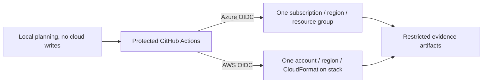

# Infrastructure Specification: cloud-orchestration

## Deployment Topology

Azure example: Bicep VM, private NIC/subnet, scoped managed identity, monitoring
and explicit health probe. AWS example: CDK EC2, private VPC/subnet/security
group, scoped instance role, monitoring and explicit health probe. No public
SSH/RDP ingress by default. Image/version and VM/instance size are explicit
validated inputs; do not pick live billable defaults silently. Monitoring and
private management connectivity must be planned along with any egress costs.
Backup is mandatory when the target policy requires it (REQ-003/AC-003).

## CI/CD Sequence

1. Unprivileged job validates source, compiles/synthesizes, scans policy and freezes artifacts.
2. Protected prepare environment authorizes scoped asset publication/preview preparation.
3. Publish redacted preview and immutable manifest for human inspection.
4. Protected apply environment authorizes the exact run and artifact; obtain short-lived credentials only after admission checks.
5. Acquire conservative account/subscription-region concurrency boundary without canceling an active apply; revalidate identity, artifacts, preview and expiry.
6. Execute exact Azure artifact with fresh what-if comparison or exact AWS Change Set; record native identity before polling.
7. Observe resources, verify mandatory checks, publish evidence; reconcile timeouts read-only.

All credentialed scripts come from a trusted protected revision. An untrusted
PR cannot replace those scripts, action versions, policy or artifact references
(REQ-004–006/AC-004–006). One orchestration repository must own the scope;
GitHub concurrency alone does not coordinate unrelated repositories.

## Environments

| Environment | URL | Auth | Trigger | Classification | Promotion Rule |
|---|---|---|---|---|---|
| local | Workspace artifacts | No cloud write identity | Explicit CLI | Internal | Valid local evidence only |
| test fixtures | Temporary test directories | Fake transport clearly labeled | CI tests | Synthetic | Cannot authorize a live operation |
| sandbox | Owner-supplied account/subscription | Protected environment OIDC | Explicit authorized workflow | Internal | Required checks and scoped approvals |
| production | Not configured by this feature | Separately managed | Outside initial development scope | Owner-defined | No automatic promotion |

## Infrastructure as Code

Bicep/ARM owns the Azure example; CDK/CloudFormation owns the AWS example.
CloudFormation stack and Azure resource manager retain provider state. No new
Terraform-like state store. Pin module/source/assembly/asset digests and preserve
existing resource identifiers. Preview policy blocks destructive brownfield
changes, ownership conflicts and imports (REQ-007/AC-007).

## Scaling Strategy

One active writer per conservative account/subscription-region key. Queue
subsequent units, with no automatic cancellation of in-flight writes. Parallel
independent regions/scopes require explicit validated configuration; the first
release favors serialization over maximizing throughput. Cross-cloud graph
dependents start only after verified predecessor receipts (REQ-006/AC-006).

## Service Level Objectives

No application availability SLA is asserted for example VMs. Required health
signals and maximum observation age are explicit profile inputs. Every polling
loop has a bounded deadline; expiry returns UNKNOWN/BLOCKED with native ID,
never success. Tests use deterministic deadlines and verify termination
(REQ-006, REQ-009; AC-006, AC-009).

## Data Residency and Retention

Cloud resources remain in the explicit approved region; CI evidence residency
and retention must be accepted before a live trial. Raw responses may contain
sensitive metadata and remain in restricted artifact storage. Store redacted
evidence in the repository only when appropriate. No credentials, secret
parameters or disk/user data in evidence (REQ-010/AC-010). Backup retention and
recovery objectives are explicit workload inputs, not invented example claims.

## Observability

Correlate CI run/attempt, unit/run, native deployment/stack ID and check IDs.
Collect actual completion state, network/identity configuration, monitoring
signal and workload probe. Record permission errors separately from failed
health. Alert/notification channels are configured by the operator; this
feature does not send messages to external recipients (REQ-009–010/AC-009–010).

## Cost Estimate

Before live approval, show region, size, runtime duration, storage, monitoring,
private endpoint/NAT and egress assumptions with a current estimate or explicit
unavailability. Require a user budget ceiling for the example run. No fixed
monthly quote is asserted without a chosen target. Missing budget/target
prevents live deployment (REQ-003/AC-003).

## Rollback

Partial failures retain actual successful resources and receipts. No automatic
destructive cross-cloud rollback. Operator inspects the original operation,
prepares a corrective or cleanup change, and obtains separate authorization.
Provider-native automatic rollback behavior must be disclosed in the preview
policy. Cleanup verifies intended deletion and reports residual billable
resources; a failed cleanup is not a successful release (REQ-006–007/AC-006–007).

## Open Questions

Environment owner supplies sandbox scope, federation, CDK bootstrap, approved
images, network/health/backup configuration, budget and evidence retention.
These block live operation, not offline implementation.
