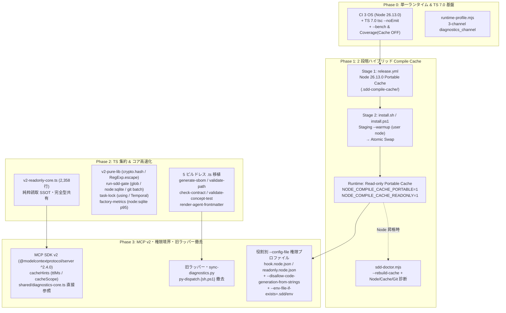

# 設計書（SDD Core）: node26-ts7-mcpv2-optimization

- **ADR**: `docs/adr/0055-node26-ts7-mcpv2-unified-runtime.md`
- **Requirements**: `specs/node26-ts7-mcpv2-optimization/requirements.md`
- **Target Base Branch**: `main`（`aharada54914/sdd-forge` v2.1.5）

---

## 1. 方針とアーキテクチャ概要

本設計は、`sdd-forge` の核心強みである **「Node.js ゼロ外部ランタイム依存・純粋読み取り SSOT コア」** を維持・拡張しつつ、以下の 4 フェーズでランタイム・型検査・キャッシュ・MCP プロトコル・実行権限境界・旧ラッパー撤去を一貫最適化する。



---

## 2. フェーズ別詳細設計

### 2.1 Phase 0: Node.js 26.13+ 統一・TS 7.0 共通基盤・計測基盤

1. **CI・パッケージ基準統一**:
   - `.github/workflows/test.yml`:
     - 全ジョブ（`v2-guardrails` 3 OS、`sdd-forge-mcp-v2`、`mcp-tests`、`installers`）の `node-version` を `"26.13.0"` に統一。
     - `v2-guardrails` に `tests/node26-ts7-optimization.test.mjs` を追加。
     - 新規ステップ/ジョブとして以下を組み込む:
       - **Root TypeScript 7.0 型検査**: `mcp/sdd-forge-mcp/node_modules/.bin/tsc --noEmit -p tsconfig.json`
       - **ランタイムベンチマーク**: `node scripts/bench-runtime.ts --iterations 3 --json`（Node 26 の `--bench` 互換ランナーも同梱）
       - **内蔵カバレッジ計測分離**: `NODE_DISABLE_COMPILE_CACHE=1 node --test --experimental-test-coverage tests/node26-ts7-optimization.test.mjs`
   - `.github/workflows/release.yml`・`.github/workflows/sdd-guardrails.yml`: `node-version: "26.13.0"` へ統一。
   - `mcp/{sdd-forge-mcp,ci-mcp,local-env-mcp}/package.json`: `"engines": { "node": ">=26.13.0" }`。`local-env-mcp` には `[DEPRECATED / Maintenance-only]` を明記。
2. **ルート `tsconfig.json`（TS 7.0 / `^7.0.2`）**:
   - `target: "ESNext"`, `module: "NodeNext"`, `moduleResolution: "NodeNext"`, `strict: true`, `erasableSyntaxOnly: true`, `allowImportingTsExtensions: true`, `verbatimModuleSyntax: true`, `noEmit: true`, `skipLibCheck: true`。
   - 対象: `plugins/sdd-quality-loop/scripts/v2/v2-readonly-core.ts`, `plugins/sdd-quality-loop/scripts/{validate-path,check-contract}.ts`, `plugins/sdd-domain/scripts/validate-concept-test.ts`, `.github/scripts/generate-sbom.ts`, `scripts/{render-agent-frontmatter,bench-runtime}.ts`, `mcp/shared/diagnostics-core.ts`。
3. **3 区分プロファイラ & ベンチマーク**:
   - `plugins/sdd-quality-loop/scripts/v2/runtime-profile.mjs`: `node:diagnostics_channel` チャネル `sdd-forge:startup`, `sdd-forge:scan`, `sdd-forge:exec` を提供。`channel.hasSubscribers === false` 時は即時リターンし、ゼロオーバーヘッドを保証する。
   - `scripts/bench-runtime.ts`: 冷起動（`NODE_DISABLE_COMPILE_CACHE=1`）vs 温起動（Portable + Read-only Cache）で `sdd-soft-guard.mjs` / `sdd-doctor.mjs` / `run-sdd-gate.mjs` を比較し、`crypto.hash()` vs `createHash()` および `fs.promises.glob` 走査速度を計測・JSON 出力する。

### 2.2 Phase 1: 2 段階ハイブリッド事前生成 Compile Cache & `sdd-doctor`

```
[Stage 1: release.yml (Node 26.13.0)]
   compile-cache.mjs --warmup --cache-dir $snapshot/.sdd-compile-cache
   (NODE_COMPILE_CACHE_PORTABLE=1)
              |
              v
[Stage 2: install.sh / install.ps1 staging (user's local node)]
   compile-cache.mjs --warmup --root $STAGING --cache-dir $STAGING/.sdd-compile-cache
   atomic swap: $STAGING -> $INSTALL_ROOT
              |
              v
[Runtime: Hooks / CLI / MCP]
   NODE_COMPILE_CACHE=<root>/.sdd-compile-cache
   NODE_COMPILE_CACHE_PORTABLE=1
   NODE_COMPILE_CACHE_READONLY=1
   (Coverage job only: NODE_DISABLE_COMPILE_CACHE=1)
```

- **`compile-cache.mjs`**:
  - `--warmup` 対象エントリ: `sdd-soft-guard.mjs`（`v2-readonly-core.ts` を包含）, `run-sdd-gate.mjs`, `render-decision-view.mjs`, `sdd-doctor.mjs`, `mcp/sdd-forge-mcp/dist/index.js`（存在時）, `mcp/ci-mcp/dist/index.js`（存在時）。
  - 各エントリに `--warmup` フラグを追加し、モジュールグラフ解決完了後に副作用ゼロで `process.exit(0)` する。
  - `inspectCompileCache(cacheDir)` で存在・サイズ・バージョン別ディレクトリ・キャッシュファイル数を検査可能にする。
- **インストーラー連携**:
  - `install-payload.txt`: `.sdd-compile-cache/` を追加（リリース同梱時コピー）。`render-agent-frontmatter.{sh,ps1}` を削除し `scripts/render-agent-frontmatter.ts` を追加。
  - `install.sh` / `install.ps1`: アトミックスワップ直前に `node` が利用可能かつ `SDD_SKIP_COMPILE_CACHE != 1` なら `$STAGING_ROOT/plugins/sdd-quality-loop/scripts/v2/compile-cache.mjs --warmup` を実行。失敗してもインストール自体は非破壊で継続する（警告出力）。
  - `tests/lib/install-payload-check.py`: ステージング生成された `.sdd-compile-cache/` を正当なインストール成果物として許可する。
- **`sdd-doctor.mjs`**:
  - `--rebuild-cache [--cache-dir <path>]` を追加し、現行 `node` バイナリ向けのポータブルキャッシュを再生成。
  - 診断項目へ以下を `INFO` 区分（Node 26.13+・キャッシュ・Git 推奨設定が整っていれば `OK`）で追加し、既存の `summary.ng === 0` 契約を維持する:
    - `runtime-node-version`: `>= 26.13.0` 判定
    - `compile-cache`: `.sdd-compile-cache/` の有無とファイル数
    - `git-performance-config`: `core.fsmonitor`, `core.untrackedCache`, `feature.manyFiles`

### 2.3 Phase 2: 純粋読み取りコアの `.ts` 化・高速化・5 本のビルドレス `.ts` 移植

1. **`v2-readonly-core.ts`（2,358 行の純粋読み取り SSOT コア）**:
   - `plugins/sdd-quality-loop/scripts/v2/v2-readonly-core.mjs` の全ロジックを erasable TypeScript の `plugins/sdd-quality-loop/scripts/v2/v2-readonly-core.ts` へ移行する。
   - エクスポート関数・返り値・IO Facade（`ReadonlyIo`）へ明確な TypeScript 型定義を付与し、`node:fs`・`process.env`・書込 API ゼロの純粋不変条件を保持する。
   - `mcp/sdd-forge-mcp/src/{next-command,pre-approval-review,tools/core,tools/v2,tools/status-view,path-guard}.ts` が `v2-readonly-core.ts` を直接インポートして完全型共有する（`tsconfig.json` / `esbuild` 双方で解決）。
   - `plugins/sdd-quality-loop/scripts/v2/v2-readonly-core.mjs` は既存の直接 `.mjs` テスト互換のため 1 行の純粋再エクスポート（`export * from './v2-readonly-core.ts';`）とする。
2. **コア高速化モジュール群**:
   - `v2-pure-lib.mjs`:
     - `sha256Text`: `typeof crypto.hash === 'function' ? crypto.hash('sha256', normalized, 'hex') : createHash(...)`
     - `escapeRegExp`: `typeof RegExp.escape === 'function' ? RegExp.escape(s) : s.replace(...)`
   - `scan-cache.mjs`（新規）:
     - `node:sqlite` (`DatabaseSync`) による `.sdd/scan-cache.sqlite` 永続化増分キャッシュ。キーは `(relPath, scannerKey)`、検証値 `(mtimeMs, size, resultJson)`。
     - `--permission` 読取専用環境や書込不可 FS では自動的に `:memory:` モードまたはキャッシュ無効へフォールバックし、クラッシュさせない。
   - `run-sdd-gate.mjs`:
     - `scanPlaceholdersAsync` / `collectFilesWithGlob`: `fs.promises.glob` による非同期ファイル収集＋並列度制限（既定 `concurrency = 16`）＋事前コンパイル済み正規表現＋`scan-cache.mjs` 増分スキップ。
     - `AbortSignal.timeout(ms)` を利用したタイムアウト付き実行ヘルパー。
     - Git 呼び出し統合:
       - `readGitStatusPorcelainV2(projectRoot)`: `git status --porcelain=v2 -z` 1 回で追跡・未追跡・リネーム状態を取得。
       - `readGitBlobsBatch(projectRoot, oids)`: `git cat-file --batch` 1 プロセスで複数 OID の Blob を一括読取（従来のファイルごとの `git cat-file blob` スポーンを廃止）。
     - Concept Test 検証を `validate-concept-test.ts` の `node` 直接実行へ切替（`pwsh` / `sh` スポーン完全廃止）。Codex バージョンキャッシュ環境（#812）の既存ワークアラウンドエラー判定はそのまま維持する。
   - `task-lock.mjs`:
     - `acquireTaskLockHandle(...)` を追加し、`[Symbol.dispose]()` で決定論的にロック解放（`using handle = acquireTaskLockHandle(...)` 対応）。
     - TTL（既定 1800 秒）と日時計算に `globalThis.Temporal?.Now?.instant()` / `Temporal.Instant` 優先ヘルパー（Node 24 フォールバック付き）を採用。
   - `factory-metrics.mjs`:
     - `summarizeMetricsWithSqlite(records)` を追加し、`node:sqlite` (`DatabaseSync(':memory:')`) により SQL ベースで件数・平均・p95・カテゴリ別集計を高速算出する（既存 JSONL 読み書き互換を完全維持）。
3. **5 本のゼロ依存ビルドレス `.ts` 移植**:
   | 新 `.ts` ファイル | 置換対象（Phase 3 で撤去） | 主な利用元 |
   |---|---|---|
   | `.github/scripts/generate-sbom.ts` | `.github/scripts/generate-sbom.py` | `.github/workflows/release.yml` |
   | `plugins/sdd-quality-loop/scripts/validate-path.ts` | `plugins/sdd-quality-loop/scripts/validate_path.py` | ゲート／契約パス検証 |
   | `plugins/sdd-quality-loop/scripts/check-contract.ts` | `plugins/sdd-quality-loop/scripts/check-contract.{py,sh,ps1}` | 契約スキーマ・証跡検証 |
   | `plugins/sdd-domain/scripts/validate-concept-test.ts` | `plugins/sdd-domain/scripts/validate-concept-test.{sh,ps1}`（※1） | `run-sdd-gate.mjs` / DDD ワークフロー |
   | `scripts/render-agent-frontmatter.ts` | `render-agent-frontmatter.{sh,ps1}` | `install-payload.txt` / エージェント生成 |

   > ※1: `validate-concept-test.py` については、`tests/concept-test.tests.py` が内部 Python 関数を単体インポートして v1 廃止境界テストを実行しているため、`validate-concept-test.{sh,ps1}` を撤去し、`tests/concept-test.tests.py` のラッパー検証を `node .../validate-concept-test.ts` へ切り替え、`run-sdd-gate.mjs` および通常運用からの Python / `pwsh` / `sh` 呼び出しを完全に排除する。

### 2.4 Phase 3: MCP SDK v2・役割別 `--config-file` 権限固定・旧ラッパー撤去

1. **MCP TypeScript SDK v2（`@modelcontextprotocol/server@^2.4.0` + `@modelcontextprotocol/client@^2.4.0`）**:
   - `mcp/sdd-forge-mcp`:
     - `@modelcontextprotocol/sdk` v1.32.2 を撤廃し、`@modelcontextprotocol/server@^2.4.0`（ランタイム）および `@modelcontextprotocol/client@^2.4.0`（テスト）へ移行。
     - `McpServer` / `ResourceTemplate` を `@modelcontextprotocol/server` から、`StdioServerTransport` を `@modelcontextprotocol/server/stdio` からインポート。
     - 4 ツール（`sdd_status`, `sdd_next_action`, `sdd_verify_evidence`, `sdd_read_spec`）および 2 リソースの静的リスト応答へ MCP 2.0 `cacheHints`（`ttlMs: 300000`, `cacheScope: "session"`）を付与。
     - `dist/index.js` を `esbuild` で再ビルドし、既存 `contracts/sdd-mcp.v2.schema.json` 契約と 100% 互換を維持。
   - `mcp/ci-mcp`:
     - 同様に `@modelcontextprotocol/server@^2.4.0` + `@modelcontextprotocol/client@^2.4.0` へ移行し、`dist/index.js` を再ビルド。
   - `mcp/shared/diagnostics-core.ts` 直接参照化:
     - `mcp/shared/diagnostics-core.ts` で `RegExp.escape` を採用。
     - `mcp/ci-mcp/src/diagnostics.ts` および `mcp/local-env-mcp/src/diagnostics.ts` から `../../shared/diagnostics-core.js` を直接インポートするように変更し、`mcp/ci-mcp/tsconfig*.json`・`mcp/local-env-mcp/tsconfig*.json` の `rootDir` / `include` を整合させる。
     - `mcp/shared/sync-diagnostics.py`、`mcp/ci-mcp/src/diagnostics-core.ts`、`mcp/local-env-mcp/src/diagnostics-core.ts` を撤去。
     - `tests/mcp-diagnostics-sharing.tests.py` を更新し、複製ゼロ・`sync-diagnostics.py` 不在・直接参照を検証する。
   - `mcp/local-env-mcp`: 非推奨（新規投資対象外）として `package.json`・`mcp/local-env-mcp/README.md`・ルート `README.md` に整理を明記（既存テストは引き続きグリーン維持）。

2. **役割別 `--config-file` 権限プロファイル（実機検証済み Node.js 設定スキーマ）**:
   - **重要技術制約（実機検証済み）**: Node.js の `node.config.json` パーサーは `nodeOptions` 内に V8 フラグ（`disallow-code-generation-from-strings`）および `env-file-if-exists` を書くと終了コード 9（`invalid content`）で起動失敗する。そのため、以下のように厳密分離する:
     - **`plugins/sdd-quality-loop/config/readonly.node.json`**（`sdd-doctor` / `sdd-forge-mcp` 用）:
       ```json
       {
         "$schema": "https://nodejs.org/schemas/node-config.json",
         "description": "Read-only role profile for sdd-doctor and sdd-forge-mcp (ADR-0055).",
         "role": "readonly",
         "nodeOptions": {
           "permission": true,
           "allow-fs-read": ["*"],
           "disable-proto": "throw"
         }
       }
       ```
     - **`plugins/sdd-quality-loop/config/hook.node.json`**（`sdd-soft-guard` 用）:
       ```json
       {
         "$schema": "https://nodejs.org/schemas/node-config.json",
         "description": "PreToolUse soft-guard hook profile for sdd-soft-guard.mjs (ADR-0055).",
         "role": "hook",
         "nodeOptions": {
           "permission": true,
           "allow-fs-read": ["*"],
           "allow-fs-write": [".sdd/drift-events.jsonl"],
           "disable-proto": "throw"
         }
       }
       ```
     - **起動引数配線**:
       - `claude-hooks.json` / `codex-hooks.json` / `copilot-hooks.json` / `gemini/hooks/hooks.json`:
         `--config-file=<plugin-root>/config/hook.node.json`, `--disallow-code-generation-from-strings`, `--env-file-if-exists=.sdd/env`, `<plugin-root>/scripts/v2/sdd-soft-guard.mjs`, `--emit`, `exit` + `env` に `NODE_COMPILE_CACHE*`。
       - `.github/workflows/sdd-guardrails.yml` の `sdd-doctor` 実行:
         `node --config-file=plugins/sdd-quality-loop/config/readonly.node.json --disallow-code-generation-from-strings --env-file-if-exists=.sdd/env plugins/sdd-quality-loop/scripts/v2/sdd-doctor.mjs --root . --quiet-info`。
       - `install.sh` / `install.ps1` の MCP 登録（`sdd-forge-mcp`）:
         Node >= 26.13.0 環境では `--config-file=<install-root>/plugins/sdd-quality-loop/config/readonly.node.json --disallow-code-generation-from-strings --env-file-if-exists=.sdd/env` を付与可能にし、Node 20〜25 環境との既存テスト互換も維持する（`readonly.node.json` は `plugins/` 配下のため自動的に全インストールへ同梱）。

3. **旧ラッパー・`py-dispatch.{sh,ps1}` の撤去**:
   - 撤去ファイル一覧:
     - `mcp/shared/sync-diagnostics.py`
     - `mcp/ci-mcp/src/diagnostics-core.ts`
     - `mcp/local-env-mcp/src/diagnostics-core.ts`
     - `.github/scripts/generate-sbom.py`
     - `plugins/sdd-quality-loop/scripts/validate_path.py`
     - `plugins/sdd-quality-loop/scripts/check-contract.py` / `check-contract.sh` / `check-contract.ps1`
     - `plugins/sdd-domain/scripts/validate-concept-test.sh` / `validate-concept-test.ps1`
     - `render-agent-frontmatter.sh` / `render-agent-frontmatter.ps1`
     - `plugins/sdd-quality-loop/scripts/lib/py-dispatch.sh` / `py-dispatch.ps1`
   - 残存する履歴互換ラッパー（CI `cloud-and-ddd` の `tests/domain-review-finalize.tests.py` が参照する `plugins/sdd-domain/scripts/finalize-domain-review.{sh,ps1}`、および他 v1 ラッパー群）は `py-dispatch.{sh,ps1}` への外部依存を外し、自己完結ディスパッチへ切り替える。
   - `tests/v2-real-flows-e2e.test.mjs`・`tests/domain-review-finalize.tests.py`・`tests/concept-test.tests.py`・`tests/codex-versioned-cache.tests.py`・`tests/mcp-diagnostics-sharing.tests.py` を新構成へ整合更新する。
   - `docs/contributor/coding-standards/audit/` 等の歴史的監査証跡スナップショットは不変保持する。

---

## 3. 採らなかった設計（Alternatives Rejected）

| 候補案 | 不採用理由 | 再検討条件 |
|---|---|---|
| Rust 製バイナリ（napi-rs / CLI）による高速化 | クロスコンパイル・3 OS 配布・署名・ツールチェーン維持コストが激増し、「ゼロ外部依存 Node.js SSOT」の強みを損なう | Node.js + Compile Cache + SQLite でも性能要件を満たせない大規模ワークロードが発生した場合 |
| 既存 `.mjs` エントリポイント（`sdd-soft-guard.mjs`, `run-sdd-gate.mjs` 等）をすべて `.ts` にリネームして `.mjs` を即時削除 | 外部フック設定・既存スキル・約 150 件のテストが `.mjs` パスを直接参照しており破壊的影響が大きい。2,358 行のコア本体を `v2-readonly-core.ts` 化し、`.mjs` は 1 行シムとすることで型共有と互換を両立できる | v3.0 メジャーリリースで `.mjs` パス廃止を事前告知する場合 |
| `--disallow-code-generation-from-strings` と `--env-file-if-exists` を `node.config.json` の `nodeOptions` に記述 | 実機検証の結果、Node.js config-file パーサーが V8 フラグおよび未許可オプションを終了コード 9（`invalid content`）で拒否するため、実行時にクラッシュする | 将来の Node.js バージョンが `nodeOptions` 内で両オプションを正式サポートした場合 |
| インストーラーの Node ゲートを即時 `26.13.0` でハード停止 | Node 24/25 ローカル端末および既存インストーラー境界テストが停止する。`sdd-doctor` での診断警告＋CI での 26.13.0 強制により安全に移行する | Node 24 移行期間終了後の次期メジャー版 |
| `node:sqlite` を永続ファイル必須のみにする | `--permission` 読取専用実行や読取専用 FS で例外停止する。自動 `:memory:` / 非キャッシュフォールバックにより安全動作を保証する | 全実行環境で書込可能キャッシュ領域が保証される場合 |

---

## 4. 影響範囲・リスク・検証方針

- **リスク区分**: `high`（CI・インストーラー・MCP 契約・権限境界・旧ラッパー撤去）
- **ロールバック方針**: `main` への単一トピック PR のため、問題発生時は PR の revert のみで即時復元可能。
- **検証マトリクス**:
  1. **TS 7.0 型検査**: ルート `tsc --noEmit -p tsconfig.json` + `mcp/sdd-forge-mcp` + `mcp/ci-mcp` + `mcp/local-env-mcp` すべて 0 errors
  2. **新規総合テスト**: `tests/node26-ts7-optimization.test.mjs`（AC-001..AC-017、5 本 `.ts` 検証、SQLite 増分キャッシュ、`git cat-file --batch`、`Symbol.dispose` ロック、MCP v2 stdio ハンドシェイク & `cacheHints`、実 `--permission` & `--config-file` / `--experimental-config-file` 許可/遮断テスト、旧ラッパー撤去検証）
  3. **既存回帰テスト全件**: `tests/v2-*.test.mjs`、`mcp/sdd-forge-mcp` (`npm test`)、`mcp/ci-mcp` (`npm test`)、`mcp/local-env-mcp` (`npm test`)、`tests/install.tests.sh`、`tests/uninstall.tests.sh`、`tests/concept-test.tests.py`、`tests/codex-versioned-cache.tests.py`、`tests/domain-review-finalize.tests.py`、`tests/mcp-diagnostics-sharing.tests.py`、`tests/structure-check-feature-mode.tests.sh`
  4. **ベンチマークベースライン**: `node scripts/bench-runtime.ts --iterations 3` を実行し冷起動/温起動/ハッシュ/スキャン実測値を記録
  5. **Node 26.13.0 CI 検証**: ローカル端末が Node `v24.13.0` のため、Node 26.13.0 専用フラグ（無印 `--config-file`・`Temporal`・V8 14.6）は GitHub Actions PR チェック（3 OS Node 26.13.0 マトリクス）で実機検証する（WFI-015 準拠で明記）。

## Spec Amendments

- （初期版のため変更なし）
