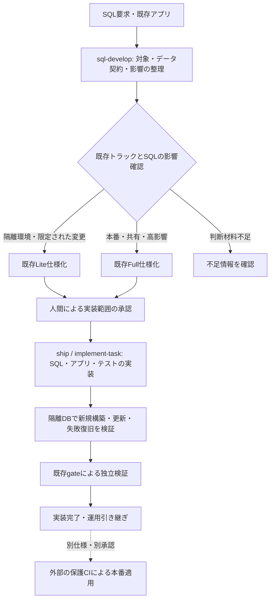

# 設計（lite）: SQL開発フロー

T-001〜T-005はユーザー承認済み、実装・隔離受入・全必須CIを完了。完了証拠は [tasks.md](tasks.md) を参照。2026-11-05 UTCに公式資料を調査した。以下の「採用方針」は資料を踏まえた本プラグインへの提案であり、各社がSDD Forgeの構成を推奨しているという意味ではない。

## 方針

既存 `sdd-implementation` に、SQL案件の入力を整理する `sql-develop` と、実装・検証で共有する参照手順を追加する。仕様は既存の `requirements.md` / `design.md` / `tasks.md` に収め、承認後は `ship → implement-task → lite-gate / quality-gate` を使う。SQLのエンジン・変更内容と、Azure／AWSという配置先を別々に扱う。

今回はSDD Liteの3文書形式で設計提案を行う。これは本開発セッションで製品のフックやCapability Modeを有効化したという記録ではなく、製品内のSQL案件を無条件にLiteへ分類する決定でもない。

### 構成案の比較

| 案 | 利点・負担 | 判断 |
|---|---|---|
| 既存implementationにSQL入口と参照手順を追加 | 承認、移行ツール、実行証跡、gateを再利用。既存 `diagnose` と同様に仕様化前の入口を持てる | **初版に採用** |
| 新規 `sdd-sql` | 独立導入には便利。ただし3ホストmanifest、marketplace、installer、所有権、固定plugin集合の変更が必要 | 専用runtimeや独立配布の必要が出た段階で再検討 |
| AzureとAWSへSQLフローを個別追加 | クラウドごとに導線ができるが、同じPostgreSQLの工程が重複する | 採用しない |

## 利用フロー

入口は `/sdd-implementation:sql-develop <要求または既存仕様>`。Codexなどでは同名スキルを明示して呼ぶ。新しい汎用CLIやSQL実行APIではない。

`sql-develop` は対象を読むだけではDBへ接続しない。既存仕様に不足項目があれば追記案を作り、承認済み範囲を勝手に広げない。承認・Doneを書かず、`implement-task` を直接起動しない。`ship` からSQLタスクを進める場合も同じ参照手順を使う。必要な既存スキルが未導入なら導入方法を示し、代替の承認フローを作らない。

公開入口のメタデータは既存 `diagnose` に合わせ、ユーザーから呼べる定義にする。内部の仕様化・実装・gateは公開入口を再起動せず、同じ `references/` を読む。managed routing中に調査・実装・レビューのworkerが必要なら既存roleの起動経路へ渡し、新しいSQL専用roleや未割当のforkを追加しない。

### Lite／Fullの選択

| 条件 | 扱い |
|---|---|
| 再作成できる隔離DB、合成データ、共有利用者なし、限定されたクエリ／スキーマ変更 | 既存の判定も通る場合に限りLite候補 |
| 本番を対象とする設計・移行、共有DB、PII、権限／RLS、テナント分離、破壊的変更、大規模バックフィル | Full。初版では設計・隔離試験・引き継ぎまで |
| DB版、管理主体、データ分類、対象環境、変更影響が不明 | 情報確認まで実装・接続を停止。安全側に分類しただけで実行を許可しない |
| 既存ContextがFull、既存risk checkerが昇格を要求 | その結果を維持し、SQL側からLiteへ格下げしない |

現行の `lite-upgrade-reason-catalog.json` に `high_risk_migration` などの語彙はあるが、SQL変更を網羅する自動分類器はない。初版は対象・変更内容を確認する手順と独立レビューを追加する。リスク欄の自己申告やSQLキーワード判定だけを権限境界にせず、実際の接続先を隔離DBに制限する。クラウド権限やDB権限の強制は外部環境が担当する。

## Azure・AWS・ソフト開発との分担

| 項目 | SQL共通フロー | 既存フローへの接続 |
|---|---|---|
| データモデル・SQL | テーブル、制約、クエリ、ストアド処理、移行、期待結果 | `sdd-domain` の承認済みモデルがあれば参照し、物理設計と同一視しない |
| アプリ変更 | 新旧スキーマとの互換性、ORM、パラメーター化、トランザクション、エラー処理 | 通常のソフト開発タスクと依存順を共有。DBとアプリを別々にDoneにして不整合を見落とさない |
| Azure | Azure SQLはT-SQL、Azure Database for PostgreSQLはPostgreSQLなど、実エンジンで選択 | Bicep unitは基盤の担当。Entra ID／managed identity、DBロール、ネットワーク、復元先は運用引き継ぎに記録 |
| AWS | RDS／Auroraは製品名だけでなくエンジン・版・サービス差分を記録 | CDK／CloudFormation unitは基盤の担当。IAM DB認証の対応可否、DBロール、TLS、復元・切替条件を記録 |
| 本番適用 | 変更ファイル、対象、順序、前提スキーマ、停止条件、復旧手順を渡す | 初版のSQLフローは接続・適用しない。cloud `apply` の成功をSQL適用成功に読み替えない |

[ADR-0018](../../docs/adr/0018-provider-binding-separation.md) のプロバイダー分離に従う。ただしprovider bindingの詳細語彙やDB実行権限は既存の骨格だけで完成していない。初版で新しいRegistryやProvider Bindingの値を捏造せず、運用情報は仕様の表に記録する。現行クラウドadapterの制限と実クラウド受入未完了も維持する（[Azure](../../docs/cloud/azure.md)、[AWS](../../docs/cloud/aws.md)）。

## データ／IF

新規の状態管理ファイルは作らず、導入先の `design.md` に「SQL開発契約」の表を追加する。

| 情報 | 必須内容 |
|---|---|
| 対象 | engine、正確なversion／互換性設定、ローカル／クラウド製品、対象環境。接続秘密は記載しない |
| 管理主体 | migration ownerと版、既存のschema／migration／queryの配置、対象オブジェクト。管理主体が衝突する場合は停止 |
| 変更 | query／schema／backfill／routine、新旧アプリの対応、データ量・分布、分類、変更前の版 |
| 正しさ | 入出力、キー、NULL、型、制約、期待件数・値、金額・日時などの境界条件 |
| 実行条件 | 検証用DBの識別、作成・破棄の責任、許可する処理、時間・ロック・資源の上限、並行実行の排他 |
| 回復 | atomicか非atomicか、チェックポイント、再実行時の扱い、roll-forward／restoreの選択と損失範囲 |
| 性能 | 必要性、測定用データ、負荷、反復回数、事前に合意した合格基準。不要なら理由 |
| 運用引き継ぎ | 本番適用未実施の表示、成果物と対象revision、必要なDB権限、前提状態、停止・復旧条件 |

検証結果は既存の実装報告・品質レポートへ記載し、共通実行器の `execution.json` を参照する。SQL用の署名済みevidence-bundleをLiteに追加しない。対象commitと未コミット差分の有無、ツール／DBの実測版、fixtureの識別、実行コマンド、終了状態、期待結果・副作用、環境制約を残す。再現に必要な値だけを残し、接続文字列や機微な行・パラメーターを出力しない。

## エンジンと既存ツールの使い分け

| 系統 | 初版の参照検証 | 新規案件の推奨と制約 |
|---|---|---|
| PostgreSQL | PostgreSQL 18、Flywayの版付きSQL migration、psqlによる期待結果検査 | 既存ownerを優先。concurrent index、ロック時間、失敗後のinvalid indexなどを個別に扱う |
| T-SQL | SQL Server 2025の開発用環境、Microsoft.Build.Sql、SqlPackage、sqlcmd | SQL Database Projectsを新規案件の候補とする。`.dacpac` と生成された変更計画・スクリプト、pre/post scriptをレビュー。Azure SQLへの適合は別途確認 |
| MySQL | MySQL 8.4、Flyway、mysql clientによる期待結果検査 | DDLの暗黙commitと途中適用を前提に復旧を試す。MariaDB／Aurora互換まで一括で認定しない |

版は参照案件の選定であり、自動で導入先をアップグレードする指定ではない。実装時に利用可能なパッチ版・CLI・コンテナdigest・ライセンス条件を確認し固定する。未検証の版は未検証と表示する。SQLFluffは既存lintがない場合の候補とし、dialectを明示する。すべてのlint・migration製品を必須依存にしない。既存Liquibase／ORM案件はそのプロジェクトのコマンドと試験を引き継ぎ、初版の参照案件で全製品の互換性が実証されたとは扱わない。

### 変更・検証の具体的なルール

1. **変更前を固定する**: 最後に適用した版、履歴、スキーマの取得方法・範囲を記録する。履歴のchecksum検証と、実スキーマの差異確認を別のチェックにする。実スキーマ比較ができなければ未確認を残す。
2. **変更を分割する**: 既存利用者のいる変更はexpand → 移行・バックフィル → 新旧アプリ検証 → contractを基本とする。撤去は別タスク。二重書込みの整合性、並行更新、NULL・重複・欠損、バックフィル中断後の再開を設計する。
3. **無条件で再実行しない**: migration ownerの履歴と排他を使う。版付きmigrationは一度だけ適用し、バックフィルは安定したキーとチェックポイントで再開する。失敗時に `repair`、`clean`、`baseline`、down migrationで自動的に成功へ寄せない。クライアントのタイムアウトや切断だけでDB側の停止・rollback完了とせず、実行中処理・transaction・lock・適用履歴を確認する。結果不明のまま再実行しない。
4. **隔離DBを使う**: 検証用に作った資源IDを記録し、その資源だけを破棄する。実データのコピー、既存の開発共有DB、環境変数に偶然存在する本番接続先は使わない。ネットワークと資格情報を隔離し、作成・接続先確認ができなければ実行しない。
5. **正しさを優先する**: 新規構築と前版からの更新に同じ期待結果を適用する。行数だけでなくキー・値・制約・アプリの読み書きも確かめる。クエリ最適化では結果集合が一致することを性能比較より先に確認する。
6. **実行計画を区別する**: 推定計画と実測計画を区別する。`EXPLAIN ANALYZE`、トリガー、ストアド処理、テンプレートmacroは実行を伴い得る。`SELECT`や`ROLLBACK`を理由に無害と扱わず、隔離環境でのみ検証する。
7. **運用に渡す**: ロック／実行時間の上限、対象DB、期待する前提状態、復旧方法、観測項目を記録する。本番前の対象・履歴・drift再確認と、変更があれば再レビューする責任を引き継ぐ。バックアップ取得だけで復旧可能とせず、復元先・切替・失われる更新も示す。

## 2026年時点の調査結果と採用方針

「最新」という語でツールを固定せず、以下の公式資料を確認日付きの設計根拠とする。SQLの安全な変更という長期的な原則と、2026年の製品状況を分けて扱う。

| 出典・確認した事実 | 本提案への反映 |
|---|---|
| [S01 Microsoft: Azure Data Studioの終了](https://learn.microsoft.com/en-us/sql/tools/whats-happening-azure-data-studio?view=sql-server-ver17)。2026-02-28に終了し、更新・security fixは提供されない | 新規手順はVS CodeのMSSQL拡張とCLIを案内。旧ツールを標準にしない |
| [S02 Microsoft: SQL Database Projects](https://learn.microsoft.com/en-us/sql/tools/sql-database-projects/sql-database-projects?view=sql-server-ver17)。宣言的T-SQLをtarget platformに対して検証し、dacpacを生成。新規開発にはMicrosoft.Build.Sqlを推奨 | T-SQLの新規案件の候補。既存migration ownerは強制移行しない |
| [S03 Microsoft: SqlPackage Publish](https://learn.microsoft.com/en-us/sql/tools/sqlpackage/sqlpackage-publish?view=sql-server-ver17)。データ損失防止やdriftの設定があり、Publishには対象DBの強い権限が必要 | plan／scriptレビューと本番権限を分離。`BlockOnPossibleDataLoss`を勝手に無効化しない。設定だけで全損失を防げるとはしない |
| [S04 Redgate: Validate](https://documentation.red-gate.com/flyway/reference/commands/validate)。適用履歴と移行ファイルの名前・型・checksum等を照合 | 履歴検証を必須化。ただし実スキーマのdrift検出と混同しない |
| [S05 Redgate: Drift analysis](https://documentation.red-gate.com/flyway/flyway-concepts/drift-analysis)。移行履歴外のDB変更を別に確認する考え方 | 比較範囲とsnapshotを明記。商用機能が利用できない場合も自動PASSにせず、既存の比較手段を選ぶ |
| [S06 Prisma: Expand and contract](https://www.prisma.io/dataguide/types/relational/expand-and-contract-pattern)。スキーマ・データ・クライアントを段階的に移行する | 追加と撤去を分け、新旧アプリ互換性と移行中の書込みを試す。これだけで無停止を保証しない |
| [S07 PostgreSQL: CREATE INDEX](https://www.postgresql.org/docs/18/sql-createindex.html)。CONCURRENTLYはtransaction block内で使えず、失敗時にinvalid indexが残る場合がある | migration単位のtransaction設定と失敗後の状態確認を設計する |
| [S08 PostgreSQL: Using EXPLAIN](https://www.postgresql.org/docs/18/using-explain.html)。ANALYZEはクエリを実行して副作用も生じる | 推定計画と実測を区別し、実測は隔離DBに限定する |
| [S09 MySQL 8.4: Implicit commit](https://dev.mysql.com/doc/refman/8.4/en/implicit-commit.html)。多くのDDLは暗黙commitを伴う | 全SQLをtransactionで囲めば戻せるという設計を採らない |
| [S10 OWASP: SQL Injection Prevention](https://cheatsheetseries.owasp.org/cheatsheets/SQL_Injection_Prevention_Cheat_Sheet.html)。値のパラメーター化、動的構造の許可リスト、最小権限 | アプリとの接続コードと動的SQLを受入対象に含める |
| [S11 SQLFluff: Security Considerations](https://docs.sqlfluff.com/en/stable/usage/security)。templatingやlibrary設定はコード／SQL実行につながり得る | lintも無条件に無害と扱わない。初版はraw SQLを基本とし、未信頼設定・macroに本番資格情報を渡さない |
| [S12 AWS: RDS Blue/Green limitations](https://docs.aws.amazon.com/AmazonRDS/latest/UserGuide/blue-green-deployments-considerations.html)。PGのphysical方式はgreen側schema変更不可。logical方式はDDLを複製しない。切替後のPITR履歴にも制限がある | Blue/Greenを全DB変更の万能な手段にせず、製品・版・複製方式・復旧先を個別確認する |
| [S13 AWS: IAM DB authentication](https://docs.aws.amazon.com/AmazonRDS/latest/UserGuide/UsingWithRDS.IAMDBAuth.html)。対応engine／regionに制約があり、token期限は15分。接続後sessionの寿命とは別 | 短命認証を候補にするが、DBロール・接続終了・SQL監査を別に設計する。全RDSに一律適用しない |
| [S14 Microsoft: Azure SQL restore](https://learn.microsoft.com/en-us/azure/azure-sql/database/recovery-using-backups?view=azuresql)。復元は別DBを作成し、既存DBへ上書きしない | rollback SQLだけでなく復元先・接続切替・RPO／RTOの確認を引き継ぐ |
| [S15 dbt: Unit tests](https://docs.getdbt.com/docs/build/unit-tests)／[model contracts](https://docs.getdbt.com/docs/mesh/govern/model-contracts)。変換ロジックの試験とモデル出力の契約を扱う | 分析SQLは後続のanalytics profileへ分ける。OLTP migrationの成功をdbt／warehouseの検証へ流用しない |

## 変更／新規ファイル

| 場所 | 責務 |
|---|---|
| `plugins/sdd-implementation/skills/sql-develop/SKILL.md` | 新規入口。入力整理、既存仕様化への引き渡し、DB未接続の境界 |
| 同スキルの `references/` と `templates/` | 共通SQL契約、3エンジンの手順、検証・運用引き継ぎ。実行時資料は配布されるスキル内へ置く |
| `plugins/sdd-implementation/skills/implement-task/SKILL.md` | 承認済みSQLタスクで同じ参照手順を読み、既存実装報告へ結果を返す |
| 既存の `lite-spec`／bootstrap、`lite-gate`／`quality-gate` の参照導線 | SQL成果物を通常仕様へ収め、要求されたSQL検証を既存gateで確認。既存状態・昇格判定は変更しない |
| `docs/sql-development.md`、`docs/skill-reference.md`、`docs/contributor/skill-reference-detail.md`、`docs/workflow-guide.md`、READMEのドキュメントマップ | 利用入口、対応範囲、Azure／AWSとの分担 |
| `tests/validate-repository.ps1`、SQLの動作試験・fixtures、既存CI catalog／workflow | スキル集合と配布参照の整合、以下の受入検証 |

既存3ホストmanifestは `skills/` 配下を公開しているため、新規plugin登録やinstallerの既定選択を変更しない。既存のmanaged model選択、Context、フック、停止要求の契約を新スキルにも適用し、新しいモデル振り分けは作らない。MCPの次コマンド案内は既存状態モデルを使う。

## テスト方針と初版の完了条件

| 観測する条件 | 合格の根拠 |
|---|---|
| 入力整理・承認境界 | 未指定engine、管理主体の衝突、既存Full、本番DROP、PII、未知対象を含む対話ケースで、必要な確認・Full引き渡しを行い、未承認実装やDB接続をしない |
| PostgreSQL参照案件 | 追加列とパラメーター化クエリを新規構築・前版更新の両方で確認。concurrent index失敗時の残存状態と回復を実DBで確認 |
| T-SQL参照案件 | project build、隔離DBへの初期配置と更新、生成計画／scriptのレビュー、期待結果と破壊的変更の停止を確認 |
| MySQL参照案件 | 新規構築・前版更新、途中DDL失敗後に残る状態とroll-forward手順、二重実行防止を実DBで確認 |
| 共通の負例 | migration履歴の改変、実スキーマだけの変更、空／欠損／重複データ、タイムアウト、間違った検証先、未信頼macro、秘密の混入を見逃さない |
| アプリ・性能 | 新旧アプリの読み書き互換性と期待結果を確認。性能案件では同条件で測定し、合意した閾値を満たす。未計測は未計測と記録 |
| 導入と回帰 | Claude／Codex／Copilotの配布先からスキルと参照資料を読める。通常ソフト開発とAzure／AWSへの既存導線が変わらない |
| 独立検証 | 実装担当とは別のコンテキストが実行結果を確かめ、既存gateで判定。必須試験の未実施はPASSにしない |

DBエンジン固有試験はLinux CIの隔離DBで各1回を基本とし、3 OSへ同じDB試験を複製しない。共通のPowerShell仕様は7で実施し、5.1には新規変更で差が生じる起動・引用・パス境界だけを追加する。WindowsホストからLinux CIへ検証を委ねた場合は、その構成を記録し、WindowsネイティブDB検証済みと表示しない。コンテナ／製品の実行条件が整わなければ該当受入はBlockedとする。

初版の完了は3参照案件と上記導線の受入まで。本番リリース実績、Azure SQL／RDS／Aurora実環境での性能・復旧保証は含まない。
