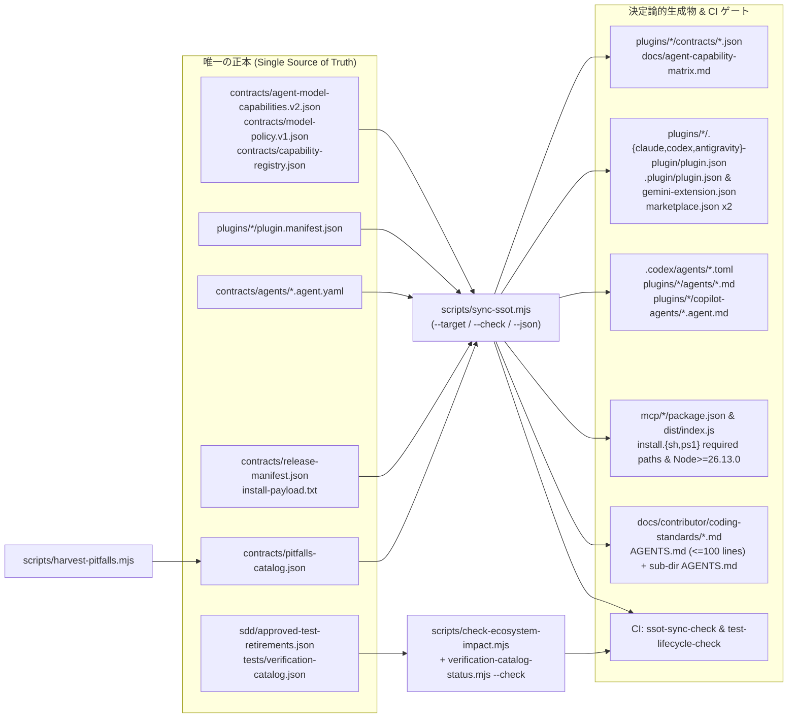

# 設計書（SDD Core）: ssot-unification-v22

- **Feature**: `ssot-unification-v22`
- **ADR**: `docs/adr/0056-ssot-unification-pitfalls-and-test-lifecycle.md`
- **Requirements**: `specs/ssot-unification-v22/requirements.md`
- **Baseline Audit Evidence**（`origin/main` `4876b04e9`, Node.js `v26.13.1` 実測）:
  - `contracts/capability-registry.json` と `plugins/sdd-quality-loop/contracts/capability-registry.json` および全 18 件の `plugins/*/contracts/*.json` は現行ルート `contracts/` とバイト一致。
  - `install.sh`（1707 行, L568 `node_version_ok`, L1227 `REQUIRED_PATHS`）と `install.ps1`（L463 `20.0.0`, L983 `Get-RequiredPaths`）に必須パスと Node 下限が二重ハードコード。
  - `plugins/sdd-implementation/gemini/gemini-extension.json:2` は `"name": "sdd-forge-model-selection"` で他 CLI と不整合。
  - `.codex/agents/sdd-investigator.toml:22` に Claude 固有ツール名 `Read, Grep, or Glob` が混入し、両 `.toml` に `# x-sdd-model:` / `# x-sdd-effort:` が欠落。
  - `AGENTS.md` は 346 行、`mcp/ci-mcp/package.json`・`mcp/local-env-mcp/package.json` は `"version": "0.1.0"` のまま `2.1.5` と乖離。

## 1. システム全体アーキテクチャ

## 2. ドメイン別詳細設計

### 2.1 統一同期 CLI（`scripts/sync-ssot.mjs`）
- Node.js 26.13+ ESM・外部依存ゼロで実装。
- ターゲット一覧: `all | contracts | manifests | agents | release | conventions | docs | diagnostics`
- マーカー置換規則: `<!-- BEGIN GENERATED:<id> -->` 〜 `<!-- END GENERATED:<id> -->` のみ差し替え。片側欠落・重複・逆順は exit `2`（Fail-Closed）。
- Remediation-Injecting Lints（R-03）: ドリフト検知時（exit `1`）は必ず `{ file, source, command, reason }` を標準エラー（および `--json` で stdout JSON）へ出力する。

### 2.2 Phase 1: 契約 JSON・能力レジストリ・モデルポリシー
- `contracts/agent-model-capabilities.v2.json` / `contracts/model-policy.v1.json` / `contracts/capability-registry.json` を正本とし、`plugins/*/contracts/*.json` のうちルート `contracts/` に同名ファイルがある全 18 ファイルを自動走査で SHA-256 同期する。
- `contracts/model-policy.v1.json`: 役ごとの候補順をロール下限に整合させ、退役役（旧パネル検証役等）を整理する（既存テストとの互換スキーマ `model-policy/v1` を維持）。
- `docs/agent-capability-matrix.md`: `capability-matrix-roles`, `capability-matrix-tiers`, `capability-matrix-role-floors`, `capability-matrix-v2-guardrails` マーカー区間へ自動生成し、v1 `sdd-hook-guard.py` 記述を現行 v2 `sdd-soft-guard.mjs` へ同期する。
- `contracts/agent-model-capabilities.v2.md`: 来歴・一次確認日・参照 URL 記録（AC-012 provenance）に特化。
- `plugins/sdd-implementation/skills/implement-task/references/agent-delegation-policy.md` および `plugins/sdd-quality-loop/references/cross-model-verification-policy.md` の古いモデル固定名・手書き役表を正本参照＋生成マーカー区間へ統一する。

### 2.3 Phase 2: マルチ CLI マニフェスト & 全階層エージェントプロンプト SSOT
- 全 8 プラグイン（`sdd-bootstrap`, `sdd-ship`, `sdd-implementation`, `sdd-quality-loop`, `sdd-review-loop`, `sdd-domain`, `sdd-azure-cloud`, `sdd-aws-cloud`）直下に `plugin.manifest.json` を配置する。
- `sync-ssot.mjs --target manifests` は `plugins/*/` をディレクトリ走査し、`plugin.manifest.json` 不在時は exit `2` で失敗する。各 CLI ごとの `skills` / `hooks` / `interface` / `contextFileName` スキーマへ決定論的に変換し、両 `marketplace.json` を生成する。
- `plugins/sdd-implementation/gemini/gemini-extension.json` の `name` を `"sdd-implementation"` へ統一し、`uninstall.{sh,ps1}` および関連テストも同時更新する。
- 全 7 エージェントロール（`sdd-investigator`, `sdd-evaluator`, `spec-reviewer-a`, `spec-reviewer-b`, `domain-reviewer-a`, `domain-reviewer-b`, `wfi-auditor-a`, `wfi-auditor-b`）を `contracts/agents/<role>.agent.yaml`（JSON-compatible YAML または厳密パーサ対応構造化 YAML）として正本化する：
  - 全ロール本文を 6 ブロック（`Role & Non-Goals` / `Boundary & Security` / `Inputs` / `Process` / `Verification Criteria` / `Output & Failure Contract`）へ統一。
  - `{{READ_TOOLS}}` / `{{SEARCH_TOOLS}}` / `{{SHELL_TOOL}}` プレースホルダを生成時にターゲット CLI（Claude: `Read, Grep, Glob`, Codex: `read-only shell commands`, Copilot: `read, search`）へ展開し、Claude 固有ツール名の Codex 混入を根絶。
  - Claude frontmatter は `model: inherit`（既存回帰テスト準拠）、Codex `.toml` 先頭に `# x-sdd-model: <current-frontier-model>` / `# x-sdd-effort: <effort>` 参照コメントを付与。
  - `render-agent-frontmatter.{sh,ps1}` を廃止し、`install-payload.txt` から除去する。

### 2.4 Phase 3: 統一バージョニング（`v2.1.5`）・Node 26.13+・`AGENTS.md` 圧縮・ピットフォール正本
- `contracts/release-manifest.json`:
  - `version: "2.1.5"`, `minNodeVersion: "26.13.0"`, `nodeCiVersion: "26.13.0"`, `requiredPaths`（コア必須パス＋クラウド追加パス）。
- `sync-ssot.mjs --target release`:
  - `mcp/*/package.json` を自動走査し、全 3 MCP パッケージ（`sdd-forge-mcp`, `ci-mcp`, `local-env-mcp`）の `version` と `engines.node: ">=26.13.0"`、および `src/server.ts` / `src/index.ts` のバージョン定数を同期・検査する。
  - `install.sh` / `install.ps1` は `contracts/release-manifest.json`（またはマーカー同期された `REQUIRED_PATHS` / `MIN_NODE_VERSION`）から必須パスと `26.13.0` を参照し、`scripts/bump-version.sh` は `contracts/release-manifest.json` 更新後に `node scripts/sync-ssot.mjs --target release` を実行する単一フローへ刷新する。
  - `.github/workflows/{test,release,sdd-guardrails}.yml` を `node-version: "26.13.0"` に統一し、`ssot-sync-check`・`test-lifecycle-check`・`capability-registry-parity.tests.sh` を必須チェック接続、かつ `check-evidence-bundle-parity.tests.py` で `pwsh` 必須化（サイレントスキップ廃止）する。
- `contracts/pitfalls-catalog.json` ＋ `docs/coding-conventions.md`（R-01〜R-05）＋ 100 行以内のルート `AGENTS.md` ＋ サブディレクトリ `AGENTS.md`（`mcp/AGENTS.md`, `plugins/AGENTS.md`, `tests/AGENTS.md`）＋ `CODEOWNERS` 保護拡張 ＋ `.gitattributes` `linguist-generated=true`。
- `sync-ssot.mjs --target conventions` は以下を機械検査する：
  1. ルート `AGENTS.md` の行数 ≤ 100 行、および `## Required Workflow` / `## Active Spec Directories` 整合。
  2. リポジトリのアクティブ領域（`reports/verification/` の歴史的フィクスチャを除く全階層）に `CLAUDE.md` ファイルおよび `AGENTS.md` / `CLAUDE.md` シンボリックリンクが存在しないこと。
  3. `docs/contributor/coding-standards/{common,bash,powershell,python,typescript-javascript}.md` のピットフォール表が `contracts/pitfalls-catalog.json` と完全同期していること。

### 2.5 Phase 4: 動的影響範囲チェック（TIA）・安全テスト改廃・Compound 抽出
- `scripts/check-ecosystem-impact.mjs`:
  - `--base <ref> --head <ref>`（または `--diff-json <file>` / `--name-status-file <file>` でテスト容易化）を受け取り、変更イベント `A` / `M` / `D` / `R` ごとに以下を動的検査する：
    - `A`: 新規プラグイン／スキル／契約に対して `plugin.manifest.json`・`install-payload.txt`・`tests/verification-catalog.json`・テストの存在を検証。
    - `M`: `tests/verification-catalog.json` の `triggers` と AST/import 依存グラフから影響テストスイートを抽出し、契約変更時のテスト／生成文書更新漏れを検査。
    - `D`: 削除された機能のみを参照するゴーストテストの残留、およびテストファイル自体の削除が `sdd/approved-test-retirements.json`（`test_path`, `git_blob_sha`, `reason`, `replaced_by_or_retired_feature`, `negative_parity_verified: true`, `approved_by`）で承認されているかを検証。
- `tests/verification-catalog-status.mjs --check`:
  - `file-missing` > 0、またはベースライン超過の `not-in-ci`、および `docs/operations/verification-catalog-status.md` ドリフトを exit 1 でブロック。
- `scripts/harvest-pitfalls.mjs`:
  - `docs/review-tickets/RT-*.yml`、`docs/workflow-improvements/WFI-*.md`、および `git log --grep='^fix'` を走査し、未登録ピットフォール候補と、記録回数 ≥ 2 の機械ルール昇格対象（`escalateToMechanical: true`）を JSON/Markdown 出力する。

### 2.6 Phase 5: 利用者プロジェクト横展開（軸 B: Productize）
- `plugins/sdd-bootstrap/scripts/init-project-governance.mjs`:
  - プロジェクト構造・言語・モノレポ／モジュール構成を自動検出し、戦略的 DDD ティア（`Lite` / `Standard` / `Full`）を自動判定（`--tier` 上書き可）。
  - 生成物: 軽量ルート `AGENTS.md`（≤100 行、`CLAUDE.md` 混在禁止明記）、`sdd/glossary.json`、`sdd/context-map.json`（Standard/Full：`notResponsibleFor`・`allowedDependencies`）、Bounded Context 別 `<context>/AGENTS.md`（Standard/Full）、`sdd/pitfalls-catalog.json`、`sdd/verification-catalog.json`、`.gitattributes`（`linguist-generated=true`）。
- `plugins/sdd-implementation/scripts/inject-pitfalls.mjs`:
  - 対象タスクの変更言語・モジュールに該当するアクティブピットフォールのみを `sdd/pitfalls-catalog.json` から Progressive Disclosure 抽出して注入する。
- `plugins/sdd-quality-loop/scripts/v2/check-architecture-fitness.mjs`:
  - 利用者プロジェクトの `sdd/context-map.json` と `sdd/glossary.json` に基づき、依存方向 Fitness Function（`domain-isolated` / `context-via-api`）とユビキタス言語チェック、および `CLAUDE.md` 混在チェックをゲート実行する。
- `plugins/sdd-review-loop/scripts/compound-pitfalls.mjs`:
  - レビュー指摘・バグ修正から利用者プロジェクトの `sdd/pitfalls-catalog.json` 更新候補および 2 回発生ルールの昇格提案を生成する Compound ステップ CLI。
- 各プラグインの `SKILL.md`（`sdd-bootstrap`, `sdd-implementation`, `sdd-quality-loop`, `sdd-review-loop`, `sdd-ship`）へ上記ツール群の運用手順を統合する。

## 3. Alternatives Rejected

`docs/adr/0056-ssot-unification-pitfalls-and-test-lifecycle.md` に記録のとおり、①個別同期スクリプトへの継ぎ足しパッチ、②`CLAUDE.md` 並存／symlink 運用、③テスト削除の無条件許可または無条件禁止、④全プロジェクト一律の戦術的 DDD 強制を却下した。

## 4. 検証計画

- 新規統合テストスイート `tests/ssot-unification-v22.test.mjs` にて AC-001〜AC-012 すべてを実実行（Node.js `v26.13.1`）で検証する。
- 既存全スイート（`tests/v2-*.test.mjs`, `mcp/{sdd-forge-mcp,ci-mcp,local-env-mcp}`, `tests/install.tests.sh`, `tests/uninstall.tests.sh`, `tests/capability-registry-parity.tests.sh`, `tests/check-evidence-bundle-parity.tests.py`, Python CI スイート群、`sdd-doctor.mjs`, `check-traceability.mjs --strict`, `check-sdd-structure.sh`）を Node.js `v26.13.1` で回帰確認する。
