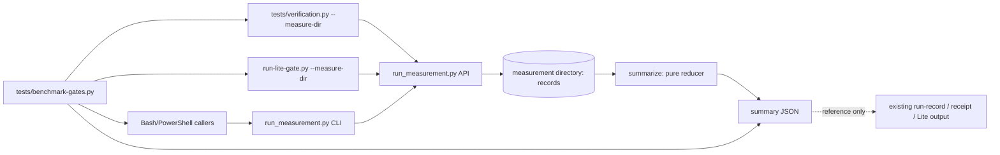

# Design: verification-measurement

Impl-Review-Status: Pending
Feature Type: repository verification tooling (observation only)

## Technical Summary

One standard-library Python helper, `plugins/sdd-quality-loop/scripts/run_measurement.py`, writes immutable measurement records into an explicitly chosen directory and reduces them into one summary. Existing execution owners call it around their actual process boundary behind one optional flag; shell and PowerShell callers use its CLI. A fixed benchmark driver runs the frozen matrix and the before/after semantic comparison. Nothing else changes: no executor, no event bus, no database, no cache, no new authority.

Chosen shape (pstack-architect): of (1) a v3 live run-record, (2) a free-standing runner with an event store and (3) a reference-joined sidecar written by existing owners, (3) is chosen. (1) is ruled out by `validate-nontty-spec-launch.py:2213` coercing records to v2 and by the v1 no-flag goldens; (2) duplicates `tests/verification.py` and `run-lite-gate.py` execution ownership. Simplification: there is no generic event stream or `event_id`. A span is two immutable files (start, finish); a milestone is one file. Idempotence is semantic: a retried call whose caller-supplied fields equal the persisted record returns that record unchanged (no re-timestamp). Cross-attempt analysis is one pure reducer (`join_attempts`) over existing measurement directories, not a new state engine.

## Architecture



The helper never starts a process. Owners keep their argv, streams, timeouts, exception and exit-code handling. Exit-code exception, stated once for every document: an invalid measurement configuration detected before execution starts (bad flag value, unusable or symlinked directory, directory already holding a measurement) exits 2 and executes nothing. After execution starts, measurement errors are caught at the owner boundary, reported as one `measurement: incomplete` stderr line, and never change the owner's exit code.

## Components

| Component | Status | Responsibility |
|---|---|---|
| `plugins/sdd-quality-loop/scripts/run_measurement.py` | new (T-001) | Record validation/writing, clock domain, CLI, pure reducer. |
| `contracts/run-measurement.schema.json` | new (T-001) | JSON Schema for the four record kinds. Root `contracts/` only; no plugin copy unless packaging tests require one (then byte-identical, tested). |
| `tests/run-measurement.tests.py`, `tests/fixtures/run-measurement/` | new (T-001) | Fixture-first reducer and writer tests. |
| `tests/verification.py` | changed (T-002) | Optional `--measure-dir`, `--measure-parent`. |
| `plugins/sdd-lite/lib/run-lite-gate.py` | changed (T-002) | Optional `--measure-dir`, `--measure-parent`; helper located as sibling plugin, following the existing pattern at `run-lite-gate.py:36,59`. |
| `plugins/sdd-quality-loop/skills/quality-gate/SKILL.md` | changed (T-002) | Optional Bash/PowerShell caller snippets around existing gate calls; product artifact, no gate order change. |
| `tests/benchmark-gates.py`, `tests/benchmark-gates.tests.py`, `tests/fixtures/run-measurement/benchmark.json` | new (T-003) | Frozen matrix, paired overhead, per-case semantic comparison, sample classification, comparison fingerprint. |
| `docs/verification.md` | changed (T-003) | Manual helper CLI protocol for review-preparation, model, human-wait, human-active spans and milestones. |

## Data Plan

Directory layout (the directory is supplied by the caller; it must not be a symlink and is created if absent):

```
<dir>/measurement.json                 kind=measurement (exactly one)
<dir>/spans/<span_id>.start.json       kind=span-start
<dir>/spans/<span_id>.finish.json      kind=span-finish
<dir>/marks/<milestone>.json           kind=mark
```

Writes use `os.open(..., O_CREAT|O_EXCL|O_WRONLY)` on a temporary name in the same directory followed by `os.link` to the final name (create-exclusive publication; no reader sees a partial file). If the final name exists, the helper compares the persisted record with the candidate after removing the helper-sampled keys `clock_domain`, `ns` and `utc` (and, for `measurement`, `environment.os/arch/python`): equal → success, the persisted record is returned unchanged and nothing is rewritten; different → conflict (exit 3), first file unchanged. File hashes are part of the compared fields, so a retry after a referenced file changed conflicts. A retry is only possible with an explicit `--span-id` (generated ids are new each call). Records are compact UTF-8 JSON with sorted keys and a trailing newline, ≤ 64 KiB, parsed with duplicate-key rejection (the `unique_object` pattern of `tests/verification.py:20-26`).

Identifiers used in file names or as join keys — `span_id`, `measurement_id`, `run_id`, `parent_run_id`, `target_run_id`, `scenario_id`, `trial_id`, opaque refs: `^[A-Za-z0-9][A-Za-z0-9._:-]{0,63}$`. `command_id` is an opaque label, never a file name or path lookup: `^[A-Za-z0-9][A-Za-z0-9._:/-]{0,127}$` (adds `/`, so `suite:tests/run-measurement.tests.py` is valid). Free text (`rerun_detail`, missing reasons supplied by callers): ≤ 200 chars, no control characters. Enum values are exact lowercase matches.

### Clock

`ns = time.monotonic_ns()`; `utc = datetime.now(timezone.utc)` ISO-8601 with microseconds and `Z`. `clock_domain = "linux-boot:" + /proc/sys/kernel/random/boot_id` when readable, else `"process:" + uuid4` fixed per process (OQ-1). Durations are computed only when start and finish domains are equal. Tests inject time only through the private `_clock()` function (returns `(clock_domain, ns, utc)`), which every public API and CLI path uses; there is no public timestamp parameter.

### Record fields (all keys always present; nullable as stated)

- `measurement`: `schema`, `kind`, `measurement_id`, `run_id`, `parent_run_id`?, `scope` (`all`|`feature`), `feature`?, `task`?, `attempt` (int ≥ 1), `rerun_reason` (`initial`|`fix`|`resume`|`repeat`|`other`), `rerun_detail`?, `scenario_id`?, `trial_id`?, `environment` `{head?, dirty?, os, arch, python, tools: {name: version}, target_count?, input_manifest_sha256?}`, `experiment_ref`?, `variant_ref`?, `decision_ref`?, `refs_missing_reason` `{field: "not-supplied"}` for each null ref, `clock_domain`, `ns`, `utc`. `os`/`arch`/`python` come from `platform.system()`, `platform.machine()`, `platform.python_version()`; everything else is caller-supplied. This key set is the complete allowlist (TEST-022).
- `span-start`: `schema`, `kind`, `span_id`, `parent_span_id`?, `phase` (`session`|`gate`|`command`|`review-preparation`|`model`|`human-wait`|`human-active`), `command_id`, `inputs` `[{path, sha256?, missing}]`, `clock_domain`, `ns`, `utc`.
- `span-finish`: `schema`, `kind`, `span_id`, `outcome` (`success`|`failure`|`timeout`|`interrupted`|`rejected`|`abandoned`|`undecided`), `exit_code`?, `signal`?, `logs` `[{stream (stdout|stderr|combined), path, sha256?, missing, truncated}]`, `artifacts` `[{kind (run-record|verification-receipt|lite-output), path, sha256?, missing, target_run_id?}]`, `token_usage`? `{input, output, source_ref}`, `token_usage_missing_reason`?, `cost`? `{amount (decimal string), currency (ISO 4217 upper-case), source_ref}`, `cost_missing_reason`?, `clock_domain`, `ns`, `utc`.
- `mark`: `schema`, `kind`, `milestone` (`idea-received`|`comparable-ready`|`human-decision`|`implementation-verified`), `ref`?, `clock_domain`, `ns`, `utc`.

The outcome is declared by the owner; the helper never infers it from an exit code.

Paths in `inputs`, `logs` and `artifacts` are stored as supplied; a relative path is resolved against the caller's working directory when hashed at write time and against `ref_root` (default: working directory) when `summarize` re-hashes it. A missing file is recorded as `missing: true, sha256: null` (diagnostic `missing-ref`); a file whose current bytes differ from the recorded hash gives diagnostic `ref-changed`; both are blocking. Artifact references are attached by the owner to its own `session` span finish after it has published the artifact in that same execution (late binding); `target_run_id` is caller-supplied (the run-record's own `run_id`; null for receipts and Lite outputs, which have none) and is never equated with the measurement's `run_id`.

## API / Contract Plan (fixed)

### Python

```python
class MeasurementError(Exception):
    code: str  # "invalid" | "conflict" | "io"

def open_measurement(directory, *, measurement_id, run_id, scope, feature=None, task=None,
                     attempt=1, rerun_reason="initial", rerun_detail=None, scenario_id=None,
                     trial_id=None, parent_run_id=None, head=None, dirty=None, tools=None, target_count=None,
                     input_manifest_sha256=None, experiment_ref=None, variant_ref=None,
                     decision_ref=None) -> dict
def start_span(directory, *, phase, command_id, span_id=None, parent_span_id=None,
               inputs=()) -> str            # returns span_id (uuid4 hex when not given)
def finish_span(directory, span_id, *, outcome, exit_code=None, signal=None, logs=(),
                truncated=(), artifacts=(), token_usage=None, cost=None) -> dict
def mark(directory, milestone, *, ref=None) -> dict
def summarize(directory, *, as_of="now", ref_root=None) -> dict   # as_of: "now" | None
def join_attempts(directories) -> dict      # kind: attempt-chain; pure, reads only these dirs
def statistics(samples) -> dict             # {median, min, max, mad} over the given numbers
```

`start_span` requires an existing `measurement.json`; `finish_span` requires the matching start. `logs` is a sequence of `(stream, path)`; `truncated` a set of stream names; `artifacts` a sequence of `(kind, path, target_run_id_or_None)`. `open_measurement`, `finish_span` and `mark` return the persisted record (the original one on an equal retry). `start_span` returns only the span id of the persisted start record (the same id on an equal retry), matching CLI `start`.

### CLI (same module, `python3 run_measurement.py <subcommand>`)

```
open      --dir D --measurement-id ID --run-id ID --scope all|feature [--feature F] [--task T]
          [--attempt N] [--rerun-reason R] [--rerun-detail TEXT] [--scenario-id S] [--trial-id T]
          [--parent-run-id ID] [--head SHA]
          [--dirty true|false] [--tool NAME=VERSION]... [--target-count N]
          [--input-manifest-sha256 HEX] [--experiment-ref R] [--variant-ref R] [--decision-ref R]
start     --dir D --phase P --command-id C [--span-id S] [--parent-span-id S] [--input PATH]...
          (prints the span id on stdout; an equal retry prints the same id)
finish    --dir D --span-id S --outcome O [--exit-code N] [--signal NAME]
          [--log STREAM=PATH]... [--truncated STREAM]...
          [--artifact KIND=PATH [--artifact-run-id ID]]...
          [--tokens-input N --tokens-output N --tokens-source REF]
          [--cost AMOUNT --currency CUR --cost-source REF]
mark      --dir D --milestone M [--ref R]
summarize --dir D [--as-of now|none] [--ref-root DIR] [--output PATH]
join      --dir D [--dir D]... [--output PATH]
```

`--artifact-run-id` applies to the immediately preceding `--artifact`.

Exit codes: 0 success (including identical repeat, and `summarize` of an incomplete measurement), 2 invalid input/usage, 3 conflict, 4 I/O. Stderr carries one line `run-measurement: <code>: <fixed message>` without paths or file content.

### Summary (`kind: summary`)

`schema`, `kind`, `measurement` (header copy), `as_of` `{ns, clock_domain, utc}`|null, `complete`, `spans` (per span: ids, phase, command_id, domains, `start_ns`, `end_ns`, `duration_ns`?, `duration_reason`?, `censored_ns`?, outcome or `open`, exit_code, signal, inputs, logs, tokens, cost), `counts` `{started, by_outcome: {7 outcomes + open}, invocations: {command_id: n}}`, `elapsed` `{session_ns, machine_elapsed_ns, machine_effort_ns, machine_phases_unobserved: [phase], phases: {phase: {count, elapsed_ns, effort_ns}}, human_wait_ns, human_active_ns, *_reason}` (all seven phases always present), `lead_times` `{idea_to_comparable_ns, comparable_to_decision_ns, decision_to_verified_ns, each with reason?}`, `marks` `{milestone: {ref, clock_domain, ns, utc}}` (UTC for correlation only), `artifacts` (from the session finish), `token_usage`?, `cost`?, `diagnostics` `[{code, span_id?}]`.

Reduction rules:
- Reference timeline = the single `session` span's domain. Union/sum aggregates use completed spans in that domain only. Machine phases = gate, command, review-preparation, model.
- Per phase: `elapsed_ns` = length of the interval union; `effort_ns` = sum of that phase's durations. Phases are never added to each other's effort.
- `machine_elapsed_ns` = union over all machine spans. `machine_effort_ns` = sum over outermost machine spans (no machine-phase ancestor); a nested machine span contributes only through its ancestor, so a suite `command` span and its child `gate` spans are counted once.
- Unobserved vs zero: any aggregate with no completed span to aggregate (`session_ns`, each phase's `elapsed_ns`/`effort_ns`, `machine_*`, `human_wait_ns`, `human_active_ns`) is null with reason `not-observed`; 0 only when observed spans have zero length. `machine_phases_unobserved` lists machine phases with no span, so a mechanical-only run cannot be read as including model time.
- `human_active_ns` null `human-active-overlap` when any two overlap.
- Lead times use marks in the same domain; otherwise null `cross-clock-domain` (no estimate; UTC endpoints remain in `marks` for correlation); absent mark → `milestone-missing` (takes precedence over `cross-clock-domain`); order violation → `milestone-order`.
- Token/cost totals: sum only when every `model` span supplies them; else null `incomplete`; none supplied → null `not-reported`.
- Blocking diagnostics (set `complete: false`): `session-missing`, `session-duplicate`, `parent-missing`, `child-outside-parent`, `clock-domain-mismatch`, `negative-duration`, `open-span`, `human-active-overlap`, `milestone-order`, `missing-ref`, `ref-changed`, `record-invalid`.

### Attempt chain (`kind: attempt-chain`)

`join_attempts` / `join` reads each directory's summary and groups by `(scenario_id, trial_id)` (null pairs are each their own group). Output per group: `attempts` (ordered by `attempt`; each `{measurement_id, run_id, parent_run_id, attempt, rerun_reason, complete, session_outcome, by_outcome, decision_ref, decision_reason?, decision_changed}`), `n` (all attempts, including undecided, rejected and incomplete ones), and diagnostics `attempt-duplicate` (same attempt number twice) and `attempt-chain-broken` (attempt > 1 whose `parent_run_id` is not the previous attempt's `run_id`). `decision_ref` is the `ref` of the attempt's `human-decision` mark (null `milestone-missing` if absent); `decision_changed` compares it with the nearest earlier attempt that has one (null when none). Nothing is overwritten; each attempt keeps its own directory. #614 owns only this deterministic chain; #600/#622 supply judgment validity, budget and evidence status from their own records joined on `run_id`, `decision_ref` and `experiment_ref`. Informational: `wall-clock-adjusted` (|UTC delta − monotonic delta| > 1 s), `log-truncated`.

### Owner flags (T-002)

`tests/verification.py --measure-dir DIR [--measure-parent SPAN]` (valid only with `--run`) and `run-lite-gate.py --measure-dir DIR [--measure-parent SPAN]`. Without `--measure-parent`, the owner creates `measurement.json` (scope `all`, `rerun_reason initial`, uuid ids, HEAD/dirty from the owner's existing `repository_state` / `_source_snapshot`) and its own `session` span; if the directory already holds a measurement, it exits 2 before executing anything. With `--measure-parent`, children attach to that span. Child spans: verification suites → phase `command`, `command_id suite:<path>`, input = suite path; a suite skipped or failed for `missing-runtime` (`tests/verification.py:151-154`) gets no span; a `process-start-failed` launch (`:158-159`) is a span with outcome `failure` and null exit code. Lite checks → phase `gate`, `command_id lite:<check_id>`, outcome `timeout` iff the owner observed `TimeoutExpired`; Lite streams are only clipped copies inside `--output`, so no `logs` entry is claimed for them. Late binding: the owner finishes its own session span after publishing its output — verification.py after `write_receipt` with `--artifact verification-receipt=<--receipt path>` (no artifact when the receipt is only printed); Lite after writing `--output` with `--artifact lite-output=<path>` (none without `--output`). With `--measure-parent` the owner has no session span and attaches nothing; the parent's caller attaches artifacts (including a run record via `--artifact run-record=PATH --artifact-run-id ID`) when it finishes the parent. Without the flag the helper is not imported.

Bash snippet for product callers (PowerShell equivalent in T-002, same subcommands):

```sh
span=$(python3 "$M_HELPER" start --dir "$MEASURE_DIR" --phase gate --command-id workflow-state:all) || span=
bash "$SCRIPTS/check-workflow-state.sh"; rc=$?
if [ -n "$span" ]; then
  [ "$rc" -eq 0 ] && outcome=success || outcome=failure
  python3 "$M_HELPER" finish --dir "$MEASURE_DIR" --span-id "$span" --outcome "$outcome" --exit-code "$rc" ||
    echo "measurement: incomplete" >&2
fi
# continue exactly as before using $rc
```

### Manual phase protocol (T-003 docs)

#614 adds no automated owner for `review-preparation`, `model`, `human-wait`, `human-active` or milestones, and changes no model launch path. An operator records them with the helper CLI (`start`/`finish` with `--parent-span-id` of the session, `mark`) under the same measurement directory; unrecorded phases stay `not-observed`. Fixed timeline fixtures test the reducer for these phases.

### Benchmark driver (T-003)

`python3 tests/benchmark-gates.py --manifest tests/fixtures/run-measurement/benchmark.json --output DIR [--code-revision REV] (--run | --overhead | --compare)`. All modes validate the whole manifest first and exit 2 before running anything on any violation.

Fixture baseline vs code under test: every disposable export (all modes and lifecycles) has two layers. Fixture layer: a fresh export of `baseline_head` of the repository containing `--manifest`. Code layer: each manifest `code_paths` entry (repo-relative file or directory holding executables the recipes and cases invoke, e.g. `plugins/sdd-quality-loop/scripts/`, `plugins/sdd-lite/lib/`, `tests/verification.py`) is removed from the export and replaced by `git archive` of `--code-revision` restricted to that path. `--code-revision` defaults to `HEAD` of that same repository; uncommitted changes are never exported (`dirty` only records that the checkout had some). Validation (exit 2, nothing run): `code_paths` empty; a `code_paths` entry equal to, containing or inside an `inputs` path, `skill_source`, a case `builder` script or `defect_patch`; `--code-revision` not resolving to a commit; the repository path named by a recipe step or compare case argv (the gate script it executes) not under a `code_paths` entry. Validation also reads each `inputs` path at `--code-revision` and exits 2 when its bytes differ from the pinned sha256 (a candidate that edits frozen fixture inputs is not comparable); after the overlay every `inputs` hash in the export is re-checked. Fixture inputs and recipes therefore stay pinned while only the code layer varies. `implementation_revision` is the commit `--code-revision` resolved to, i.e. the code actually exported and executed.

Manifest (`schema: sdd-gate-benchmark/v1`), every field required:
- `baseline_head`; `code_paths` `[path]` (above); `inputs` `[{path, sha256}]`; `trials: 5`; `pinned` `{feature (OQ-2), task_id, risk, contract}` — the task whose Risk and contract select the mechanical gate set; `skill_source` `{path: plugins/sdd-quality-loop/skills/quality-gate/SKILL.md, sha256}` the cycle recipe was transcribed from at `baseline_head`.
- `recipes` `{name: [{step_id, argv, cwd, expected_exit}]}` with ordered argv arrays and cwd relative to the disposable export. `full-correction-cycle` lists the ordered mechanical gates of one quality-gate cycle for the pinned task, then `repeat_count` unchanged-input workflow-state checks (`repeat_count` an explicit integer equal to the number present in `skill_source` at `baseline_head`), then the final whole-repository workflow-state check.
- `lifecycles`, each an executable setup with expected outcomes: `initial` — fresh two-layer export, run the recipe measured, every step `expected_exit`. `after-repair` — apply `defect_patch` `{path, sha256}`, run the recipe unmeasured and assert `defect_expected` `{step_id: exit}`, reverse-apply the patch, then run the recipe measured with every step `expected_exit`. `resume` — run steps up to `resume_after` (step_id) measured as attempt 1, then a new process opens attempt 2 (`rerun_reason resume`, `parent_run_id` = attempt 1's `run_id`, same `scenario_id`/`trial_id`) and measures the remaining steps; attempt 2 is started whatever attempt 1's outcome. A resume trial is one sample with two attempts.
- `temperatures`: cold = new process and fresh disposable export per trial; warm = one discarded warm-up then trials in the same prepared export; the OS page cache is uncontrolled and recorded as such.
- `primary` `{recipe: full-correction-cycle, scope: all, lifecycle: initial, temperature: cold, statistic: median, value: session_ns}`; #615 must compare under this same manifest.
- `compare_cases` (see below).

Sample classes (one sample per trial; a trial has one attempt, two for `resume`): `censored` = some attempt of the trial has `complete: false` (open span, interrupted driver, missing/changed ref) or an expected attempt is absent; otherwise `failed` = in some attempt a measured step's exit differs from its `expected_exit`; otherwise `successful`. `completed` = successful + failed. `n` = trials (samples), including failed and censored ones; `attempts_started` = measurement attempts opened for those trials, every one kept and counted (five resume trials: `n: 5`, `attempts_started: 10`). A successful sample's value is its attempt's `session_ns`, or for `resume` the sum of both attempts' `session_ns`. `statistics()` runs over successful values only; the primary statistic is admissible only when `successful == n == 5`. Classification and aggregation are one pure function `aggregate_trials(recipe, trials)` over per-attempt summaries, so fixtures drive it directly. `join_attempts` keeps its own attempt denominator `n`.

Comparison fingerprint: `results.json` carries `fixture_fingerprint` = sha256 of canonical JSON (sorted keys, compact) of the manifest with `baseline_head` removed, plus the recorded OS, arch, Python and tool versions; and separately `implementation_revision` (the `--code-revision` commit exported into the code layer) and `dirty`. The pure function `comparable(results_a, results_b)` returns true only when the fingerprints are equal and both primary statistics are admissible; it never compares across different fingerprints. Results: one directory per trial plus `results.json` with per scenario/step `{n, attempts_started, successful, failed, censored, completed, statistics, samples: [{trial_id, class, value, attempts: [measurement directory, log refs]}]}`.

Per-case comparison (`--compare`, no copied validators or check logic): each `compare_cases` entry `{case_id, family, class (normal|invalid|tampered|boundary), argv, cwd, expected_exit}` plus exactly one input source invokes the real gate script from the code layer. Input sources: `fixture_paths` — static files the named existing suites already use (must exist in the fixture layer; hashed into `inputs`); or `builder` `{script, sha256, case}` — a case materialized by the shared builder seam below (`script` hash and known `case` validated with the manifest, exit 2 before anything runs). No gate script, production validator or original evidence file is copied, edited or reimplemented; builders write only inside a disposable case root. For a builder case the driver materializes the case once in a fresh export, records `generated_inputs_sha256` (sorted per-file sha256 list of the case root), substitutes `<CASE_ROOT>` in `argv`, runs bare then measured on that same tree and re-hashes it after each run; a changed tree fails the case (`case-input-changed`). Each case runs twice: bare, and wrapped by the documented Bash caller snippet (or, for Lite, `run-lite-gate.py` without and with `--measure-dir`). The compared tuple is `(exit_code, sha256(normalized stdout, then normalized stderr))`. Normalization replaces the export's absolute root with `<ROOT>` (and a builder case root with `<CASE_ROOT>`) and CRLF with LF; for the Lite family the stdout JSON is additionally normalized by the TEST-027 rule — assert `recorded_at` is ISO-8601 UTC with `+00:00` and each `duration_ms` a non-negative number, then remove only those keys, comparing every other field — through the same function `normalize_lite_payload` (`tests/lite_normalize.py`, added in T-002) that TEST-027 uses; a malformed volatile value fails the case. No other field is normalized. Every family the T-002 snippets or Lite owner wrap has at least one case per class. The existing suites listed in Test Strategy are also run whole, with and without measurement, as a secondary exit-code check only.

Case builder seam (T-003): the runtime-generated workflow-state cases (`tests/workflow-state.tests.sh` builds trees under `mktemp` at `:6-7` via `make_full_fixture` `:12-44`; normal case `valid` `:236-237`; tampered cases `stale` `:318-320` and `forged` `:328-335`, the latter using `latest_task_round_dir` `:216-232`) are moved without behavior change into `tests/lib/workflow-state-cases.sh`, a functions-only sourced helper following `tests/lib/fixture-matrix-builder.sh`. It exposes `materialize_workflow_state_case CASE DEST` (CASE ∈ `valid`, `stale`, `forged`), which builds the case under DEST from the surrounding repository and prints the case root. `tests/workflow-state.tests.sh` sources it for those cases with its assertions unchanged, so its whole-suite run shows the move is behavior-neutral. The manifest uses it for at least `valid` (normal) and `stale` and `forged` (tampered) of the workflow-state family; other families keep static `fixture_paths`. Line numbers are observations at the drafting HEAD and `tests/workflow-state.tests.sh` had no entry in `plugins/sdd-quality-loop/references/guard-invariants.json` then; re-verify both immediately before the T-003 edit (WFI-013).

## Test Strategy

Tests first for every non-trivial unit. T-001 fixtures are hand-written record files whose expected values are derived in `acceptance-tests.md`, not computed by the code under test. Negative fixtures cover each blocking diagnostic and each invalid enum. Integration (T-002) compares base vs changed owner outputs under identical controlled state: verification.py base and changed copies each run as `tests/verification.py` inside the same non-git fixture directory with the same one-suite catalog (so `revision`/`clean_*` are null and `catalog_sha256` equal in both, asserted); Lite base and changed exports run against the same fixture `--repo-root`. Normalization removes only `seconds`, `duration_ms` and `recorded_at` after asserting their format (non-negative number; ISO-8601 UTC with offset `+00:00`); Lite stdout is compared after the same normalization and stderr byte-for-byte. The Lite part is one function, `normalize_lite_payload` in `tests/lite_normalize.py` (T-002), reused unchanged by T-003 `--compare`. T-003 per-case comparison invokes the real gates from the selected code layer on static fixtures or shared-builder cases already used by, and also runs whole, the existing suites (`tests/workflow-state.tests.{sh,ps1}`, `tests/workflow-state-parity.tests.sh`, `tests/workflow-state-registry.tests.{sh,ps1}`, `tests/gates.tests.sh`, `tests/guard-parity.tests.sh`, `tests/review-agent-isolation.tests.sh`, `tests/lite-gate-cli-chain.tests.sh`, `tests/emit-run-record-feature-scope.tests.{sh,ps1}`) and does not copy them. No timing threshold in any registered suite.

## Security Boundaries

No subprocess, no network, no environment reads except `/proc/sys/kernel/random/boot_id` and `platform` values. Only explicitly named files are hashed; only the measurement directory is written. Record names are validated identifiers; the directory must resolve to itself (no symlink). Logs and summaries are local artifacts; publishing them is a separate human decision.

## ADR Change Log

ADR-0039 (`docs/adr/0039-run-measurement-observation-ownership.md`, Proposed): measurement is passive observation owned by existing executors and joined by late-bound reference; pre-execution configuration errors are the only exit-code effect.

## Compatibility

Run-record v1/v2, verification-receipt/v1, Lite output JSON, catalog schema, CLI exit codes and diagnostics unchanged. New flags are additive; the helper rejects unknown and case-variant values. The only exit-code change is the pre-execution configuration error (exit 2) when a measurement flag is given. Catalog gains only new suite registrations (mandatory per `tests/verification.py:79-82`, unregistered `*.tests.*` files fail catalog load); no gate's required check set changes.
